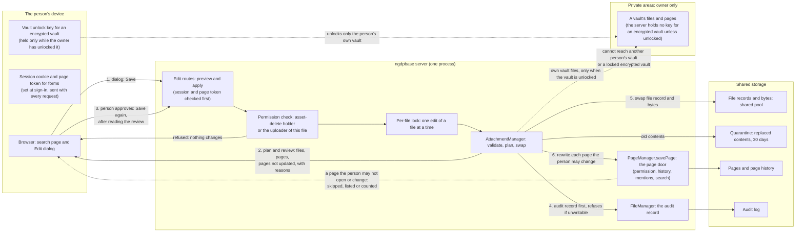

# Edit a local file from /search: change caption and tags, rename it, or replace it

Design for [#2536](https://github.com/jwilleke/ngdpbase/issues/2536). It builds the requirements R1 to R28 from the [draft on that issue](https://github.com/jwilleke/ngdpbase/issues/2536#issuecomment-7191510202), the [amendment](https://github.com/jwilleke/ngdpbase/issues/2536#issuecomment-7191531089) (one Edit button, a dialog, the shared form), and Jim's decisions of 2026-11-26: [update the pages for me](https://github.com/jwilleke/ngdpbase/issues/2536#issuecomment-7191592903), and [the uploader may also edit caption and tags](https://github.com/jwilleke/ngdpbase/issues/2536#issuecomment-7198701264). The permission rule comes from the merged [#2534](https://github.com/jwilleke/ngdpbase/issues/2534). Nothing here is built. Jim approves this design before any build.

## In plain words

On the search page, each of your own uploaded files gets one __Edit__ button. It opens a box where you can change the file's caption and tags, give it a new name, or swap in a new version of the file. Before anything changes, the box shows which pages use the file and what will happen to them. Pressing Save then changes the file and also fixes every page that uses it, so no page ends up pointing at nothing. Each page fix is a normal saved edit in that page's history, so it can be undone.

- __Who can do it:__ a person who may delete files, or the person who uploaded that file. Nobody else sees the button, and the server refuses them even if they call it directly.
- __Rename:__ the file keeps its identity and contents. Only the name changes. Pages that use the old name are rewritten to the new one.
- __Replace:__ the new file takes the old file's name and details. Pages that point at the old file by its link are rewritten to the new link. The old contents are kept for 30 days so an administrator can bring them back.
- __Pages the person may not change__ (for example, someone else's private area) are left alone and listed as "not updated", with the reason. Pages they may not even open are counted, not named.
- __Two people at once:__ the second one waits, then is told if the file or its pages changed under them, and must look again before saving.

What Jim is asked to decide is at the end, under [Questions for Jim](#questions-for-jim).

## Prior work

Searched at master `c96b4b74d`: `docs/` (guides, design, planning), open and closed issues and pull requests on `jwilleke/ngdpbase` for rename, replace and edit of a file or attachment, and `git grep` for the same terms in `src/` and `views/`. Nothing overlaps enough to stop the design.

| Where                                                                                                                                                                                                                                                    | What it gives us                                                                                                                                                                                                  | Covers                                                                                                                       |
| -------------------------------------------------------------------------------------------------------------------------------------------------------------------------------------------------------------------------------------------------------- | ----------------------------------------------------------------------------------------------------------------------------------------------------------------------------------------------------------------- | ---------------------------------------------------------------------------------------------------------------------------- |
| [#2536](https://github.com/jwilleke/ngdpbase/issues/2536)                                                                                                                                                                                                | The request, the requirements and Jim's decisions                                                                                                                                                                 | This design                                                                                                                  |
| [#2534](https://github.com/jwilleke/ngdpbase/issues/2534) (delete), merged as [#2539](https://github.com/jwilleke/ngdpbase/pull/2539)                                                                                                                    | The permission rule R1, `AttachmentManager.mayDeleteSharedFile` and `mayDeleteAttachment`, the `canDelete` and `usedBy` answers on each /search row, the Delete button                                           | The rule and the row annotation this design reuses. Delete itself is not touched                                              |
| [#1851](https://github.com/jwilleke/ngdpbase/issues/1851), [#1853](https://github.com/jwilleke/ngdpbase/issues/1853) and the storage guide, "The files door writes new files only"                                                                         | The plan for one files door. "Replace as a version", a stable id across renames and one editing right are listed as future                                                                                        | Out of scope here. Replace in this design swaps the file (a new id); it does not build versions or a version list             |
| [#999](https://github.com/jwilleke/ngdpbase/issues/999)                                                                                                                                                                                                  | `PATCH /attachments/api/:attachmentId`, caption and tags, gated on `asset-edit`                                                                                                                                   | The caption and tags half of the dialog. The gate widens to R1 (see [Who may do it](#who-may-do-it))                         |
| [#2188](https://github.com/jwilleke/ngdpbase/issues/2188), `ImportManager.relinkStorePages`                                                                                                                                                             | A working precedent for rewriting links in many pages through the page door, passing over a page that cannot be saved and reporting it                                                                           | The pattern the page rewrite copies                                                                                          |
| [#865](https://github.com/jwilleke/ngdpbase/issues/865) slice 3, `AttachmentManager.quarantineOrphans`                                                                                                                                                   | A quarantine folder with a per-run manifest, shared pool only                                                                                                                                                     | Where replaced contents are kept. It has no 30-day removal and no restore action today; this design adds both                  |
| `docs/design/shared-links.md`, `docs/design/required-pages-sync-states.md`                                                                                                                                                                               | The shape and tone of earlier design docs                                                                                                                                                                         | Style only                                                                                                                   |

Not found anywhere: a rename or replace of a stored file, a page rewrite driven by a file change, or a shared edit form for media and attachments. __No requirement already exists, so the design goes ahead.__

## What exists today

- A file's id is the SHA-256 of its contents (`generateAttachmentId`, `src/providers/BasicAttachmentProvider.ts:630`). A replace always gives a new id. A rename never does: the bytes are stored as `${id}${ext}` (`:675` to `:798`), independent of the display name, so a rename is a change to the record's `name` only. This corrects the #2534 split comment.
- A page points at a file two ways. By name: `[{Image src='photo.jpg'}]` or `[{ATTACH src='report.pdf'}]`, resolved when the page is shown (`AttachmentManager.resolveAttachmentSrc` `:2712`, `lookupAttachmentByName` `:2782`, provider `getAttachmentByFilename` `:1616`): the page's own files first, then all files, the first exact name wins, with a basename fallback. By id link: `/attachments/<64-hex id>` in text (`extractAttachmentIdRefs` `:2915`).
- Names are not unique today, so two files with one name make a page show an arbitrary one.
- Each record lists the pages that use it in `mentions[]`. The save of a public page runs `syncPageMentions` (`PageManager.ts` post-save step at about `:3889`, `AttachmentManager.ts:2929` to `:2997`), which attaches files a page now names and detaches the ones it no longer does. A rename that breaks a reference therefore quietly drops the page from `mentions[]` on its next save.
- The provider already has a rename path in its metadata update: `updateAttachmentMetadata` (`:1459` to `:1488`) handles `filename`, and a comment at `:2354` warns that editing the name breaks references. No route calls it for a rename.
- Who may act today: the caption and tags route needs `asset-edit` (`WikiRoutes.ts:22646`). `asset-edit` is held by admin-full-access and vault-owner-permissions; `asset-delete` also by editor-permissions (`config/app-default-config.json` around `:2956`, `:3142`, `:3390`).
- Delete (#2534) already decides with `mayDeleteSharedFile` (`AttachmentManager.ts:2438`): a holder of `asset-delete`, or the uploader when policy is silent, a signed-in person (not a job or a ceiling), matched with `IdentityManager.refersTo` against the record read now.
- Upload rules live in `validateFile` (`BasicAttachmentProvider.ts:640`, size and type from `ngdpbase.attachment.maxsize` 10 MB and `ngdpbase.attachment.allowedtypes`), ICE vetting (`ImportManager.vetFile`) and `FileManager.put` (`FileManager.ts:234` records the upload). Uploading bytes already held returns the existing file (`:696` to `:722`).
- A vault file has an id that is not a content hash, and an index of its own (`storeFileInStore` `:1047`: a `fingerprint` is the content hash, and dedup is per store). Its mentions are kept by `setFileMentionInStore` (`:1124`).
- The Media Manager's edit form is an inline collapsible panel (`views/media-item.ejs:72` to `:122`) with its own submit script (`:283` to `:330`) that sends `PATCH /media/api/item/:id`.

## Data flow

The diagram shows what the browser and the server can reach, where each credential lives, and the two places a person approves: the Save in the dialog (which first shows the review) and the list of pages not updated.

What the browser can do: ask for a review, send a file, and approve. What it cannot do: choose which pages are rewritten (the server recomputes the list at Save and refuses if it differs from the reviewed one), skip the permission check, or reach storage. What the server cannot reach: another person's private area, and an encrypted vault whose key it does not hold.

## Who may do it

R1, R2, R3, using the permission check that #2534 built. Wording to a person is always "permission check", never a role.

- A person may rename, replace, or edit the caption and tags of a shared file if they hold the `asset-delete` permission, or they uploaded it. This is `AttachmentManager.mayDeleteSharedFile` (`:2438`) unchanged, and the build gives it a neutral name shared by delete and edit. The uploader's right applies only when policy is silent on the permission, needs a signed-in person (not a job, not a ceiling), and is matched against the record read now.
- Caption and tags: today `updateAssetMetadata` (`:2636`) needs `asset-edit`. It widens to "`asset-edit`, or the rule above". Admins and vault owners hold both permissions in the default configuration, so they lose nothing; the uploader and the editor gain the right. `asset-edit` is not the gate for rename or replace (the 2026-11-26 pointer on the issue).
- Files in someone else's vault or in a shared folder: not offered, and refused by the server (R3). A person's own vault files follow the vault rule that already decides their delete (`locateOwnStoreFile` `:1370`, `mayInVault`): the owner of the container, with the vault-owner permission set.
- The Edit button reflects a server answer, like `canDelete` does. `WikiRoutes.annotateFileDeletes` (about `:16975`) gains a sibling that marks each row `canEdit`, and the page gets no other say. The server asks again on every request (R2). The answer is computed without writing an audit record: it is an affordance, not a door.
- The refusal is "You may not change this file." with HTTP 403, and nothing changes.

## What changes in the file's record

| Change    | Id                                                     | Bytes on disk                                      | Name                    | Caption, tags, uploader                                  | `mentions[]`                                                                |
| --------- | ------------------------------------------------------ | -------------------------------------------------- | ----------------------- | -------------------------------------------------------- | --------------------------------------------------------------------------- |
| Rename    | Unchanged (R11)                                        | Unchanged. The stored name is `${id}${ext}`        | New name                | Unchanged                                                | Unchanged until pages are rewritten; then the save of each page re-syncs it |
| Replace   | New. The hash of the new contents                      | New file written. Old contents go to the quarantine | The old name is kept (R15) | Carried over to the new record, with the original uploader | Carried over to the new record at once, then re-synced by each page save    |
| Caption and tags only | Unchanged                                  | Unchanged                                          | Unchanged               | Changed                                                  | Unchanged                                                                   |

- __Rename rules (R9, R10).__ The new name must not be held by another file in the same place: the shared pool for a shared file, the same vault for a vault file, because the name lookup that pages use is per place. It keeps the extension (case-insensitive). It is not empty, has no slash, no backslash and no quote, and is trimmed. Refusal names the file that holds the name (R9). A name equal to the current one is "nothing to change".
- __Replace rules (R12 to R16).__ The new file must be the same type as the old one (the type the vetting step reads from the bytes, not the browser's claim). It passes `validateFile` and ICE vetting like any upload (R13, R24; no new setting). If its hash equals the old id, nothing changes and the person is told (R14). If its hash is another file's id, replace is refused and names that file (R14). Old and new are never both live under one name (R16): see the swap below.
- __A vault file keeps its id on replace.__ A vault id is not a content hash, so pages that point at it by id link keep working with no rewrite, and only the stored `fingerprint` and the bytes change. Dedup there is per store, so R14 is checked against that store. Replacing inside an encrypted vault needs the vault unlocked; if it is not, the dialog says "Unlock this private area first" and changes nothing. Replaced vault bytes stay inside that vault's own folder, never the shared quarantine (the move out of a store is what #1460 undid).
- __`mentions[]` (R20).__ The mention list is a cache of "pages that name this file", kept by the page save. After the rewrite, each saved page runs `syncPageMentions` (public pages) or the store index update (vault pages), so the list matches reality. The replace also copies the old list to the new record so the list is right before the last page is saved. A page that is skipped keeps its old text, so after a rename it stays out of the new record's list: the list tells the truth, the page is simply broken, and it is listed to the person as "not updated".

## Finding the pages (R17)

1. Start from `mentions[]`.
2. Scan every page's text for the file's name and, for a shared file, its id link, using the existing `extractLocalAttachmentRefs` (`:2896`) and `extractAttachmentIdRefs` (`:2915`), the same two the health report uses (`getHealthReport` `:3022`, which already finds pages that name a file but are missing from `mentions[]`). A page counts as using the file by name only if the same resolver the page uses (`resolveAttachmentSrc`, with that page as context) lands on this file, so a same-named file in another place is not mistaken for it.
3. The union is the list. The scan reads page text through the page door's reader for the person's context, and pages the person may not open are counted, never named (the same rule as `usedBy.hidden` in the delete dialog).

Cost: one pass over all pages for each review and one at Save. It is one file at a time (R25), and the health report already runs the same scan.

## Rewriting the pages (R17 to R20)

The rewrite goes through `PageManager.savePage` (`PageManager.ts:2868`), the one door, so each change is a normal saved edit: versioned, audited as a page edit, with indexes and mentions synced. This copies `ImportManager.relinkStorePages` (`:1918` to `:1942`): loop the pages, rewrite the text, save with the page's own metadata, pass over a page that cannot be saved and record why.

- __The actor is the person.__ Each page is saved with the editing person's context, so the page door's own decision applies (`assertMaySave` `:2302`: the page-edit permission, the vault container rule, the audience and shared-folder rules). A page the person may not change is skipped. This keeps the uploader from changing, through a file, a page they could not edit by hand. See Question 1.
- __Rename__ rewrites `src='old'` to `src='new'` inside `[{Image ...}]` and `[{ATTACH ...}]`, only where the resolver lands on this file. A reference with a folder prefix keeps the prefix and gets the new base name. The new name has no quote or slash, so no escaping is needed.
- __Replace__ rewrites `/attachments/<old id>` to `/attachments/<new id>`, reusing `rewriteAttachmentLinks` and `attachmentLink` (`src/ice/shims/takeout.ts` about `:143` to `:158`), which match whole ids only. By-name references need no rewrite, because the new file carries the old name.
- __Save options.__ The page's own metadata and `lastModified` handling are the same as `relinkStorePages`. The conflict check inside `savePage` stays on (never `skipConflictCheck`): a page someone else edited between the review and the rewrite is skipped as "changed while we worked", not overwritten. Content validation stays on; a page it refuses is skipped with the reason.
- __The result.__ The dialog and the audit record list counts: changed, not updated, and why for each not-updated page (cannot open: counted only; cannot change: named, with a link; someone else's private area or an encrypted vault: counted only, reason "in a private area"; changed while we worked; refused by validation).
- __Never silent (R18).__ After the swap, the person is shown every page that still points at nothing. Pages missed for any reason are found later by the existing health report (`brokenRefs`, `looseTextRefs`).

## Skipped pages and their reasons (R19)

| Page                                                          | What happens                          | What the person sees                                                                 |
| ------------------------------------------------------------- | ------------------------------------- | ------------------------------------------------------------------------------------ |
| A page the person may change                                  | Rewritten and saved                   | Counted as changed                                                                   |
| A page the person may open but not change                     | Left alone                            | Named, with a link: "You may not change this page"                                   |
| A page the person may not open                                | Left alone                            | Counted only: "N pages in private areas or you cannot open were not updated"         |
| Another person's private area, or an encrypted vault (locked) | Left alone, never read                | Counted only, reason "in a private area"                                             |
| A page edited by someone else meanwhile                       | Left alone                            | Named: "Changed while we worked. Open it and fix by hand"                            |
| A page the content check refuses                              | Left alone                            | Named with the plain reason from the check                                           |

A skipped page keeps its old text. After a rename, a skipped page points at a name that no longer exists and shows "not found". This is the cost of Jim's decision to leave such pages alone; the dialog states it before Save (Question 2).

## Order of steps, failure and undo

The apply request runs under the per-file lock (see [Two edits at once](#two-edits-at-once)).

1. Check the permission (R2) and the session and page token. Re-read the record now.
2. Validate: the rename rules, or the replace rules and vetting. Compute the plan (files and pages) and its token. If the person sent a review token that differs, refuse with "This changed while you were looking. Look again." and change nothing.
3. Write the audit record first and await it. If it cannot be written, refuse and change nothing (R21, as delete does since #1158; the event is declared critical so `refusesOnFailure` applies).
4. Swap the file:
   - Rename: one metadata update of `name`, saved once.
   - Replace: write the new bytes to a new file; then in one metadata save add the new record and remove the old one; then move the old bytes into the quarantine with the old record in a manifest. A crash after the metadata save and before the move leaves old bytes on disk with no record, which the health report already lists as a recordless file; a crash before the metadata save leaves new bytes with no record, listed the same way and removable by the existing cleanup. No state has two live records under one name.
5. Rewrite the pages, one at a time, as above.
6. Write a second, non-critical audit record with the result (pages changed, pages not updated). A failure of this record is logged, never fatal.
7. Return the result for the dialog.

__If step 3 or 4 fails__ nothing has changed or the swap is not committed, and the person is told, with a plain reason (R8). __If step 5 fails partway__ the pages already saved stay valid, each in its own history; the person is told how many are done and which are not, and the list stays on the result and in the audit record. There is no all-or-nothing rollback of the pages, and the design does not pretend there is: a rollback of saved pages would itself be page edits.

__Undo.__

- Pages: each rewritten page has a normal history entry, so a person restores it from page history (R19).
- Rename: rename it back in the same dialog. The pages are rewritten back by the same code.
- Replace: the old contents are in the quarantine for 30 days (R22), with the old record in a manifest. An administrator restores them from there. Restoring moves the file back and re-adds the record. It is a separate action, not offered on /search, and the old id is not served to ordinary readers meanwhile. See Question 3.
- Removal after 30 days: a daily pass registered with `BackgroundJobManager` (`src/managers/BackgroundJobManager.ts`) removes quarantine entries made by replace once they are older than the retention setting (default 30). It never removes entries made by the orphan cleanup, which have no expiry today.

## Two edits at once

- __Same file.__ A small per-file lock inside `AttachmentManager` (a promise chain keyed by file id, in one process; the site is single-instance, held by `src/utils/pidLock.ts`). The second request waits, then re-reads the record. If the record's last-modified stamp differs from what that person's dialog was shown, the answer is "This file changed while you were editing. Look again.". Slice 1 confirms the shared-pool record carries a last-modified stamp and adds one if it does not (a store entry already has `dateModified`).
- __Same page.__ The page save's own stale-edit check (`versionTokenOf`, `isStaleSave`, `src/utils/pageVersionToken.ts`) stays on for the rewrite, as above.
- __Review to Save.__ The review includes a token over the record's stamp and the list of pages with their stamps. The apply step recomputes it and refuses when it differs.
- __Caption and tags edits__ go through the same lock, so they cannot interleave with a rename or replace.

## The shared edit form (R27, R28)

Media items and attachments are different stores with different save routes, so the shared part is one form partial and one script, not one backend.

__What moves into the shared partial__ (`views/_asset-edit-form.ejs`, with `public/js/asset-edit-form.js`):

- The field markup: a labeled text field, a caption box, the keyword field with its typeahead and the `_suggested-keywords` include, a date field, the Save button, and the inline error line.
- The script that fills the fields from values, validates them, sends the request and shows the error or success.
- A parameter list: which fields to show (`title`, `caption`, `keywords`, `dateTaken`, `name`, `replace`), the current values, a save address and a method, and an id prefix so two forms on one page do not collide.

__What each caller keeps.__

| Caller                           | Keeps                                                                                                                                                                  | Fields                                  |
| -------------------------------- | ---------------------------------------------------------------------------------------------------------------------------------------------------------------------- | --------------------------------------- |
| Media Manager (`media-item.ejs`) | Its collapsible panel and toggle button, its `PATCH /media/api/item/:id` route and permission, its meaning of title and date taken. Changes only by including the partial | title, caption, keywords, date taken    |
| /search Edit dialog              | A dialog wrapper, the review step, the file chooser, its own apply route                                                                                               | caption, keywords, name, replacement file |

For an image the dialog shows the same thumbnail and field layout as the Media Manager (R27). Attachments get no title and no date taken, and the Media Manager gets no rename or replace (R28); Delete for the Media Manager is [#2537](https://github.com/jwilleke/ngdpbase/issues/2537).

__The dialog flow.__ One Edit button per eligible local-file row (`_asset-picker.ejs`, beside the Delete button at about `:689`). Pressing it opens the dialog with the current values. Save with only caption or tags changed applies at once. Save with a new name or a replacement file first asks the server for the review and shows the review inside the same dialog (R6): the pages that use the file as links, what will happen to each kind, the pages not updated and why, and a Confirm and a Back. Cancel at any point changes nothing. After success the row updates at once and a message says how many pages were changed and how many were not (R7). A failure shows the plain reason and changes nothing (R8).

Screen words follow the house rules: no issue numbers, no "see the log", no word for the product's own name where a plain word works.

## Routes

All use the existing session and page-token checks (`lint:csrf`) and the permission check above. Slice 1 and 2 settle the exact paths.

| Route                                             | Does                                                                                                                  |
| ------------------------------------------------- | --------------------------------------------------------------------------------------------------------------------- |
| `POST /attachments/api/:id/edit` with `apply=0`   | The review: validates, finds the pages, returns the plan and its token, changes nothing. Carries the new file if any |
| `POST /attachments/api/:id/edit` with `apply=1`   | Applies caption, tags, name and replacement as one locked change, with the review token                               |
| `PATCH /attachments/api/:id` (existing)           | Caption and tags for callers that are not the dialog. The gate widens to `asset-edit` or the R1 rule                  |
| `GET /api/assets/search` (existing)               | Gains `canEdit` on each local row, beside `canDelete` and `usedBy`                                                   |

The replacement file is sent on both steps (at most 10 MB), so the server never holds an unreviewed upload between requests.

## Limits (R13, R24)

No new setting. A replacement uses `ngdpbase.attachment.maxsize` (10 MB) and `ngdpbase.attachment.allowedtypes` (image, text, PDF) through `validateFile` (`:640`), plus ICE vetting and the multer limit the upload route uses. Both checks run on the review step so the person learns early. The retention for replaced contents is one new setting, `ngdpbase.attachment.replaced-retention-days`, default 30 (R22).

## Audit (R21, R23)

- Two events are declared once in the audit catalog (`src/utils/auditEventNames.ts`, with the registry in `src/utils/auditRegistry.ts`), as the audit guide requires: `asset-rename` and `asset-replace`. Each is written before the action, awaited, and refuses the action if it cannot be written, as `asset-delete` does. The detail holds who, when, old and new name, old and new id, and the pages planned. A second, non-critical record holds the pages changed and not updated.
- Writing goes through `FileManager.recordFileEvent` (`FileManager.ts:249`), extended to take these two operations, so a record is written in one place. The attribution comes from the context, as `lint:audit-attribution` checks.
- A file in an encrypted vault is recorded by id and store only, never by name (R23, `sealedStore`, #2048). Its replacement record carries no old or new name.
- The caption and tags edit keeps recording `asset-edit` with field names only (`recordAssetEdit` `:2557`).
- The page rewrite is audited by the page door as ordinary page edits.

## Build plan

Each slice is a separate pull request, with the failing test first. Each updates `docs/guides/storage-developer-guide.md` (and the audit guide where it declares an event) in the same pull request: lines 138 to 154 (the file record and the delete rule), 161 to 163 (the future decisions this makes real: "id stable across renames" is true for rename and not for replace) and 206 ("The files door writes new files only"). The repo checks `npm run lint:csrf`, `lint:gates`, `lint:permission-subject`, `lint:audit-attribution`, `lint:page-door`, `lint:permissions`, `lint:md` and `lint:docs` pass in every slice.

1. __Rename, server only.__ `AttachmentManager.renameAttachment`, the review and apply route, the lock, the page-finding scan, the by-name rewrite through `savePage`, the `asset-rename` event, `canEdit` on /search rows, shared pool and own vault. Tests: rule refusals (neither right), name taken, wrong extension, a quote in the name, pages rewritten and their history entries, a page skipped with a reason, an encrypted vault audited by id. __Verified when:__ as the uploader (not an admin), renaming a file used by three pages by name gives three new page versions that render the new name, `mentions[]` lists those three, the audit log holds the record, and the same call by a person with neither right returns 403 and changes nothing.
2. __Replace, server only.__ The provider's atomic swap (`replaceAttachment`), quarantine retention for pool and vault, the id-link rewrite, the dedup and same-type refusals, the `asset-replace` event, the retention setting and the daily removal job. __Verified when:__ replacing a PDF used by one page by name and one page by id link leaves both pages showing the new file with no hand edit, the old contents are in the quarantine with a manifest entry, a same-contents replace answers "nothing to change", contents held by another file are refused naming it, and a record aged past the retention days is removed by the job.
3. __Caption and tags for the uploader.__ Widen the gate of `updateAssetMetadata` to `asset-edit` or the R1 rule, and run it under the same lock. __Verified when:__ the uploader (an editor without `asset-edit`) edits their own file's caption and tags and a second user without either right is refused.
4. __The Edit dialog on /search, with the shared partial.__ `views/_asset-edit-form.ejs`, `public/js/asset-edit-form.js`, the Edit button and dialog in `_asset-picker.ejs`, the review step. __Verified when:__ in a browser as the uploader, Edit on an image row opens a dialog with the Media Manager's layout, a rename shows the review with the page links, Confirm updates the row and the message, Cancel changes nothing, and a person without the right sees no button.
5. __The Media Manager on the shared partial.__ `media-item.ejs` includes the partial with title, caption, keywords and date taken, and its route and fields are unchanged. __Verified when:__ the existing Media Manager end-to-end checks pass unchanged and a metadata edit on a media item saves as before.
6. __Admin restore and user guide.__ The administrator's restore of replaced contents from the quarantine, the user guide for /search, the end-to-end test of the whole flow (rename, replace, undo). __Verified when:__ an administrator restores a replaced file within the retention days and the old file is served again by its old id, and the end-to-end test is green in CI.

## Questions for Jim

1. When pages are rewritten, whose permission applies? __Recommended: the editing person's own.__ A page they may not change is left alone and listed. The alternative is that the site rewrites every public page on their behalf, which fixes more pages but lets an uploader change, through a file, pages they could not edit by hand.
2. After a rename, any page the system could not update (someone's private area, a page the person may not change) will show "not found" until fixed by hand. __Recommended: allow the rename, and say so plainly in the review before Save__, as you chose. The alternative is to refuse a rename while any page cannot be updated.
3. The old contents of a replaced file are kept 30 days. __Recommended: an administrator restores them by an action in the admin area, built in slice 6.__ The alternative is a documented hand step from the quarantine folder now and the button later.

## Files and functions read

Line numbers are as of master `c96b4b74d`.

| Path                                                 | What I read                                                                                                                                                                                                                                                           |
| ---------------------------------------------------- | --------------------------------------------------------------------------------------------------------------------------------------------------------------------------------------------------------------------------------------------------------------------- |
| `AGENTS.md`, `docs/guides/storage-developer-guide.md` | The rules for guides, tests and wording; the Files section (`:138` to `:154`), future decisions (`:161` to `:163`), "writes new files only" (`:206`)                                                                                                                   |
| `src/providers/BasicAttachmentProvider.ts`           | `generateAttachmentId` `:630`; `validateFile` `:640`; `storeAttachmentInternal` `:675` to `:798`; `storeFileInStore` `:1047`; `setFileMentionInStore` `:1124`; `updateAttachmentMetadata` `:1459`; `deleteAttachment` `:1495`; `getAttachmentsForPage` `:1575`; `getAttachmentByFilename` `:1616`; `quarantineAttachment` `:1706`; `getQuarantineDir` `:1756`; `updateMetadata` `:2337` |
| `src/managers/AttachmentManager.ts`                  | `checkPermission` `:592`; `uploadAttachment` `:716`; `locateOwnStoreFile` `:1370`; `mayDeleteSharedFile` `:2438`; `mayDeleteAttachment` `:2474`; `deleteAttachment` `:2489`; `recordAssetEdit` `:2557`; `updateAssetMetadata` `:2636`; `resolveAttachmentSrc` `:2712`; `lookupAttachmentByName` `:2782`; `extractLocalAttachmentRefs` `:2896`; `extractAttachmentIdRefs` `:2915`; `syncPageMentions` `:2929`; `getHealthReport` `:3022`; `quarantineOrphans` (after `:3105`) |
| `src/managers/PageManager.ts`                        | `mayChangeExisting` `:2212`; `assertMaySave` `:2302`; `mayEditPage` `:2396`; `savePage` `:2868` and its post-save steps (mentions at about `:3889`); `getAllPages` `:4244`; `filterPagesFor` `:4297`                                                                    |
| `src/managers/ImportManager.ts`                      | `relinkStorePages` `:1918` to `:1942` (the precedent), `saveTakeoutPage` `:1945`                                                                                                                                                                                       |
| `src/managers/FileManager.ts`                        | The upload record at `:234`; `recordFileEvent` at `:249`                                                                                                                                                                                                               |
| `src/ice/shims/takeout.ts`                           | `attachmentLink`, `rewriteAttachmentLinks`, `linksToAttachment` at about `:143` to `:158`                                                                                                                                                                              |
| `src/utils/pageVersionToken.ts`                      | `versionTokenOf`, `isStaleSave`                                                                                                                                                                                                                                        |
| `src/routes/WikiRoutes.ts`                           | `annotateFileDeletes` about `:16975`; `assetSearch` about `:17020` (route `:19148`); `POST /attachments/upload` `:19560`; `DELETE /attachments/:attachmentId` `:19604`; the edit routes about `:19750`; `attachmentApiMetadataUpdate` `:22646`; `mediaApiItemUpdate` `:22760`; the page save's stale check about `:4401` |
| `views/_asset-picker.ejs`, `public/js/asset-delete.js` | The search call (`:481`), the Delete button (`:689` to `:693`), the confirm wording                                                                                                                                                                                  |
| `views/media-item.ejs`                               | The edit panel (`:72` to `:122`) and its script (`:283` to `:330`)                                                                                                                                                                                                      |
| `config/app-default-config.json`                     | `ngdpbase.attachment.maxsize` and `allowedtypes` (`:244` to `:245`); the permission lists that hold `asset-edit` and `asset-delete`                                                                                                                                    |
| `src/managers/BackgroundJobManager.ts`               | The scheduler the daily removal job registers with                                                                                                                                                                                                                      |
