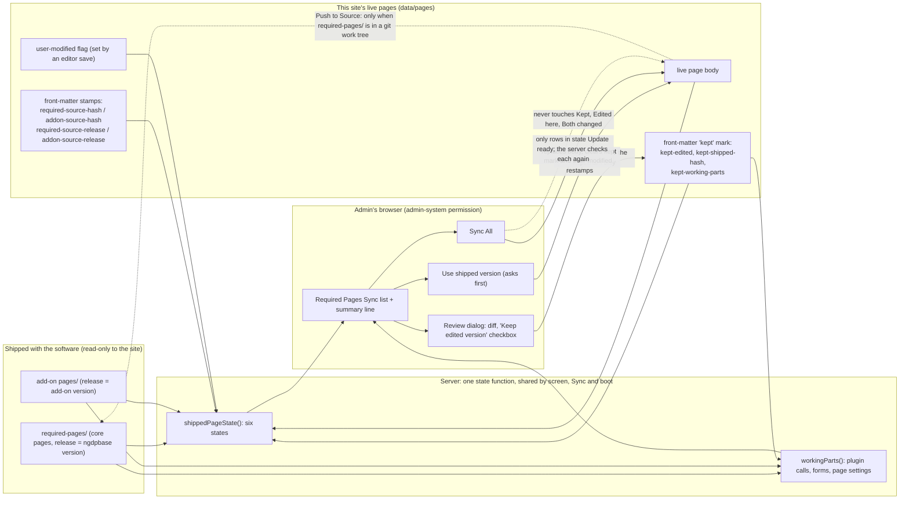

# Required Pages Sync: six plain states, and a "kept" mark

Design for [#2389](https://github.com/jwilleke/ngdpbase/issues/2389). It builds exactly the requirements R1–R8 agreed on that issue (Jim, 2026-11-14). Nothing here is built yet.

## Prior work

Searched on 2026-11-14 at master `4e2902a9`: `docs/` (guides, design, architecture), `gh pr list` and `gh issue list` with `--state all --search "required pages"`, and `git grep` for `required-source-hash`, `addon-source-hash`, `user-modified`, `bulkOutdated`, `pushToSource` and `isRequiredPage` in `src/`, `views/` and the tests.

What exists, and what it covers:

| Where | What it gives us | Covers |
| --- | --- | --- |
| #1395 (closed), `src/utils/addonPageSync.ts` | `pageSourceHash` and the `required-source-hash` stamp. `evaluateSeededAddonPage` compares source, live body and stamp | The inputs R1 needs: live hash, stamped hash, shipped hash. Not the six states |
| #920, #931, `AddonsManager.seedAddonPage` | The same stamp for add-on pages, as `addon-source-hash`. The boot pass and the admin screen share one evaluator | The add-on half of the same inputs |
| #1408, `PageManager.backfillShippedPageStamp` | Stamps an unstamped page only when its body equals the source. A metadata-only save that keeps `lastModified` | The pattern for writing R3's label and R2's mark without a new version |
| #1871, #1872, `WikiRoutes.markBulkOutdated` | Sync All skips `userModified` rows, and the button counts only what it will sync | Part of R5. Today's rule is "not user-edited", not "Update ready" |
| #1918, #1919, `views/_sync-button.ejs`, `syncRowState` | One status word per row (`current` / `modified` / `new`), Force Sync with a confirm | The row UI R1 replaces. Force Sync is the "Use shipped" action |
| #1412 | A site can decline a shipped page it will not take | Separate feature; unchanged |
| `WikiRoutes.savePage` (~4300–4420) | A save of a shipped copy sets `user-modified` and notifies admins ("Required page edited in wiki UI") | The trigger for R7's "edited here". Keeps working as is |
| `views/_basicEditor.ejs` lines 14–21 | The banner R8 replaces | R8's starting text |
| #1464 (open) | A door for re-identifying a page | Unrelated |

Not found anywhere: a "kept" mark, a release label, any working-parts comparison, or any check that the site runs from a source checkout. __No requirement already exists, so the design goes ahead.__

Two places where today's code conflicts with the agreed requirements. Both are changed here:

1. __A page with no stamp counts as reseedable today.__ `evaluateSeededAddonPage` returns `outdated` when there is no stamp and the body differs. Both the add-on boot pass and the core Sync All then replace it. R7 says such a page is "Edited here, not confirmed" and is never replaced automatically. The shared evaluator changes, and the add-on boot pass changes with it (slice 1).
2. __`user-modified` does not block the add-on boot pass for a page whose body matches its stamp.__ R7 says any page flagged `user-modified` is not confirmed and never replaced. The new evaluator reads the flag.

Out of scope: shipped forms (#1909, #1919). They have their own sync rows. R1 covers pages, core and add-on.

## Data flow



Trust boundaries:

- The shipped folders are written only by a release, or by Push to Source on a source checkout (R6). An installed site never writes to them.
- The live pages are written by editor saves (which set `user-modified`), by Sync, by the add-on boot pass, and by the new Keep action, which changes front-matter only.
- Every change from the browser goes through the admin route, which requires `admin-system`, a CSRF token, and a re-check of each page's state on the server. The browser's idea of a row's state is never trusted.

What __Sync All__ may touch: only pages whose server-computed state is __Update ready__ at the moment of the request. What it may not touch: Same as shipped (nothing to do), Kept for this site, Kept needs your review, Edited here not confirmed, Both changed. Pages that are not on the site yet (__New__) keep their existing separate __Sync All New__ button.

## One state function

Today three places decide "is this page edited?" with slightly different rules: the core list, the add-on list (both through `syncRowState`) and `PageManager.syncShippedPages`. The add-on boot pass is a fourth. They get one function, in `src/utils/addonPageSync.ts`, replacing `syncRowState`:

```ts
shippedPageState({
  shippedBody, liveBody,
  stamp,            // required-source-hash / addon-source-hash, or undefined
  userModified,     // front-matter user-modified === true
  kept,             // front-matter kept-edited === true
  keptShippedHash,  // front-matter kept-shipped-hash
  keptParts,        // front-matter kept-working-parts
  shippedParts      // workingParts() of the shipped page
}): { state, newerAvailable, workingChanges }
```

The screen, `syncShippedPages` (non-force), the add-on boot reseed and the unit tests all call it, so they cannot drift (the lesson of #931).

## R1: the six states

Inputs, per page that exists both on the site and in the shipped folder:

- __L__ — hash of the live body (`pageSourceHash`, trimmed).
- __T__ — the stamped source hash, or none.
- __S__ — hash of the current shipped body.
- __K__ — the kept mark is present.
- __U__ — `user-modified` is true.
- __W__ — for a kept page: the shipped page's working parts differ from the parts recorded when it was kept (R4).

Derived: __E__ (edited here) = U, or T is none, or L ≠ T. __C__ (shipped changed) = T exists and S ≠ T. With no stamp, C is false: we cannot know, and R7 wants "Edited here, not confirmed" for it.

Rows are evaluated top to bottom; the first match wins.

| # | Condition | State | In Sync All | In the summary count |
| --- | --- | --- | --- | --- |
| 1 | L = S | __Same as shipped__ | no | no |
| 2 | K and W | __Kept, needs your review__ | no | yes |
| 3 | K and not W | __Kept for this site__ (quiet "newer version available" when S ≠ the kept shipped hash) | no | no |
| 4 | E and C | __Both changed__ | no | yes |
| 5 | E and not C | __Edited here, not confirmed__ | no | yes |
| 6 | C (so not E) | __Update ready__ | __yes__ | no |

The table is complete. A page that reaches row 6 is not E and has a stamp (E is true without one), so L = T. L ≠ S then forces S ≠ T, which is C. No seventh case exists.

Notes:

- Row 1 wins over the kept mark. A kept page whose body now equals the shipped body is just the same as shipped. The mark stays, so a later edit is still a kept page.
- A page with `user-modified` and a body equal to its stamp (a save that changed only the title or keywords) is E, so it is never replaced. That follows R7 literally. It lands in row 4 when a newer version shipped, otherwise row 5.
- Add-on pages and core pages use the same function. For add-on pages, `Update ready` is normally applied by the boot pass already (existing behaviour, `reseedEnabled`), but the boot pass now calls the same function, so a page in any other state is never reseeded.
- A live copy with malformed front-matter keeps today's behaviour: it is shown as Update ready so a re-sync heals it. That is the one row not derived from the table.
- __New__ and __UUID mismatch__ (the page is not on the site, or its name is taken) are not part of the six. They stay as they are, with their own buttons.

## R2: "Keep edited version"

Stored on the live page's front-matter, three flat keys (flat, so search indexing and the editor carry-forward need no change):

```yaml
kept-edited: true
kept-shipped-hash: <pageSourceHash of the shipped body the admin saw when ticking>
kept-working-parts: [ ...canonical strings from workingParts() of that shipped body... ]
```

Who and when are not stored on the page. They are in the audit entry and page history, because the write goes through the page door.

- __Written__ by a new route, `POST /admin/required-pages/keep`, body `{ source, uuid, keep: boolean }`. The page door saves it with `rawFrontmatter: true` and `preserveLastModified: true`, the way `backfillShippedPageStamp` does: front-matter only, no new version, and Recent Changes stays quiet. It is audited as an edit.
- __Guard:__ the same permission as the rest of the screen, `admin-system`, plus CSRF. Page-level permissions do not matter: the body is not touched.
- __Survives syncs and upgrades.__ The editor's save carries forward all front-matter it does not manage (`WikiRoutes.savePage`, "step 1"), so editing a kept page keeps it kept. A normal Sync never touches a kept page: `syncShippedPages` without `force` protects state 2–5 rows, using `shippedPageState`. A release upgrade replaces nothing on its own. The add-on reseed merges `existingMeta` and never runs for a kept page.
- __Undone__ by unticking the box and saving the choice (`keep: false` deletes the three keys), or by __Use shipped version__. `saveShippedPage` builds the page from the shipped front-matter, so the kept keys and `user-modified` are gone after it.
- Ticking again after a "needs your review" flag rewrites `kept-shipped-hash` and `kept-working-parts` from the current shipped page. That is what clears the flag (D3).

## R3: release label

Display only. The content hash still decides the state.

| Page | Key on the live copy | Value |
| --- | --- | --- |
| Core required page | `required-source-release` | `ngdpbase.version` at the time of the write, e.g. `5.45.0` |
| Add-on page | `addon-source-release` | that add-on's own version from its manifest |

- __Written__ wherever the stamp is written: `PageManager.saveShippedPage` (boot seed, Sync, Use shipped) and the add-on reseed in `AddonsManager.seedAddonPage`. One helper returns `{ stampKey, releaseKey, release }` per source.
- __Backfilled__ for pages already on a site: `backfillShippedPageStamp` already runs for present pages. It also writes the label when the page is Same as shipped (its body equals the shipped body, so the release it matches is the current one). A stamped page that is behind gets no label, and the screen says "an earlier release".
- __Shown__ as "Your copy: v5.43.0 · This release: v5.45.0", or "Your copy: an earlier release" when there is no label. No commit hash.

## R4: detecting a working change

Used for kept pages only. A kept page is compared against the shipped page as it was when kept (`kept-working-parts`), not against the live page. That avoids flagging a page forever for the edits the admin deliberately kept.

__Parser.__ The tokens are the ones the renderer already uses: `PluginSyntaxHandler` matches `(?<!\[)\[\{(\w+)\s*([^}]*)\}\]` and has `parsePluginParameters`. The regex and the parameter parser move into a small shared module, `src/utils/pluginCalls.ts`, and the handler imports them. A second copy would drift from the renderer. `workingParts(shippedBody, shippedFrontmatter)` returns a sorted list of canonical strings:

1. __Plugin calls and form elements.__ Every `[{Name params}]` in the body. Form elements (`[{FormOpen ...}]`, `FormInput`, `FormButton`, etc.) have the same shape, so one scan covers both. ACL markup (`[{ALLOW ...}]`, `[{DENY ...}]`) has that shape too and counts: it changes who can see the page. String: `plugin:Name key="value" key="value"`, keys sorted, whitespace collapsed.
2. __Front-matter keys that change behaviour.__ A named list, `WORKING_FRONTMATTER_KEYS`, in the same module: `system-category`, `audience`, `requires-setting`, `version`, `effective`, `private`, `status`, `author-lock`, `slug`, `acl`. String: `setting:key=value`. A second list, `WORDING_FRONTMATTER_KEYS`, names the keys that do not matter (`title`, `description`, `user-keywords`, `system-keywords`, `author`, `editor`, `created`, `lastModified`, the stamps, the kept mark).

__False positives, and how they are avoided:__

- Calls inside fenced code blocks and inline code, and escaped `[[{...}]`, are shown to a reader, not run. They are stripped before the scan, as the renderer does.
- Variables `[{$name}]` are text substitution, not working parts, and the regex's `\w` does not match `$`.
- Order does not matter (sorted), and neither does whitespace or parameter order.
- Presentation-only parameters are ignored: `class`, `style`, `width`, `height`, `alt`. The list is one constant, kept short.
- Body text between `[{Name}]` and `[{/Name}]` is wording. Only the opening call counts.
- __A test makes a missing classification fail the build.__ It reads every front-matter key in `required-pages/` and in each add-on's `pages/` and fails if one is in neither list, so a new behaviour key cannot slip through as "wording".

__Showing the change.__ "Kept, needs your review" lists the parts added, removed or changed, in plain words: "This page now calls Calendar with calendars=family." A kept page with only wording changes shows only "Newer version available (v5.45.0)".

__Known limit.__ A page kept before this ships has no baseline, because nothing starts kept (R7). The first time an admin ticks the box, the baseline is written. No back-computation is needed.

## R5: the summary line, and what Sync All does

At the top, one line, counting core and add-on pages together:

- "__2 pages need a decision.__ Sync All updates only pages marked Update ready (3). Pages edited on this site are never changed by Sync All."
- With none: "Nothing needs a decision. Sync All updates the 3 pages marked Update ready."
- With none at all: "Everything matches what shipped."

The count is rows in states 2, 4 and 5 of the table (Kept needs your review, Both changed, Edited here not confirmed). Same as shipped, Kept for this site and Update ready do not count.

__Sync All__ replaces "Sync All Outdated". It sends only the uuids the server marked Update ready (`bulkOutdated` becomes `state === 'update-ready'`). The server re-evaluates each uuid with `shippedPageState` and skips (reports as protected) any that is no longer Update ready. A forged request cannot overwrite an edited page. The existing `data-testid="sync-all-outdated"` stays for the E2E tests.

## R6: Push to Source only from a source checkout

- __Detection.__ `isSourceCheckout(requiredDir)` in a new `src/utils/sourceCheckout.ts`: true when the directory *containing* `required-pages/` has a `.git` entry (a folder, or a file for a git worktree). The parent only, not any ancestor, so an installed copy under a project's `node_modules` inside someone's repo is not mistaken for a checkout. No `git` binary is needed, and none is spawned. It is a cheap `stat`, checked on each request, so tests need no restart. If `requiredpagesdir` is moved elsewhere the result is "no": hiding is the safe error.
- __Screen.__ The page's render data carries `canPushToSource`. When false, neither Push to Source button shows (the row button and the "not in the shipped set" list), and the help text about Push to Source is removed.
- __Route.__ `adminSyncRequiredPages` refuses a request with a non-empty `pushToSource` when `isSourceCheckout` is false: HTTP 403, `"This site is not running from a source checkout, so there is no shipped copy to change. Nothing was changed."` The whole request is refused, like the existing "A page id is not valid" refusal.
- __Where it shows,__ the button is unchanged apart from a one-line confirm (`data-confirm`): "Make this site's text the version every release ships?" R6 asks only for hiding and refusing; the confirm is a single attribute and is the only addition.

## R7: upgrade path

No data migration. The states are derived on every read, so on the first start after upgrade:

- A page with `user-modified`, or with no stamp and a body that differs from the shipped one, lands in __Edited here, not confirmed__, or __Both changed__ when a newer version also shipped. It is shown once, with its diff. Welcome and Request access on The Fairways are the cases Jim named.
- Nothing starts as Kept. No kept key is written by the upgrade.
- Nothing is replaced automatically. The two code paths that could are changed in slice 1: the core Sync and the add-on boot reseed no longer treat "no stamp" as reseedable.
- A page with no stamp whose body equals the shipped body is still stamped by the existing `backfillShippedPageStamp`, and now also gets its release label. It reads Same as shipped.
- The existing notification ("Required page edited in wiki UI") keeps working. It links to the same screen.

## R8: the editor banner

Replaces `views/_basicEditor.ejs` lines 14–21 (text for a person who is not a developer; no file paths, no issue numbers):

> __This page came with the software.__ Your changes stay on this site: an update will not replace them. An admin will see this page in the list at [Admin › Required Pages Sync](/admin/required-pages) and confirm that the change was meant. If it was a mistake, the admin can put the original back.

## Plain-language text

State labels and the line under each. A page's release label goes after it: "Your copy: v5.43.0 · This release: v5.45.0".

| State | Label | Line under the label | Buttons |
| --- | --- | --- | --- |
| Same as shipped | Same as shipped | (none) | (none) |
| Update ready | Update ready | A newer version came with this release. This page has not been changed on this site. | __Update__ |
| Kept for this site | Kept for this site | This site keeps its own version. *When newer:* A newer version is available (v5.45.0). | __See changes__, __Use shipped version__ |
| Kept, needs your review | Kept, needs your review | The newer version changes how this page works: *(list)*. Your kept version does not have that. | __Review changes__, __Use shipped version__ |
| Edited here, not confirmed | Edited here, not confirmed | This page was changed on this site. Choose whether to keep your version. | __Review changes__, __Use shipped version__ |
| Both changed | Edited here, and a newer version is available | This page was changed on this site, and a newer version also shipped. Choose what to do. | __Review changes__, __Use shipped version__ |

__Review dialog__ (the existing diff modal, extended). Title: "Review: *page name*". It shows the diff, and above it the list of working changes if there are any ("Changes how the page works"). Then:

- Checkbox: __Keep edited version__. Help: "This site keeps its own version. Updates will not replace it. You will be told if a later release changes how this page works." Ticked at the start for a kept page.
- Buttons: __Save choice__, __Use shipped version__, __Cancel__.
- __Use shipped version__ asks: "Replace the changes made to "*page name*" on this site with the shipped version? Your version stays in the page history." (existing Force Sync question, reworded). The button was "Force Sync".

__Not used on screen:__ "Modified", "Force Sync", "user-edited", `required-pages/`, issue numbers, hash and key names. The Same as shipped state's old word was "Current".

## Tests: what proves each Verified-when item

Unit tests (Vitest, next to `WikiRoutes.requiredPagesSourceHash.test.ts` and `syncPartialsView.test.ts`):

- `addonPageSync.state.test.ts`: the decision table above, one case per row, plus each edge in the notes (flag with unchanged body, no stamp, kept with L = S, malformed front-matter).
- `pluginCalls.test.ts`: `workingParts` — reordered params are equal, a changed param differs, a call in a code fence is ignored, `[{$var}]` is ignored, an added `[{Calendar}]` differs, a changed `system-category` differs, a changed `title` does not, and the classification test over every key in `required-pages/` and add-on `pages/`.
- `sourceCheckout.test.ts`: temp dirs for a checkout (`.git` folder, `.git` file), an installed folder, and a folder inside a repo's `node_modules`.
- `PageManager.syncShippedPages` and `AddonsManager` reseed tests: a kept page and an unstamped differing page are protected from Sync and the boot reseed; Use shipped clears the kept keys.

Route tests:

- `WikiRoutes.requiredPagesStates.test.ts`: the list shows the right state for a never-edited page, an edited page, an edited-and-kept page, a kept page with a changed plugin call, and a no-stamp page.
- The keep route: needs `admin-system` (403 otherwise), writes the three keys, `keep: false` removes them, no body change, no new version.
- Sync All with a forged uuid list that includes a kept page changes nothing for it.
- Push to Source on a non-checkout: 403, nothing written to the shipped folder.

E2E (`tests/e2e/admin-required-pages-states.spec.ts`, Playwright, as the other `admin-*.spec.ts` files):

| Verified when (issue #2389) | Test |
| --- | --- |
| Welcome edited shows "Edited here, not confirmed" with its release label; after ticking Keep it shows "Kept for this site" and Sync All does not change its body | Edit Welcome as admin, open the list, check the label and release text, open the dialog, tick, save, check the label, press Sync All, read the page body |
| A never-edited page with a changed shipped body shows "Update ready" and Sync All updates it | Change a shipped page in a fixture add-on, restart or rescan, check the label, press Sync All, read the page body |
| A kept page whose new shipped version changes a plugin call shows "Kept, needs your review" | Keep a page, change a plugin call in the fixture shipped page, check the label and the listed change |
| On an installed site, no Push to Source button, and the route refuses it | The E2E instance is an installed layout: assert no button, and a direct `POST` returns 403 |

## Slicing

Four slices, in build order. Each can ship alone, and the screen is never left half-changed.

1. __The state function and the safe defaults__ (R1 minus the kept mark, R7, R5's rule). `shippedPageState` without K and W. Core list, add-on list, `syncShippedPages` and the add-on boot reseed all call it. The four states that need no new data (Same as shipped, Update ready, Edited here not confirmed, Both changed) show with the new labels, and the summary line and Sync All use it. No-stamp pages stop being reseeded. Unit and route tests. *Verified when:* a page never edited with a changed shipped body shows Update ready and Sync All updates it; an edited page shows Edited here, not confirmed and Sync All leaves it.
2. __Keep edited version__ (R2, R4, rows 2 and 3). The keep route, the three front-matter keys, the Review dialog with the checkbox, `pluginCalls.ts` and `workingParts`, and the two kept states with the review list. *Verified when:* tick Keep, see Kept for this site, Sync All leaves it; change a plugin call in the shipped page, see Kept, needs your review.
3. __Release label and editor banner__ (R3, R8). The release keys, written with the stamp and backfilled, shown on the rows. The new banner. *Verified when:* a row shows "Your copy: v… · This release: v…"; editing Request access shows the new banner.
4. __Push to Source on source checkouts only__ (R6). `isSourceCheckout`, the hidden buttons, the 403, the confirm. Independent of the others, so it can go first if Jim wants The Fairways cleaned up sooner. *Verified when:* on an installed site there is no Push to Source button and a direct request is refused.

Slice 4 touches different files from 1–3 and can be built in parallel. Slices 1 → 2 → 3 are in order: 2 needs the state function, and 3 shows a label on rows that 1 defines.

## Open questions for Jim

Only two the requirements leave open:

1. __A page flagged `user-modified` whose body still equals what shipped__ (someone saved it but changed only the title or keywords). As written, it counts as edited, so it is never replaced, and it asks for a decision once. The alternative is to treat an unchanged body as not edited. That would make Welcome and Request access read Update ready if their bodies were never really changed. Recommendation: keep it as written (R7 says "any page flagged `user-modified`"). Is that right?
2. __Add-on pages that are Update ready today are replaced at start-up without anyone pressing Sync All.__ Should that stay (the add-on boot pass keeps reseeding unedited pages, only the unsafe cases change), or should add-on pages also wait for Sync All? Recommendation: stay, since a page nobody edited has nothing to lose and it is today's behaviour.
