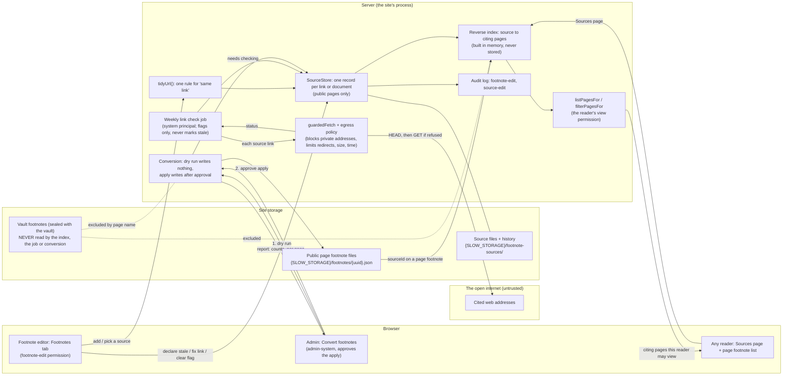
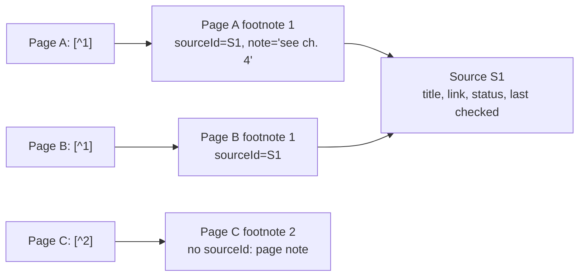

# Shared footnote sources: one index of sources across pages

Design for [#2454](https://github.com/jwilleke/ngdpbase/issues/2454). It builds the requirements R1–R8 Jim confirmed on that issue ([comment](https://github.com/jwilleke/ngdpbase/issues/2454#issuecomment-7060680486)), with R5 as amended by his decision 8 ([comment](https://github.com/jwilleke/ngdpbase/issues/2454#issuecomment-7060704094)). Nothing here is built yet. Typed citations ([#707](https://github.com/jwilleke/ngdpbase/issues/707)) are out of scope.

## Prior work

Searched on 2026-11-21 at master `edfe9782`: `docs/` (guides, design, planning), `gh issue list` and `gh pr list` with `--state all` and the terms "footnote", "citation", "bibliography", "link check" and "broken link", and `git grep` for `sourceId`, `canonicalUrl`, `linkCheck` and `HEAD` requests in `src/`.

| Where                                                                                                                                         | What it gives us                                                                                                                                                      | Covers                                                                                                                                  |
| --------------------------------------------------------------------------------------------------------------------------------------------- | --------------------------------------------------------------------------------------------------------------------------------------------------------------------- | --------------------------------------------------------------------------------------------------------------------------------------- |
| [#128](https://github.com/jwilleke/ngdpbase/issues/128), `src/managers/FootnoteManager.ts`                                                   | Per-page footnotes as JSON files, one per page uuid, out of the page text. `PageFootnote` is `{ id, display, url, note, createdBy, createdAt }` (line 33)             | The page-local record R1 builds on. It has no shared source, no link status, no tidy URL                                                |
| [#1839](https://github.com/jwilleke/ngdpbase/issues/1839), `src/utils/pageNotes.ts`, [docs/private-stores.md](../private-stores.md)          | A vault page's footnotes live inside its vault, sealed with it, found by the page's name, never its uuid alone                                                        | The rule R6 repeats. Every new record here that touches a page must follow it                                                           |
| [#1233](https://github.com/jwilleke/ngdpbase/issues/1233), `recordEdit` (`FootnoteManager.ts:442`), audit event `footnote-edit`              | An audit record for each footnote change, ids only                                                                                                                    | The model for R7's audit record                                                                                                         |
| [#1347](https://github.com/jwilleke/ngdpbase/issues/1347), `transferFromContent` (`FootnoteManager.ts:343`)                                   | A conversion funnel with `dryRun`: reads definitions out of page text, writes them as footnotes, returns the rewritten text and warnings. Used by the NCM conversion | The pattern for R5: dry run first, then apply                                                                                           |
| `convertCreatorsToIdentityIds` (`FootnoteManager.ts:104`)                                                                                     | A start-up conversion of stored records                                                                                                                               | The pattern for a one-time, safe-to-repeat store upgrade                                                                                |
| `src/converters/ncm/footnotes.ts` (`extractFootnoteDefs`, line 60)                                                                            | Reads `[^id]: text` definitions, with continuation lines, and sorts each into link, bare URL or plain note                                                            | The reader R5 reuses for Markdown definitions                                                                                           |
| `src/converters/JSPWikiConverter.ts:443-466`, [#1343](https://github.com/jwilleke/ngdpbase/issues/1343)                                       | Turns `[1]` into `[^1]` and `[#1] text` into `[^1]: text`                                                                                                             | The JSPWiki form R5 names. The blanket rule also hits NCM page links like `[1]`; Q4 asks how to tell them apart                         |
| `src/plugins/FootnotesPlugin.ts` (`renderFootnoteListHtml`, line 161)                                                                         | The list at the bottom of a page, anchors `footnote-ID`, and the Footnotes tab's add, edit and delete script                                                          | R8's starting point                                                                                                                     |
| `PageManager.listPagesFor` (line 4176) and `filterPagesFor` (line 4207)                                                                       | The doors every reader-facing page list must pass through                                                                                                             | R4: a reader sees only the citing pages they may view                                                                                   |
| `BackgroundJobManager.registerJob` (line 437), `WikiRoutes.registerAdminJobs` (~23571)                                                        | Scheduled jobs with `schedule`, `catchUp`, `overlap`, `timeout`, `persist`                                                                                            | R3's weekly check                                                                                                                       |
| `src/http/guardedFetch.ts:153`, `src/http/egressPolicy.ts:61`                                                                                 | The one allowed way to call out: SSRF-guarded, every redirect hop checked, `HEAD` allowed, a size and time limit                                                      | R3. Raw `fetch` is not allowed in `src/`                                                                                                |
| `docs/design/required-pages-sync-states.md`, `required-pages/`                                                                                | How a shipped page is seeded and kept in step                                                                                                                         | R4: the __Sources__ page ships as a required page                                                                                       |
| [docs/guides/storage-developer-guide.md](../guides/storage-developer-guide.md) line 160                                                       | The decision log already says "Footnotes are shared records used by many pages; editing one asks which pages take the new wording"                                    | The long-term intent. This design builds a smaller first step toward it, and says where it does not match (R7, Q3)                      |
| `AppHealthPlugin` broken-link check                                                                                                           | Finds broken internal page links                                                                                                                                      | Not external links. Nothing in the repo checks an outside URL                                                                           |
| [#707](https://github.com/jwilleke/ngdpbase/issues/707)                                                                                       | Typed citations                                                                                                                                                       | Out of scope here, by Jim's decision                                                                                                    |

Not found anywhere: a shared source record, URL tidying, a link checker for outside addresses, or a list of sources across pages. __No requirement already exists, so the design goes ahead.__

## What exists today

- Each page has its own footnote file, `{SLOW_STORAGE}/footnotes/{pageUuid}.json`, written by `FootnoteManager` (`FootnoteManager.ts:51`). A vault page's file sits inside the vault, written through the vault's store and sealed with it (`src/utils/pageNotes.ts:39-43`). The vault page is found by its name through `parsePrivatePageName`.
- A mark `[^1]` in page text is a page-local id. `MarkupParser` renders it as a superscript and never asks `FootnoteManager` anything (`src/parsers/MarkupParser.ts:1849-1925` reads definitions and marks; `2611-2650` renders them). `FootnotesPlugin` draws the list at the bottom from the page's own file.
- `[^1]: text` definitions typed into page text still work as a legacy form, and the NCM conversion moves them into the page's file (`transferFromContent`).
- The routes `/api/footnotes/:pageUuid...` need `page-edit` on that page, and the creator or an `admin-system` holder may delete (`WikiRoutes.ts:12643-12873`, registered at `19085-19091`).
- The Footnotes tab comes from the shipped required page `Template:PageTabs` (`required-pages/56e48394-b507-4f0e-98fb-02d9e7c2e165.md`), which calls `FootnotesPlugin`.
- Nothing links two pages' footnotes. The same web address cited on 40 pages is 40 separate records.

## Data flow

Where the lines are:

- __Outside:__ only the weekly job talks to the internet, and only through `guardedFetch`. A source's link is untrusted text from an editor; the egress policy, not the job, decides where it may connect.
- __Credentials:__ none. The check sends no cookies, no tokens and no login. It runs as a system principal (or `job:<id>`, as other scheduled jobs do), which gives it no page permission.
- __What the job cannot do:__ it cannot mark a source stale, edit a link, or read a vault. It writes one thing: the "needs checking" flag and the date of the last check.
- __Where a person approves:__ a footnote editor declares a source stale, fixes its link or clears the flag. An admin approves the conversion apply after reading the dry run. The job's own flag needs no approval because it only raises a question.
- __Where the vault stops:__ vault footnotes are not read by the index, the job or the conversion. They never get a `sourceId`.

## Design

### Overview

A new store holds __sources__. A page footnote may point at one with an optional `sourceId`. A source's address, title and status live once; a page footnote adds only page-specific text. The page-local `[^id]` mark and the parser stay as they are, so no page text depends on a source record.

### The records

A source record (one JSON file per source, `{SLOW_STORAGE}/footnote-sources/{sourceId}.json`):

| Field         | Meaning                                                                                                                         |
| ------------- | ------------------------------------------------------------------------------------------------------------------------------- |
| `id`          | A UUID, stable for life                                                                                                         |
| `title`       | The name shown to readers                                                                                                       |
| `url`         | The address as an editor entered it                                                                                             |
| `urlKey`      | The tidy form (R2), used to find the source again. Never shown                                                                  |
| `status`      | `good`, `needs-checking` or `stale`                                                                                             |
| `statusSince` | When `status` last changed                                                                                                      |
| `lastChecked` | When the weekly job last looked, with the answer it got (a code or a short reason). Empty if it never ran                       |
| `staleBy`     | Who declared it stale, as an identity `@id` (same rule as `createdBy`, [#2041](https://github.com/jwilleke/ngdpbase/issues/2041)) |
| `createdBy`, `createdAt` | As on `PageFootnote`                                                                                                 |

`PageFootnote` gains one optional field, `sourceId`. A footnote with a `sourceId` shows the source's title and link plus its own `note`. Its stored `display` and `url` are kept as a copy of the source at the time of the last save, so a restore of only the page file still reads sensibly. A footnote without a link has no `sourceId` and is a page note, exactly as today (R1).

A __reverse index__ (source to citing pages) is built in memory from the public page files at start-up and kept current on each footnote write, as search and the link graph are. It is never written to disk, so it cannot disagree with the page files after a restore. It never contains a vault page.

The store is owned by `FootnoteManager` (the one writer, as pages are owned by `PageManager`), with `backupFolders()` (`FootnoteManager.ts:181`) naming the new folder so backup and the staged site restore carry it.

### R1. Shared sources

A new `SourceStore` inside `FootnoteManager` creates, reads and updates sources. `addFootnote` and `updateFootnote` (`FootnoteManager.ts:260`, `391`) accept a `sourceId` or a link. With a link, they tidy it (R2), look for a source with the same key, and use it or create one. With neither, the footnote is a page note. `renderFootnoteRow` (`FootnotesPlugin.ts:122`) reads the source for a footnote that has a `sourceId`.

### R2. One rule for "the same link"

`tidyUrl(url)` is one pure function with its own unit tests. Two links are the same when their tidy forms match:

- `http` and `https` are equal (the key stores `https`).
- The host is lower case, a leading `www.` is dropped, a trailing slash on the path is dropped, and a fragment (`#...`) is dropped.
- Query parameters named `utm_*`, plus `fbclid` and `gclid`, are dropped. Other parameters stay, and the rest keep their order.
- Anything else is left alone. A link that does not parse is not tidied and never matches another.

The tidy form is a key for finding, not a rewrite of what the editor typed: the source keeps the address as entered, and the reader's link goes where the editor said. Adding a footnote whose link matches shows "This link is already a source: [title]. Use it?" before saving. The editor may decline and make a separate source; that is allowed, because two sources with one key are better than refusing a person's wording. Q5 asks what happens to the key when someone edits a source's link.

### R3. Weekly check, flag only

A job `footnotes.sources-check` is registered beside the other admin jobs (`WikiRoutes.registerAdminJobs`, ~23571), with `schedule` weekly, `catchUp: 'latest'`, `overlap: 'skip'`, a `timeout` of one hour and `persist: true`. `ngdpbase.jobs.footnotes.sources-check.schedule` and `.enabled` work like every other job's. For each source with a link that is not `stale`:

1. `guardedFetch(url, { method: 'HEAD', policy, timeoutMs, maxRedirects, maxBytes })` through `resolveEgressPolicy` (`egressPolicy.ts:61`). A `405`, `403` or `501` on HEAD is retried once as `GET`, because many servers refuse HEAD.
2. A `2xx` after redirects sets `status: good` (if it was `needs-checking`, the job does not clear it, see below) and records `lastChecked`.
3. Anything else (`4xx`, `5xx` other than a temporary one, a refused connection, a timeout, a blocked address) sets `needs-checking` and records why.

Two rules keep the check from deciding anything a person should decide:

- __It never sets `stale`.__ `stale` is only set by a person (R7). A `stale` source is skipped by the job.
- __It never clears a flag.__ A source that was flagged and now answers stays `needs-checking`, and its record shows "answered again on {date}". A person clears it. This stops a flaky site from flipping a source between states with nobody looking.

Politeness and safety: one request at a time per host, a pause between hosts, a total cap per run, no cookies and no request body. A source whose link is a private or non-routable address is flagged `needs-checking` with the reason "address not allowed" and never connected to. The job writes to the audit log once per run with counts, never per link.

### R4. The Sources page

A required page named __Sources__ (one new file in `required-pages/`, with a fresh uuid, synced as `docs/design/required-pages-sync-states.md` says) contains one plugin call, `[{SourcesPlugin}]`. The plugin is a new `src/plugins/SourcesPlugin.ts` (`SimplePlugin`, like `FootnotesPlugin.ts:284`), with `context.dependsOn(PAGE_DATA_TOPIC)` (`src/cache/CacheDependencies.ts:17`) so a cached render is dropped when a page changes.

- The page is readable by anyone who can read the site (the page's own view permission, as every shipped page).
- The list shows every source: title, link, status, last-checked date, and the pages that cite it.
- __The cited-by column passes through `filterPagesFor`__ (`PageManager.ts:4207`) with the reader's context, so a reader sees only the citing pages they may view. The same call gives the count. A source cited only by pages a reader may not view shows with "used on pages you can't see" and no names (Q2 asks whether it shows at all).
- __For a reader with the footnote-edit permission__, a block at the top lists the sources that are `needs-checking`, with the reason and the date, and the actions from R7. Other readers see no such block.
- A `stale` source shows "Out of date since {date}" to everyone (R3).
- No vault page is ever in the list, because no vault page has a source.

### R5. Converting what exists

An admin screen, __Admin → Convert footnotes__, offers the same two steps as the NCM convert ([#1347](https://github.com/jwilleke/ngdpbase/issues/1347); the preview and execute routes at `WikiRoutes.ts:17693-17830`, registered at `19229-19231`), in the same permission (`admin-system`).

__Step 1, dry run. Writes nothing.__ It reads every public page and reports, per page and in total:

| What it reads                                          | What it would write                                                                                                                                               |
| ------------------------------------------------------ | ----------------------------------------------------------------------------------------------------------------------------------------------------------------- |
| An entry in the page's Footnotes tab list              | A source if it has a link (made new or matched by its tidy link), otherwise it stays a page note. Its id and `[^id]` mark are kept                               |
| A Markdown definition `[^1]: text` in the page text    | The same, with the definition line removed from the page text. The mark `[^1]` stays                                                                              |
| A JSPWiki `[1]` mark with a `[#1] text` definition     | The mark becomes `[^1]`, the definition line leaves the page text, and the text becomes a source or a page note as above                                           |
| Anything it cannot read safely                         | Nothing. It is listed as "needs a person" with the page name and why                                                                                              |

Footnote ids that already exist on a page are never reused for a different footnote: a clash gets the next free number, and the report says so. The dry run also lists the sources it would create and merge, with each tidy link.

__Step 2, approved apply.__ The admin reads the report and approves. The apply goes through the existing funnel (`transferFromContent` with `dryRun: false`, `FootnoteManager.ts:343`) so every page change passes the page door, with the audit record and the version history, and each page can be undone through page history. The report is stored so the admin can see what was done.

__Pages it skips, and says so:__ every vault page, found by name through `parsePrivatePageName` and never by uuid (R6); every page where footnotes are turned off (`isAllowedOn`, `FootnoteManager.ts:215`), whose definitions stay as written (the warning `transferFromContent` already returns).

Repeating it is safe: a page already converted has nothing left to convert. The JSPWiki rule has one ambiguity, set out in Q4.

### R6. Vault pages stay separate

Three rules, each a test:

- The index, the job and the conversion are given __only public pages__, chosen by page name (not uuid) through `parsePrivatePageName`, before any file is opened.
- A footnote on a vault page is never given a `sourceId`. If an editor of a vault page picks a source, the choice is refused with "Sources are shared across the site, so they can't be used on private pages. Add the link as a note on this page instead." The page's own footnote file stays inside its vault, sealed with it, unchanged.
- The source store lives in public storage and holds no vault page's data: no page name, no uuid, no page text.

When a page moves into a vault (`movePageFootnotes`, `PageManager.ts:3766-3772`), its footnotes are copied as page notes with the source's title and link written into them, and the page's `sourceId`s are dropped. The page then leaves the index. A source nobody cites any more stays (Q6).

### R7. Who can change a source, and how it is recorded

- __Permission.__ The same permission that edits footnotes (`page-edit` today, `src/routes/WikiRoutes.ts` footnote routes) changes a source, declares it stale, fixes its link or clears its flag. The open point is that `page-edit` is checked per page and a source spans many pages. Q3 asks which page the check uses; this design does not choose.
- __Edit screen.__ It shows "Used on N pages" before saving. N is the count of public pages that cite the source. It is the full count (not filtered by the reader's view permission) because the count reveals nothing but a number, and an editor must see how wide a change goes. Q3 asks Jim to confirm this.
- __History.__ Each change appends the old record to the source's history file, `{sourceId}.history.json`, with who and when, so an earlier version can be restored from the edit screen.
- __Audit.__ A change writes one audit record with the source id, the action (`create`, `update`, `stale`, `fix`, `clear`, `merge`) and the actor. No title, no link, no page name. Today's `footnote-edit` event (`config/app-default-config.json:2194`) is page-scoped, so a new event `source-edit` is proposed. Events are declared in config and regenerated with `npm run generate:permissions`; a catalog change needs Jim's approval before the build slice (Q7).

### R8. The Footnotes tab

The tab stays where it is, defined by `Template:PageTabs`. In its add form, "Add a footnote" searches shared sources first: the editor types a name or a link, sees matching sources, and picks one, or chooses "New source" or "A note for this page only". A new source is made only when a link is entered. The list a reader sees at the bottom of the page is unchanged: the same numbered list, with the source's title and link and the page's own text, and a "(link out of date since {date})" mark for a stale source.

### Plain-language text

All of it is shown to a home-user admin or editor, so no issue numbers, file names or "see the log".

| Where                              | Text                                                                                                                                       |
| ---------------------------------- | ------------------------------------------------------------------------------------------------------------------------------------------ |
| Add form, match found              | "You already have a source for this link: __{title}__. Use it?" Buttons: __Use it__, __Make a new one__                                    |
| Add form, search box               | "Search your sources by name or link"                                                                                                      |
| Add form, no link                  | "A note for this page only"                                                                                                                |
| Source edit screen                 | "This source is used on {N} pages. Changing it changes it on all of them."                                                                 |
| Status labels                      | __Good__, __Needs checking__, __Out of date__                                                                                              |
| Needs checking, with reason        | "This link didn't answer on {date}: {reason}. Check it, fix the link, or mark it out of date."                                              |
| Answered again                     | "This link answered again on {date}. Clear the flag when you've looked."                                                                   |
| Actions                            | __Fix the link__, __Mark out of date__, __Clear the flag__                                                                                 |
| Reader, out-of-date source         | "Link out of date since {date}"                                                                                                            |
| Sources page, hidden pages         | "Also used on {N} pages you can't see"                                                                                                     |
| Private page, picking a source     | "Sources are shared across the site, so they can't be used on private pages. Add the link as a note on this page instead."                 |
| Convert, dry run                   | "This is a preview. Nothing has been changed. {N} footnotes on {M} pages would become {S} shared sources. {K} need you to look at them."   |
| Convert, apply                     | __Convert {N} footnotes__ (asks first). After: "Converted {N} footnotes on {M} pages. You can undo any page from its history."             |
| Convert, skipped                   | "Skipped {V} private pages and {O} pages with footnotes turned off."                                                                        |

The word "wiki" appears nowhere in the text in this table.

### Requirement map

| Requirement                          | Where this design meets it                                                                                                               |
| ------------------------------------ | ---------------------------------------------------------------------------------------------------------------------------------------- |
| R1 shared sources, page-local notes  | The records; `sourceId` on a page footnote; a footnote with no link has no `sourceId`                                                    |
| R2 tidy links, offer the match       | `tidyUrl`; the "You already have a source" prompt in the add form                                                                        |
| R3 weekly check, flag only           | `footnotes.sources-check` job; it never sets `stale` and never clears a flag; a stale source shows on every citing page with its date    |
| R4 Sources page                      | The required page and `SourcesPlugin`; `filterPagesFor` per reader; the needs-checking block for footnote editors                        |
| R5 convert, dry run then approve     | __Admin → Convert footnotes__, through `transferFromContent`; Tab lists, Markdown and JSPWiki forms; vault pages excluded                |
| R6 vault pages separate              | Public pages only, chosen by name; no `sourceId` on a vault footnote; the store holds no vault data                                      |
| R7 same permission, count, history, audit | Permission (Q3); "Used on N pages"; source history file; the `source-edit` audit event (Q7)                                        |
| R8 Footnotes tab stays               | Search sources first in the add form; the reader's list at the bottom is unchanged                                                        |

## Tests

Written first and run to fail, as the repo's TDD rule says. Unit tests (`tests/unit/`):

- `tidyUrl`: http and https match; trailing slash, `www.`, fragment and `utm_*` ignored; a real query parameter is kept; an invalid link never matches; two tidy forms that differ stay different.
- `SourceStore`: create, find by key, update with history, restore from history.
- `FootnoteManager`: a footnote with a `sourceId` renders with the source's title; a footnote with no link has no `sourceId`; a vault page refuses a `sourceId`; the index never lists a vault page; the index matches the files after a rebuild.
- Link check: 2xx sets `good`; 404 sets `needs-checking`; a HEAD refusal retries as GET; a flagged source that answers stays flagged; the job never writes `stale`; a stale source is skipped; a blocked address is flagged and never connected to (with the `guardedFetch` test transport).
- Sources page: a reader without view permission on a citing page does not see its name or count; a footnote editor sees the needs-checking block and another reader does not.
- Conversion: the dry run writes nothing (file hashes before and after are equal); each of the three forms converts; the apply is repeatable; a vault page and a footnotes-off page are skipped and reported.

An end-to-end check in the build slice for the Sources page and the add form. Tests that use a real clock or network use the transport and clock seams, never the real internet.

## Slicing

Each slice is its own pull request, and each is checked on its own.

1. __Records and tidy links.__ `tidyUrl`, `SourceStore`, `sourceId` on `PageFootnote`, the in-memory index, backup folder. No screens.
2. __Add form and edit screen.__ Search sources first, "Used on N pages", history, audit. Needs Q3 and Q7 answered.
3. __Sources page.__ The plugin and the required page, with the per-reader filter.
4. __Weekly check.__ The job, the flag and its text on the Sources page. Needs Q1.
5. __Convert footnotes.__ The dry run, the approved apply, the skip report. Needs Q4.

The guides change in the slice that changes the behaviour: `docs/managers/FootnoteManager.md`, `docs/plugins/FootnotesPlugin.md`, `docs/guides/ncm-developer-guide.md` (footnote lines 10, 53, 170, 181), `docs/guides/storage-developer-guide.md` (120, 160-161, 187-189), `docs/private-stores.md` and `docs/guides/backup-restore-guide.md`.

## Open questions for Jim

Only Jim can answer these. None is decided above, and the design works whichever way each goes, except where it says it needs the answer.

1. __How careful is the weekly check?__ A page that answers slowly, or sends the reader to a login or "page not found" screen with a normal 200 reply, can look fine to the check. Options: (a) only a connection failure or a 4xx/5xx counts as a failure (simplest, misses some dead links); (b) also flag a link that redirects to the site's home page; (c) also flag a page that answers 200 but is very short or says "not found". Also: how many failures in a row before "needs checking" (one, or two weeks running)?
2. __Does a source cited only by pages a reader can't view show on the Sources page?__ Options: (a) show it with "used on pages you can't see" and no names; (b) hide it from that reader entirely. (a) reveals that the source exists and its link; (b) keeps the list shorter and reveals nothing.
3. __Who may change a source, since it spans many pages?__ Footnotes today need the edit permission on one page. Options: (a) the editor needs the edit permission on at least one page that cites it; (b) a site-wide permission to edit sources, held by chosen people; (c) the edit permission on every page that cites it (safest, but a popular source can never be changed). Also: confirm the edit screen's "Used on N pages" shows the full count even for pages the editor can't view.
4. __How do we tell a JSPWiki footnote `[1]` from a link to a page called "1"?__ The proposal: convert `[1]` only when the page also has a `[#1] text` line; otherwise leave it and list it as "needs a person". Do you want that, or convert every `[1]` that has any matching definition?
5. __What happens to a source's matching when someone edits its link?__ Options: (a) the match key follows the new link, and if another source already has that key the two are offered for merging, never merged on their own; (b) the key stays as it was. (a) keeps "same link" true; (b) never surprises anyone.
6. __What happens to a source no page cites any more?__ Options: (a) keep it, listed as "not used" for footnote editors to delete; (b) delete it after N days; (c) delete it at once. The design assumes (a).
7. __May a new audit event, `source-edit`, be added?__ It changes the permission and audit catalog, which needs your approval. The alternative is to record source changes under the existing `footnote-edit` event, with the page left empty.
8. __Do footnotes on a page where footnotes are turned off still count as citations?__ Options: (a) yes, the source is still listed with that page, since the footnotes exist but are hidden; (b) no, a turned-off page counts as not citing.
