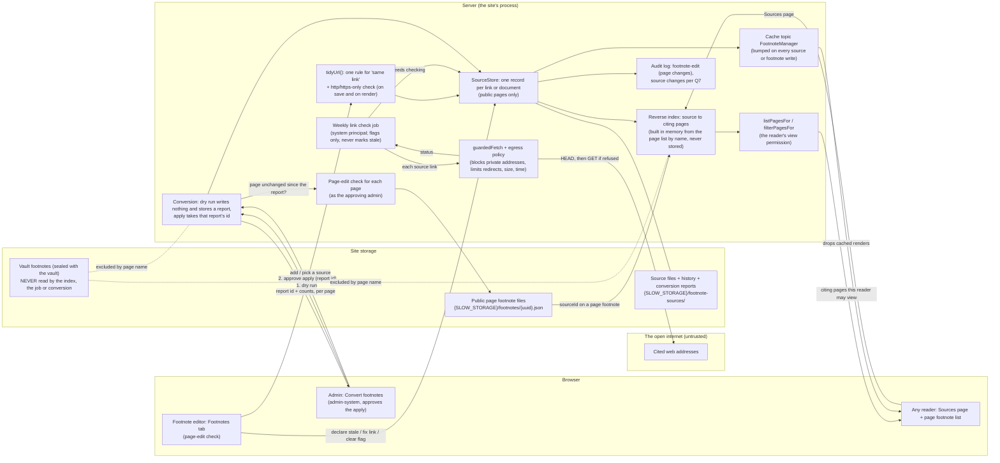
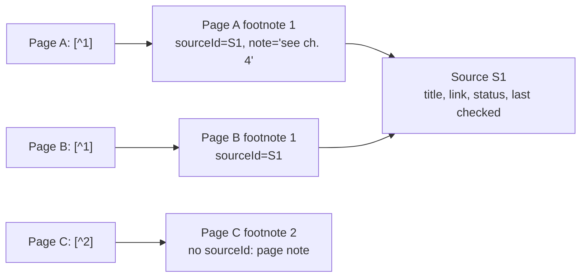

# Shared footnote sources: one index of sources across pages

Design for [#2454](https://github.com/jwilleke/ngdpbase/issues/2454). It builds the requirements R1–R8 Jim confirmed on that issue ([comment](https://github.com/jwilleke/ngdpbase/issues/2454#issuecomment-7060680486)), with R5 as amended by his decision 8 ([comment](https://github.com/jwilleke/ngdpbase/issues/2454#issuecomment-7060704094)). Nothing here is built yet, and none of the open questions at the end is decided in it: where a choice is needed, the text says "depends on Qn". Typed citations ([#707](https://github.com/jwilleke/ngdpbase/issues/707)) are out of scope.

## Prior work

Searched on 2026-11-21 at master `edfe9782`: `docs/` (guides, design, planning), `gh issue list` and `gh pr list` with `--state all` and the terms "footnote", "citation", "bibliography", "link check" and "broken link", and `git grep` for `sourceId`, `canonicalUrl`, `linkCheck` and `HEAD` requests in `src/`.

| Where                                                                                                                                         | What it gives us                                                                                                                                                      | Covers                                                                                                                                  |
| --------------------------------------------------------------------------------------------------------------------------------------------- | --------------------------------------------------------------------------------------------------------------------------------------------------------------------- | --------------------------------------------------------------------------------------------------------------------------------------- |
| [#128](https://github.com/jwilleke/ngdpbase/issues/128), `src/managers/FootnoteManager.ts`                                                   | Per-page footnotes as JSON files, one per page uuid, out of the page text. `PageFootnote` is `{ id, display, url, note, createdBy, createdAt }` (line 33)             | The page-local record R1 builds on. It has no shared source, no link status, no tidy URL                                                |
| [#1839](https://github.com/jwilleke/ngdpbase/issues/1839), `src/utils/pageNotes.ts`, [docs/private-stores.md](../private-stores.md)          | A vault page's footnotes live inside its vault, sealed with it, found by the page's name, never its uuid alone                                                        | The rule R6 repeats. Every new record here that touches a page must follow it                                                           |
| [#1233](https://github.com/jwilleke/ngdpbase/issues/1233), `recordEdit` (`FootnoteManager.ts:442`), audit event `footnote-edit` (an audit event, not a permission)              | An audit record for each footnote change, ids only                                                                                                                    | The model for R7's audit record                                                                                                         |
| [#1347](https://github.com/jwilleke/ngdpbase/issues/1347), `transferFromContent` (`FootnoteManager.ts:343`)                                   | A conversion funnel with `dryRun`: reads definitions out of page text, writes them as footnotes, returns the rewritten text and warnings. Used by the NCM conversion | The pattern for R5: dry run first, then apply                                                                                           |
| `convertCreatorsToIdentityIds` (`FootnoteManager.ts:104`)                                                                                     | A start-up conversion of stored records                                                                                                                               | The pattern for a one-time, safe-to-repeat store upgrade                                                                                |
| `src/converters/ncm/footnotes.ts` (`extractFootnoteDefs`, line 60)                                                                            | Reads `[^id]: text` definitions, with continuation lines, and sorts each into link, bare URL or plain note                                                            | The reader R5 reuses for Markdown definitions                                                                                           |
| `src/converters/JSPWikiConverter.ts:443-466`, [#1343](https://github.com/jwilleke/ngdpbase/issues/1343)                                       | Turns `[1]` into `[^1]` and `[#1] text` into `[^1]: text`                                                                                                             | The JSPWiki form R5 names. The blanket rule also hits NCM page links like `[1]`, so the conversion does not reuse it (R5)                         |
| `src/plugins/FootnotesPlugin.ts` (`renderFootnoteListHtml`, line 161)                                                                         | The list at the bottom of a page, anchors `footnote-ID`, and the Footnotes tab's add, edit and delete script                                                          | R8's starting point                                                                                                                     |
| `PageManager.listPagesFor` (line 4176) and `filterPagesFor` (line 4207)                                                                       | The doors every reader-facing page list must pass through                                                                                                             | R4: a reader sees only the citing pages they may view                                                                                   |
| `BackgroundJobManager.registerJob` (line 437), `WikiRoutes.registerAdminJobs` (~23571)                                                        | Scheduled jobs with `schedule`, `catchUp`, `overlap`, `timeout`, `persist`                                                                                            | R3's weekly check                                                                                                                       |
| `src/http/guardedFetch.ts:153`, `src/http/egressPolicy.ts:61`                                                                                 | The one allowed way to call out: SSRF-guarded, every redirect hop checked, `HEAD` allowed, a size and time limit                                                      | R3. Raw `fetch` is not allowed in `src/`                                                                                                |
| `docs/design/required-pages-sync-states.md`, `required-pages/`                                                                                | How a shipped page is seeded and kept in step                                                                                                                         | R4: the __Sources__ page ships as a required page                                                                                       |
| [docs/guides/storage-developer-guide.md](../guides/storage-developer-guide.md) line 160                                                       | The decision log already says "Footnotes are shared records used by many pages; editing one asks which pages take the new wording"                                    | The long-term intent. This design builds a smaller first step toward it, and says where it does not match (R7, Q3, Q4)                      |
| `AppHealthPlugin` broken-link check                                                                                                           | Finds broken internal page links                                                                                                                                      | Not external links. Nothing in the repo checks an outside URL                                                                           |
| [#707](https://github.com/jwilleke/ngdpbase/issues/707)                                                                                       | Typed citations                                                                                                                                                       | Out of scope here, by Jim's decision                                                                                                    |

Not found anywhere: a shared source record, URL tidying, a link checker for outside addresses, or a list of sources across pages. __No requirement already exists, so the design goes ahead.__

## What exists today

- Each page has its own footnote file, `{SLOW_STORAGE}/footnotes/{pageUuid}.json`, written by `FootnoteManager` (`FootnoteManager.ts:51`). A vault page's file sits inside the vault, written through the vault's store and sealed with it (`src/utils/pageNotes.ts:39-43`). The vault page is found by its name through `parsePrivatePageName`.
- A mark `[^1]` in page text is a page-local id. `MarkupParser` renders it as a superscript and never asks `FootnoteManager` anything (`src/parsers/MarkupParser.ts:1849-1925` reads definitions and marks; `2611-2650` renders them). `FootnotesPlugin` draws the list at the bottom from the page's own file.
- `[^1]: text` definitions typed into page text still work as a legacy form. `transferFromContent` reads only those lines (through `extractFootnoteDefs`), writes each into the page's footnote file with `putImported`, and returns the rewritten text. It does not save the page: the caller does. On an id clash it keeps the definition in the page text and warns (`FootnoteManager.ts:376-381`). It does not read the Footnotes tab lists, JSPWiki `[1]` marks or sources.
- The routes `/api/footnotes/:pageUuid...` need the `page-edit` permission and the page's own edit check (`writeRefusal`), and the creator or an `admin-system` holder may delete (`WikiRoutes.ts:12643-12873`, registered at `19085-19091`). `footnote-edit` is not a permission: it is an audit event (`config/app-default-config.json:2194`, `grantable: false`) that `recordEdit` writes after each change.
- The add route requires both a title and a link (`WikiRoutes.ts:12778`). Only a note converted from `[^1]: text` can have no link today.
- A footnote's link is put into `href` as it is (`FootnotesPlugin.ts:123-125`). Nothing checks its scheme.
- The Footnotes tab comes from the shipped required page `Template:PageTabs` (`required-pages/56e48394-b507-4f0e-98fb-02d9e7c2e165.md`), which calls `FootnotesPlugin`.
- Nothing links two pages' footnotes. The same web address cited on 40 pages is 40 separate records.

## Guides this design follows

[docs/guides/security-developer-guide.md](../guides/security-developer-guide.md) and [docs/guides/audit-developer-guide.md](../guides/audit-developer-guide.md) are required reading before a route, manager method, background job, permission or audit event changes (AGENTS.md, rule 7). What this design takes from them:

- Allow and deny come only from `hasPermission` and `canAccess`, with the caller's context forwarded (P1, P2). A role name never decides. `holdsPermission` only decides whether to show a control; acting on the control asks `hasPermission`.
- A page is read through the page door (`readPage`) and listed through `listPagesFor` or `filterPagesFor`.
- A change to the permission or audit catalog is declared in configuration and regenerated, and needs Jim's approval (Q7).
- Each build slice ends with the guides' "How you know you are done" checks (see [Slicing](#slicing)).

## Data flow

Where the lines are:

- __Outside:__ only the weekly job talks to the internet, and only through `guardedFetch`. A source's link is untrusted text from an editor; the egress policy, not the job, decides where it may connect.
- __Credentials:__ none. The check sends no cookies, no tokens and no login. It runs as a system principal (or `job:<id>`, as other scheduled jobs do), which gives it no page permission.
- __What the job cannot do:__ it cannot mark a source stale, edit a link, or read a vault. It writes only the "needs checking" flag, the reason, and the last-checked date and answer.
- __Where a person approves:__ a footnote editor declares a source stale, fixes its link or clears the flag. An admin approves the conversion apply after reading the dry run, and the apply writes only what that report lists. The job's own flag needs no approval because it only raises a question.
- __Where the vault stops:__ vault footnotes are not read by the index, the job or the conversion. They never get a `sourceId`.

## Design

### Overview

A new store holds __sources__. A page footnote may point at one with an optional `sourceId`. A source's address, title and status live once; a page footnote adds only page-specific text. The page-local `[^id]` mark and the parser stay as they are, so no page text depends on a source record.

### The records

A source record (one JSON file per source, `{SLOW_STORAGE}/footnote-sources/{sourceId}.json`):

| Field                    | Meaning                                                                                                                           |
| ------------------------ | --------------------------------------------------------------------------------------------------------------------------------- |
| `id`                     | A UUID, stable for life                                                                                                           |
| `title`                  | The name shown to readers                                                                                                         |
| `url`                    | The address as an editor entered it. Only `http` or `https` (see [Links](#links-http-and-https-only))                             |
| `urlKey`                 | The tidy form (R2), used to find the source again. Never shown                                                                    |
| `status`                 | `good`, `needs-checking` or `stale`                                                                                               |
| `statusSince`            | When `status` last changed                                                                                                        |
| `flagReason`             | Why the job set `needs-checking`: a code or short reason. Empty otherwise                                                         |
| `lastChecked`            | When the weekly job last looked, with the answer it got (a code or a short reason). Empty if it never ran                         |
| `staleBy`                | Who declared it stale, as an identity `@id` (same rule as `createdBy`, [#2041](https://github.com/jwilleke/ngdpbase/issues/2041)) |
| `createdBy`, `createdAt` | As on `PageFootnote`                                                                                                              |

`PageFootnote` gains one optional field, `sourceId`. A footnote with a `sourceId` shows the source's title and link plus its own `note`.

__Which copy wins.__ A footnote also keeps a stored copy of the source's `display` and `url` from its last save. After someone fixes the source's link, those copies are out of date, and nothing rewrites every citing page's file to refresh them. The rule: __the source wins whenever it exists.__ The reader's list, the edit screen and the Sources page all read the source. The stored copy is read only when the source record is missing, such as after a restore of the page file alone, so the footnote still reads sensibly; it then shows no status.

__A footnote with no link.__ It has no `sourceId` and is a page note (R1). Today the add route requires a link (`WikiRoutes.ts:12778`), so the only notes with no link are those converted from `[^1]: text`. Whether the add form should also allow a note with no link is the "A note for this page only" choice in R8; the route then stops requiring a link for that choice only.

A __reverse index__ (source to citing pages) is built in memory and never written to disk, so it cannot disagree with the page files after a restore. How it is built is the vault rule, in [R6](#r6-vault-pages-stay-separate).

The store is owned by `FootnoteManager` (the one writer, as pages are owned by `PageManager`), with `backupFolders()` (`FootnoteManager.ts:181`) naming the new folder so backup and the staged site restore carry it.

### Links: http and https only

One function, `safeSourceUrl(url)`, parses the value with `new URL()` and returns it only when the scheme is `http:` or `https:`. Everything else (`javascript:`, `data:`, `file:`, a value that does not parse) is not a source link. It is enforced in three places, so a bad value cannot get in and an old one cannot get out:

- __On save.__ `SourceStore` create and update, and the add and edit routes that feed them, refuse a link that fails the check: "A source's link must start with http:// or https://. Add it as a note on this page instead." A footnote added with such a value becomes a page note with no source.
- __On render.__ `renderFootnoteRow` (`FootnotesPlugin.ts:122`) and `SourcesPlugin` put a value into `href` only when `safeSourceUrl` passes, and otherwise show the text without a link. This also covers records already stored, imported or restored, and page notes, whose `href` is not checked today.
- __In the weekly check.__ The job calls `safeSourceUrl` first and skips a source whose link fails it, without calling `guardedFetch` and without changing its status. It does not rely on `guardedFetch` to refuse the scheme.

### R1. Shared sources

A new `SourceStore` inside `FootnoteManager` creates, reads and updates sources. `addFootnote` and `updateFootnote` (`FootnoteManager.ts:260`, `391`) accept a `sourceId` or a link. With a link, they check it (`safeSourceUrl`), tidy it (R2), look for a source with the same key, and use it or create one. With neither, the footnote is a page note. `renderFootnoteRow` reads the source for a footnote that has a `sourceId`.

### R2. One rule for "the same link"

`tidyUrl(url)` is one pure function with its own unit tests. Two links are the same when their tidy forms match:

- `http` and `https` are equal (the key stores `https`).
- The host is lower case, a leading `www.` is dropped, and a trailing slash on the path is dropped.
- Query parameters named `utm_*`, plus `fbclid` and `gclid`, are dropped. Other parameters stay, and the rest keep their order.
- A fragment (`#section`): __depends on Q9.__ If the answer is "keep it", two links that differ only by fragment are two sources. If "drop it", they are one.
- Anything else is left alone. A link that does not parse is not tidied and never matches another.

The tidy form is a key for finding, not a rewrite of what the editor typed: the source keeps the address as entered, and the reader's link goes where the editor said. Adding a footnote whose link matches shows "You already have a source for this link: [title]. Use it?" before saving. The editor may decline and make a separate source; two sources with one key are better than refusing a person's wording. What happens to the key when someone edits a source's link, and whether two sources with one key are offered for merging, __depends on Q5.__

### R3. Weekly check, flag only

A job `footnotes.sources-check` is registered beside the other admin jobs (`WikiRoutes.registerAdminJobs`, ~23571), with `schedule` weekly, `catchUp: 'latest'`, `overlap: 'skip'`, a `timeout` of one hour and `persist: true`. `ngdpbase.jobs.footnotes.sources-check.schedule` and `.enabled` work like every other job's. For each source whose link passes `safeSourceUrl` and whose status is not `stale`:

1. `guardedFetch(url, { method: 'HEAD', policy, timeoutMs, maxRedirects, maxBytes })` through `resolveEgressPolicy` (`egressPolicy.ts:61`). A `405`, `403` or `501` on HEAD is retried once as `GET`, because many servers refuse HEAD.
2. A `2xx` after redirects updates `lastChecked` with the answer. On a `good` source that is all. On a `needs-checking` source it also changes nothing else: the flag stays until a person clears it.
3. Anything else (a `4xx` or `5xx` after the retry, a refused connection, a timeout, a blocked address) sets `needs-checking`, sets `statusSince`, and records the reason in `flagReason` and `lastChecked`.

What else counts as a failure beyond step 3, such as a redirect to a home page or a "not found" text on a 200 answer, __depends on Q1.__ With no extra detection, only step 3 flags.

Two rules keep the check from deciding anything a person should decide:

- __It never sets `stale`.__ `stale` is only set by a person (R7). A `stale` source is skipped by the job.
- __It never clears a flag.__ A source that was flagged and now answers stays `needs-checking`; its `lastChecked` shows the good answer, and a person clears the flag. This stops a flaky site from flipping a source between states with nobody looking.

Politeness and safety: one request at a time per host, a pause between hosts, a total cap per run, no cookies and no request body. A source whose link is a private or non-routable address is flagged `needs-checking` with the reason "address not allowed" and never connected to. The job writes to the audit log once per run with counts, never per link.

### Caching: what invalidates what

A cached render is dropped when a topic it declared has a new version. `PAGE_DATA_TOPIC` is in every render already (`BASE_RENDER_TOPICS`, `src/cache/CacheDependencies.ts:36`), and a source write bumps nothing on it. So a source edit, a status change by the job and a "mark out of date" would leave the Sources page and each citing page showing the old status. The design adds a topic:

- `FOOTNOTE_DATA_TOPIC = 'FootnoteManager'` in `CacheDependencies.ts`, named for its owner as the others are.
- `FootnoteManager` calls `CacheManager.bump(FOOTNOTE_DATA_TOPIC)` after: every source write (create, update, fix the link, declare stale, clear the flag, restore from history); every write to a page's footnote file (add, update, delete, import, transfer, and the move into or out of a vault); and the weekly job's status changes. The job bumps once when a run ends (also when it ends on its timeout), not once per link.
- `SourcesPlugin` and `FootnotesPlugin` both call `context.dependsOn(FOOTNOTE_DATA_TOPIC)` before they read.

The cache key is per viewer (`MarkupParser.ts:1183`), so the per-reader filter in R4 stays correct once the topic is right. A page's access rules change `PAGE_DATA_TOPIC`, so a change to who may view a citing page also drops the render.

### R4. The Sources page

A required page named __Sources__ (one new file in `required-pages/`, with a fresh uuid, synced as `docs/design/required-pages-sync-states.md` says) contains one plugin call, `[{SourcesPlugin}]`. The plugin is a new `src/plugins/SourcesPlugin.ts` (`SimplePlugin`, like `FootnotesPlugin.ts:284`). It depends on the topic above, so a status change shows at once.

- The page is readable by anyone who can read the site (the page's own view permission, as every shipped page).
- The list shows every source: title, link (only when `safeSourceUrl` passes), status, last-checked date, and the pages that cite it.
- __The cited-by column passes through `filterPagesFor`__ (`PageManager.ts:4207`) with the reader's context, so a reader sees only the citing pages they may view. The same call gives the count shown to readers.
- A source cited only by pages the reader may not view: __depends on Q2.__ Either it shows with its title and link and the line "Also used on {N} pages you can't see", with no page names, or it is not listed for that reader at all.
- __For a reader the page-edit check would allow__ (shown with `holdsPermission('page-edit')`, an affordance only), a block at the top lists the sources that are `needs-checking`, with the reason and the date, and the actions from R7. Other readers see no such block. Acting on a button asks the real check, in R7.
- A `stale` source shows "Out of date since {date}" to everyone (R3).
- No vault page is ever in the list, because no vault page has a source.

### R5. Converting what exists

An admin screen, __Admin → Convert footnotes__, has two steps, like the NCM convert ([#1347](https://github.com/jwilleke/ngdpbase/issues/1347); preview and execute routes at `WikiRoutes.ts:17693-17830`, registered at `19229-19231`). Running it takes `admin-system`. That is not enough to write a page: see Step 2.

The conversion covers what decision 8 lists: the Footnotes tab lists, Markdown `[^1]: text` definitions in page text, and JSPWiki `[1]` marks with their `[#1]` lines.

__Step 1, dry run. Writes nothing to any page, footnote file or source.__ It lists the public pages by name (never the footnote folder; see R6), reads each, and builds a report, stored in `{SLOW_STORAGE}/footnote-sources/reports/{reportId}.json`. For each page the report holds a hash of the page text and of its footnote file, plus what would change. The admin sees counts per page and in total, and the report id.

| What it reads                                       | What it would write                                                                                                                                                     |
| --------------------------------------------------- | ----------------------------------------------------------------------------------------------------------------------------------------------------------------------- |
| An entry in the page's Footnotes tab list           | A source if it has a link (made new or matched by its tidy link), otherwise it stays a page note. Its id and `[^id]` mark are kept. New code: `transferFromContent` does not read these |
| A Markdown definition `[^1]: text` in the page text | The same, with the definition line removed from the page text and the mark `[^1]` kept. This is what `transferFromContent` does today, followed by the source step above |
| A JSPWiki `[1]` mark with a `[#1] text` line        | The mark becomes `[^1]` and the line becomes `[^1]: text`, then as the row above. New code, see below                                                                    |
| A link that is not `http` or `https`                | It stays a page note, and the report lists it                                                                                                                           |
| Anything it cannot read safely                      | Nothing. It is listed as "needs a person" with the page name and why                                                                                                    |

__The JSPWiki form.__ The existing rule (`JSPWikiConverter.convertFootnotes`, lines 443-466) turns every `[1]` into `[^1]`, which would also change a page link `[1]` to a page named "1". The conversion does not reuse it. By decision 8 it converts a `[n]` mark only on a page that has a matching `[#n] text` line. If a page named "n" also exists, the dry run lists that mark as "needs a person" and writes nothing for it. A `[n]` with no `[#n]` line is left alone.

__Id clashes.__ The conversion does not renumber anything. If a page's footnote file already has the id a definition uses, `transferFromContent` keeps the definition in the page text and warns, and the report lists it as "needs a person". The marks in the page text are never rewritten except `[n]` to `[^n]` as above, so no mark can end up pointing at the wrong footnote.

__Step 2, approved apply.__ The apply takes the report id and nothing else; it re-reads no page list of its own. For each page in that report:

1. __Unchanged since the report?__ It hashes the page text and the footnote file now. If either differs from the report, the page is skipped and listed as "changed since the preview". The pages that match are written, so a single edited page does not block the rest. An unknown report id, or no id, is refused with "Run the preview first." A page not in the report is never touched.
2. __Page-edit check, as the admin.__ Each page is written as the admin who approved, never as the system, and passes that page's own edit check (the `convertEditContext` / `writeRefusal` path the NCM convert uses, #1127). `admin-system` does not stand in for it. A page the admin may not edit is skipped and listed as "no permission to edit".
3. __Write.__ `transferFromContent(page, text, adminCtx, false)` writes the definitions and returns the text; the apply then saves that text with `PageManager.savePage` and the admin's context and address, so version history and the audit record name the admin. A source is created only when the first page that uses it is written. If a save fails after the footnote file was written, the definitions are in both places; the next dry run lists the page, and `putImported` never overwrites.

The check in step 1 and the write in step 3 are not one atomic step: a page edited in the moments between them is overwritten. The window is the time one page takes. The per-page hash narrows it and does not close it; the design does not add page locking.

The apply's own report (what was written, skipped and why) is stored with the report so the admin can see what was done. Each page can be undone through page history.

__Pages it skips, and says so:__ every vault page, chosen by name (R6); every page where footnotes are turned off (`isAllowedOn`, `FootnoteManager.ts:215`), whose definitions stay as written (the warning `transferFromContent` already returns).

Repeating it is safe: a page already converted has nothing left to convert.

### R6. Vault pages stay separate

Four rules, each a test:

- __The index, the job and the conversion start from the page list, by name.__ They take the names from `PageManager.getAllPages()`, drop any name `parsePrivatePageName` recognizes as a vault page, and open each remaining page's footnote file by `{ name, uuid }` through `pageNotesPath`. They never list a footnote folder. This matters because a vault page written before [#1839](https://github.com/jwilleke/ngdpbase/issues/1839) can still have its footnote file, named by uuid, in the public folder (`findVaultPageNotesOutside`, [docs/private-stores.md](../private-stores.md) line 194); a folder walk would read it.
- A footnote on a vault page is never given a `sourceId`. If an editor of a vault page picks a source, the choice is refused with "Sources are shared across the site, so they can't be used on private pages. Add the link as a note on this page instead." The page's own footnote file stays inside its vault, sealed with it, unchanged.
- The source store lives in public storage and holds no vault page's data: no page name, no uuid, no page text. The conversion report lists public pages only.
- The index is kept current by `FootnoteManager` on each footnote write, and by the same hooks `PageManager` already uses when a page moves (`movePageFootnotes`, `PageManager.ts:3766-3772`), extended to page delete, restore and rename. A page that moves into a vault leaves the index. A change to who may view a page needs no index change, because the reader's filter runs at read time (R4). The index is rebuilt from the page list at start-up as well, so a missed hook heals on restart.

When a page moves into a vault, its footnotes are copied as page notes with the source's title and link written into them, and the page's `sourceId`s are dropped. A source nobody cites any more: __depends on Q6.__

### R7. Who can change a source, and how it is recorded

- __Permission.__ Changing a source, declaring it stale, fixing its link and clearing its flag take the check that edits footnotes today, which is the `page-edit` permission (the routes call `permitted(wikiContext, 'page-edit', ...)` and then the page's own edit check). `footnote-edit` is an audit event, not a permission, and is not asked. A source spans many pages and `page-edit` is checked per page, so which page or pages the check is asked about is open: __depends on Q3.__ Either `canAccess('edit', page)` passes on at least one page that cites the source, or on every page that cites it. The citing pages come from the index, so only public pages are asked.
- __Edit screen.__ It shows "Used on N pages" before saving. Whether N counts every citing page or only those the editor may view: __depends on Q4.__
- __History.__ Each change appends the old record to the source's history file, `{sourceId}.history.json`, with who and when, so an earlier version can be restored from the edit screen.
- __Audit.__ A change writes one audit record with the source id, the action (`create`, `update`, `stale`, `fix`, `clear`) and the actor. No title, no link, no page name. Which event carries it __depends on Q7__: a new event `source-edit`, or the existing `footnote-edit` event with no page. The existing event's description is page-scoped (`config/app-default-config.json:2194`). A new event is declared in configuration and regenerated with `npm run generate:permissions`, and needs Jim's approval first.

### R8. The Footnotes tab

The tab stays where it is, defined by `Template:PageTabs`. In its add form, "Add a footnote" searches shared sources first: the editor types a name or a link, sees matching sources, and picks one, or chooses "New source" or "A note for this page only". A new source is made only when a link is entered. Adding to a page still needs the `page-edit` permission and that page's edit check, as today. The list a reader sees at the bottom of the page is unchanged: the same numbered list, with the source's title and link and the page's own text, and a "Link out of date since {date}" mark for a stale source.

### Plain-language text

All of it is shown to a home-user admin or editor, so no issue numbers, file names or "see the log". A row marked with a question number is shown only if that question is answered that way.

| Where                          | Text                                                                                                                                                  |
| ------------------------------ | ----------------------------------------------------------------------------------------------------------------------------------------------------- |
| Add form, match found          | "You already have a source for this link: __{title}__. Use it?" Buttons: __Use it__, __Make a new one__                                               |
| Add form, search box           | "Search your sources by name or link"                                                                                                                 |
| Add form, no link              | "A note for this page only"                                                                                                                           |
| Add form, bad link             | "A source's link must start with http:// or https://. Add it as a note on this page instead."                                                         |
| Source edit screen             | "This source is used on {N} pages. Changing it changes it on all of them." (what N counts: Q4)                                                        |
| Status labels                  | __Good__, __Needs checking__, __Out of date__                                                                                                         |
| Needs checking, with reason    | "This link was flagged on {date}: {reason}. Last checked {date}: {answer}. Check it, fix the link, or mark it out of date."                           |
| Actions                        | __Fix the link__, __Mark out of date__, __Clear the flag__                                                                                            |
| Reader, out-of-date source     | "Link out of date since {date}"                                                                                                                       |
| Sources page, hidden pages (Q2) | "Also used on {N} pages you can't see"                                                                                                               |
| Private page, picking a source | "Sources are shared across the site, so they can't be used on private pages. Add the link as a note on this page instead."                            |
| Convert, dry run               | "This is a preview. Nothing has been changed. {N} footnotes on {M} pages would become {S} shared sources. {K} need you to look at them."              |
| Convert, apply                 | __Convert {N} footnotes__ (asks first). After: "Converted {N} footnotes on {M} pages. You can undo any page from its history."                        |
| Convert, skipped               | "Skipped {V} private pages, {O} pages with footnotes turned off, {C} pages changed since the preview and {P} pages you can't edit."                   |
| Convert, no preview            | "Run the preview first."                                                                                                                              |

The word "wiki" appears nowhere in the text in this table.

### Requirement map

| Requirement                               | Where this design meets it                                                                                                                           |
| ----------------------------------------- | ---------------------------------------------------------------------------------------------------------------------------------------------------- |
| R1 shared sources, page-local notes       | The records; `sourceId` on a page footnote; a footnote with no link has no `sourceId`; the source wins over a stored copy                            |
| R2 tidy links, offer the match            | `tidyUrl`; the "You already have a source" prompt in the add form; only http and https accepted (Links)                                               |
| R3 weekly check, flag only                | `footnotes.sources-check` job; it never sets `stale` and never clears a flag; the cache topic shows a stale source on every citing page with its date |
| R4 Sources page                           | The required page and `SourcesPlugin`; `filterPagesFor` per reader (Q2); the needs-checking block for those the `page-edit` check allows            |
| R5 convert, dry run then approve          | __Admin → Convert footnotes__; the apply takes the report id, skips changed pages, writes each page as the admin with the page-edit check; vault pages excluded |
| R6 vault pages separate                   | Index built from the page list by name; no `sourceId` on a vault footnote; the store holds no vault data                                             |
| R7 same permission, count, history, audit | The `page-edit` check (Q3); "Used on N pages" (Q4); source history file; audit record (Q7)                                                           |
| R8 Footnotes tab stays                    | Search sources first in the add form; the reader's list at the bottom is unchanged                                                                   |

## Tests

Written first and run to fail, as the repo's TDD rule says. Unit tests (`tests/unit/`):

- `tidyUrl`: http and https match; trailing slash, `www.` and `utm_*` ignored; a real query parameter is kept; an invalid link never matches; two tidy forms that differ stay different. The fragment case is written once Q9 is answered.
- `safeSourceUrl`: `http` and `https` pass; `javascript:`, `data:`, `file:` and an unparseable value fail. `SourceStore` refuses a failing link on create and update. `renderFootnoteRow` and `SourcesPlugin` print a stored `javascript:` link as text with no `href`. The job skips a source with a failing link and never calls `guardedFetch` for it.
- `SourceStore`: create, find by key, update with history, restore from history. A footnote whose source differs from its stored copy renders the source's title and link; with the source file missing it renders the stored copy.
- `FootnoteManager`: a footnote with a `sourceId` renders with the source's title; a footnote with no link has no `sourceId`; a vault page refuses a `sourceId`.
- Reverse index: it never lists a vault page. With a stray vault footnote file placed in the public footnote folder, the index, the Sources page, the job and the dry run never read or list it. Delete, restore, rename and move of a page update the index; a rebuild matches the files.
- Link check: 2xx sets `good` and `lastChecked`; 404 sets `needs-checking` with a reason; a HEAD refusal retries as GET; a flagged source that answers stays flagged; the job never writes `stale`; a stale source is skipped; a blocked address is flagged and never connected to (with the `guardedFetch` test transport).
- Caching: with a cached Sources page and a cached citing page, a person's source edit, a "mark out of date", and the job's flag each change what both show on the next request, with no page edit in between.
- Sources page: a reader without view permission on a citing page does not see its name or count; a reader the `page-edit` check allows sees the needs-checking block and another reader does not.
- Conversion: the dry run writes nothing (file hashes before and after are equal) and stores a report; the apply with no report id or an unknown one is refused; a page edited after the preview is skipped and the rest are written; a page the admin may not edit is skipped even for an `admin-system` holder; pages are saved as the admin, not the system; each of the three forms converts; a JSPWiki `[1]` with no `[#1]` line, and one that also matches a page named "1", are not rewritten; an id clash keeps the body definition and changes no mark; a vault page and a footnotes-off page are skipped and reported; the apply is repeatable.

An end-to-end check in the build slice for the Sources page and the add form. Tests that use a real clock or network use the transport and clock seams, never the real internet.

## Slicing

Each slice is its own pull request, and each is checked on its own. Each slice also passes the guides' "How you know you are done" checks that apply to it: `npm run lint:permission-subject`, `lint:page-door`, `lint:signed-out-writes`, `lint:http`, `lint:csrf` and the permission tests from the security guide, and `npm run lint:audit`, `lint:audit-attribution`, `docs:audit:check` and `audit:coverage` from the audit guide.

1. __Records, safe links and tidy links.__ `tidyUrl`, `safeSourceUrl` (save and render), `SourceStore`, `sourceId` on `PageFootnote`, the in-memory index built by name, the cache topic, backup folder. No screens. Needs Q9 for the fragment rule.
2. __Add form and edit screen.__ Search sources first, "Used on N pages", history, audit. Needs Q3, Q4, Q5 and Q7 answered.
3. __Sources page.__ The plugin and the required page, with the per-reader filter. Needs Q2 and Q8.
4. __Weekly check.__ The job, the flag and its text on the Sources page. Needs Q1.
5. __Convert footnotes.__ The dry run and stored report, the apply that takes the report id, the skip report. Needs no open question.

The guides change in the slice that changes the behaviour: `docs/managers/FootnoteManager.md`, `docs/plugins/FootnotesPlugin.md`, `docs/guides/ncm-developer-guide.md` (footnote lines 10, 53, 170, 181), `docs/guides/storage-developer-guide.md` (120, 160-161, 187-189), `docs/private-stores.md` and `docs/guides/backup-restore-guide.md`.

## Open questions for Jim

Only Jim can answer these. The design builds none of them. Where the design needs a choice, the text above says "depends on Qn" and the branches are the options here.

1. __How careful is the weekly check?__ A page that answers slowly, or sends the reader to a login or "page not found" screen with a normal 200 reply, can look fine to the check. Options: (a) only a connection failure or a non-2xx answer counts (simplest, misses some dead links); (b) also flag a link that redirects to the site's home page; (c) also flag a page that answers 200 but is very short or says "not found".
2. __Does a source cited only by pages a reader can't view show on the Sources page?__ Options: (a) show it with its title and link and "Also used on {N} pages you can't see", with no names; (b) hide it from that reader entirely. (a) reveals that the source exists and its link; (b) reveals nothing.
3. __When someone changes a source, which citing pages must they be allowed to edit?__ The `page-edit` check is per page and a source spans many. Options: (a) at least one page that cites it; (b) every page that cites it (safest, but a popular source can never be changed by most editors).
4. __What does "Used on N pages" on the edit screen count?__ Options: (a) every public page that cites the source, even those the editor can't view (an editor sees how wide a change goes; reveals only a number); (b) only the pages the editor may view (reveals nothing, but understates the reach of a change).
5. __When someone edits a source's link so it now matches another source, what happens?__ Options: (a) the match key follows the new link and the two sources are offered for merging, never merged on their own (a merge is more than the requirements ask for); (b) the key follows the new link and nothing is offered, so two sources can share a key; (c) the key stays as it was.
6. __What happens to a source no page cites any more?__ Options: (a) keep it, and offer nothing (the requirements add no delete); (b) keep it, list it as "not used" and let footnote editors delete it; (c) delete it after N days.
7. __May a new audit event, `source-edit`, be added?__ It changes the permission and audit catalog, which needs your approval. The alternative is to record source changes under the existing `footnote-edit` event, with no page.
8. __Do footnotes on a page where footnotes are turned off still count as citations?__ Options: (a) yes, the source is still listed with that page, since the footnotes exist but are hidden; (b) no, a turned-off page counts as not citing. The requirements do not say, so this stays a question.
9. __Does a `#section` at the end of a link make it a different source?__ R2 lists `http`/`https`, a trailing slash, `www.` and tracking parameters, and does not mention the fragment. Options: (a) keep it, so `page#a` and `page#b` are two sources (as R2 is written); (b) drop it, so they are one.
