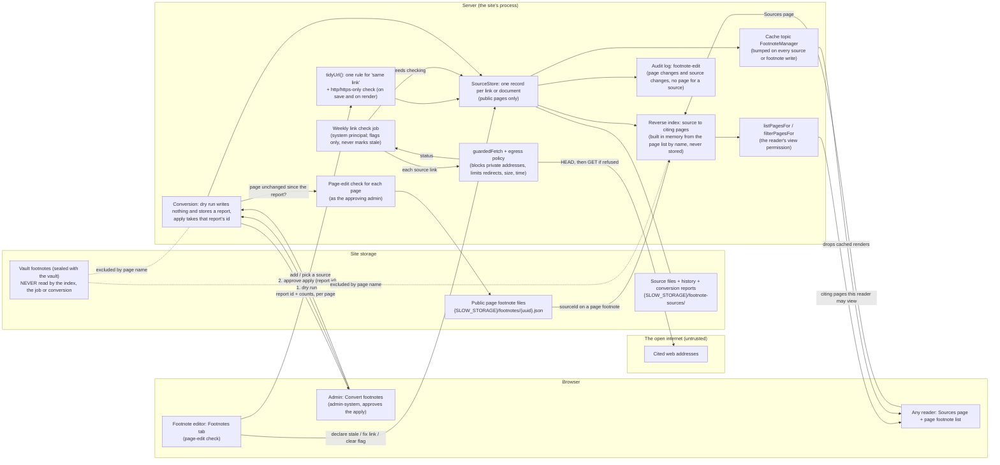
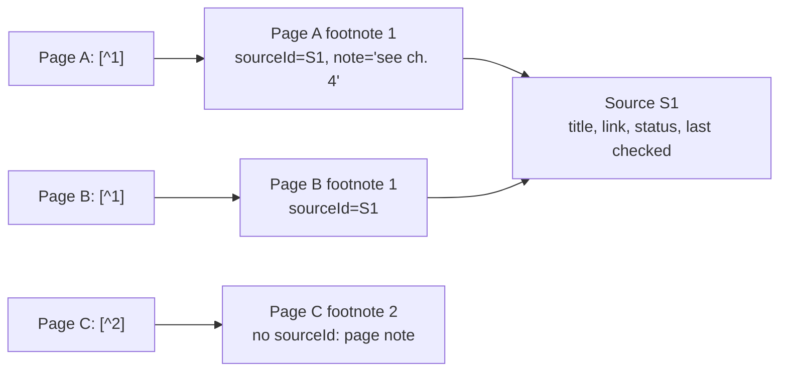

# Shared footnote sources: one index of sources across pages

Design for [#2454](https://github.com/jwilleke/ngdpbase/issues/2454). It builds the requirements R1–R8 Jim confirmed on that issue ([comment](https://github.com/jwilleke/ngdpbase/issues/2454#issuecomment-7060680486)), with R5 as amended by his decision 8 ([comment](https://github.com/jwilleke/ngdpbase/issues/2454#issuecomment-7060704094)). Nothing here is built yet. Jim answered the thirteen open questions on that issue (1–9 in [one comment](https://github.com/jwilleke/ngdpbase/issues/2454#issuecomment-7067455663), then [10](https://github.com/jwilleke/ngdpbase/issues/2454#issuecomment-7069070564), [11](https://github.com/jwilleke/ngdpbase/issues/2454#issuecomment-7069079679), [12](https://github.com/jwilleke/ngdpbase/issues/2454#issuecomment-7069087223) and [13](https://github.com/jwilleke/ngdpbase/issues/2454#issuecomment-7070106350)); [Decisions](#decisions) records each answer, and the text below follows them. Typed citations ([#707](https://github.com/jwilleke/ngdpbase/issues/707)) are out of scope.

## Prior work

Searched on 2026-11-21 at master `edfe9782`: `docs/` (guides, design, planning), `gh issue list` and `gh pr list` with `--state all` and the terms "footnote", "citation", "bibliography", "link check" and "broken link", and `git grep` for `sourceId`, `canonicalUrl`, `linkCheck` and `HEAD` requests in `src/`.

| Where                                                                                                                                         | What it gives us                                                                                                                                                      | Covers                                                                                                                                  |
| --------------------------------------------------------------------------------------------------------------------------------------------- | --------------------------------------------------------------------------------------------------------------------------------------------------------------------- | --------------------------------------------------------------------------------------------------------------------------------------- |
| [#128](https://github.com/jwilleke/ngdpbase/issues/128), `src/managers/FootnoteManager.ts`                                                   | Per-page footnotes as JSON files, one per page uuid, out of the page text. `PageFootnote` is `{ id, display, url, note, createdBy, createdAt }` (line 33)             | The page-local record R1 builds on. It has no shared source, no link status, no tidy URL                                                |
| [#1839](https://github.com/jwilleke/ngdpbase/issues/1839), `src/utils/pageNotes.ts`, [docs/private-stores.md](../private-stores.md)          | A vault page's footnotes live inside its vault, sealed with it, found by the page's name, never its uuid alone                                                        | The rule R6 repeats. Every new record here that touches a page must follow it                                                           |
| [#1233](https://github.com/jwilleke/ngdpbase/issues/1233), `recordEdit` (`FootnoteManager.ts:442`), audit event `footnote-edit` (an audit event, not a permission)              | An audit record for each footnote change, ids only                                                                                                                    | The model for R7's audit record                                                                                                         |
| [#1347](https://github.com/jwilleke/ngdpbase/issues/1347), `transferFromContent` (`FootnoteManager.ts:343`)                                   | A conversion funnel with `dryRun`: reads definitions out of page text, writes them as footnotes, returns the rewritten text and warnings. Used by the NCM conversion | The pattern for R5: dry run first, then apply                                                                                           |
| `convertCreatorsToIdentityIds` (`FootnoteManager.ts:104`)                                                                                     | A start-up conversion of stored records                                                                                                                               | The pattern for a one-time, safe-to-repeat store upgrade                                                                                |
| `src/converters/ncm/footnotes.ts` (`extractFootnoteDefs`, line 60)                                                                            | Reads `[^id]: text` definitions, with continuation lines, and sorts each into link, bare URL or plain note                                                            | The reader R5 reuses for Markdown definitions                                                                                           |
| `src/converters/JSPWikiConverter.ts:443-466`, [#1343](https://github.com/jwilleke/ngdpbase/issues/1343)                                       | Turns `[1]` into `[^1]` and `[#1] text` into `[^1]: text`                                                                                                             | The JSPWiki form R5 names. The blanket rule also hits NCM page links like `[1]`, so the conversion does not reuse it (R5)                         |
| `src/plugins/FootnotesPlugin.ts` (`renderFootnoteListHtml`, line 161)                                                                         | The list at the bottom of a page, anchors `footnote-ID`, and the Footnotes tab's add, edit and delete script                                                          | R8's starting point                                                                                                                     |
| `PageManager.listPagesFor` (line 4176) and `filterPagesFor` (line 4207)                                                                       | The doors every reader-facing page list must pass through                                                                                                             | R4: a reader sees only the citing pages they may view                                                                                   |
| `BackgroundJobManager.registerJob` (line 437), `WikiRoutes.registerAdminJobs` (~23571)                                                        | Scheduled jobs with `schedule`, `catchUp`, `overlap`, `timeout`, `persist`                                                                                            | R3's weekly check                                                                                                                       |
| `src/http/guardedFetch.ts:153`, `src/http/egressPolicy.ts:61`                                                                                 | The one allowed way to call out: SSRF-guarded, every redirect hop checked, `HEAD` allowed, a size and time limit                                                      | R3. Raw `fetch` is not allowed in `src/`                                                                                                |
| `docs/design/required-pages-sync-states.md`, `required-pages/`                                                                                | How a shipped page is seeded and kept in step                                                                                                                         | R4: the __Sources__ page ships as a required page                                                                                       |
| [docs/guides/storage-developer-guide.md](../guides/storage-developer-guide.md) line 160                                                       | The decision log already says "Footnotes are shared records used by many pages; editing one asks which pages take the new wording"                                    | The long-term intent. This design builds a smaller first step toward it, and says where it does not match (R7)                      |
| `AppHealthPlugin` broken-link check                                                                                                           | Finds broken internal page links                                                                                                                                      | Not external links. Nothing in the repo checks an outside URL                                                                           |
| [#707](https://github.com/jwilleke/ngdpbase/issues/707)                                                                                       | Typed citations                                                                                                                                                       | Out of scope here, by Jim's decision                                                                                                    |

Not found anywhere: a shared source record, URL tidying, a link checker for outside addresses, or a list of sources across pages. __No requirement already exists, so the design goes ahead.__

## What exists today

- Each page has its own footnote file, `{SLOW_STORAGE}/footnotes/{pageUuid}.json`, written by `FootnoteManager` (`FootnoteManager.ts:51`). A vault page's file sits inside the vault, written through the vault's store and sealed with it (`src/utils/pageNotes.ts:39-43`). The vault page is found by its name through `parsePrivatePageName`.
- A mark `[^1]` in page text is a page-local id. `MarkupParser` renders it as a superscript and never asks `FootnoteManager` anything (`src/parsers/MarkupParser.ts:1849-1925` reads definitions and marks; `2611-2650` renders them). `FootnotesPlugin` draws the list at the bottom from the page's own file.
- `[^1]: text` definitions typed into page text still work as a legacy form. `transferFromContent` reads only those lines (through `extractFootnoteDefs`), writes each into the page's footnote file with `putImported`, and returns the rewritten text. It does not save the page: the caller does. On an id clash it keeps the definition in the page text and warns (`FootnoteManager.ts:376-381`). It does not read the Footnotes tab lists, JSPWiki `[1]` marks or sources.
- The routes `/api/footnotes/:pageUuid...` need the `page-edit` permission and the page's own edit check (`writeRefusal`), and the creator or an `admin-system` holder may delete (`WikiRoutes.ts:12643-12873`, registered at `19085-19091`). `footnote-edit` is not a permission: it is an audit event (`config/app-default-config.json:2194`, `grantable: false`) that `recordEdit` writes after each change.
- The add route requires both a title and a link (`WikiRoutes.ts:12778`). Only a note converted from `[^1]: text` can have no link today.
- A footnote's link is put into `href` as it is (`FootnotesPlugin.ts:123-125`). Nothing checks its scheme.
- The Footnotes tab comes from the shipped required page `Template:PageTabs` (`required-pages/56e48394-b507-4f0e-98fb-02d9e7c2e165.md`), which calls `FootnotesPlugin`.
- Nothing links two pages' footnotes. The same web address cited on 40 pages is 40 separate records.

## Guides this design follows

[docs/guides/security-developer-guide.md](../guides/security-developer-guide.md) and [docs/guides/audit-developer-guide.md](../guides/audit-developer-guide.md) are required reading before a route, manager method, background job, permission or audit event changes (AGENTS.md, rule 7). What this design takes from them:

- Allow and deny come only from `hasPermission` and `canAccess`, with the caller's context forwarded (P1, P2). A role name never decides. `holdsPermission` only decides whether to show a control; acting on the control asks `hasPermission`.
- A page is read through the page door (`readPage`) and listed through `listPagesFor` or `filterPagesFor`.
- A change to the permission or audit catalog is declared in configuration and regenerated, and needs Jim's approval. This design adds nothing to either catalog.
- Each build slice ends with the guides' "How you know you are done" checks (see [Slicing](#slicing)).

## Data flow

Where the lines are:

- __Outside:__ only the weekly job talks to the internet, and only through `guardedFetch`. A source's link is untrusted text from an editor; the egress policy, not the job, decides where it may connect.
- __Credentials:__ none. The check sends no cookies, no tokens and no login. It runs as the scheduled-job context (`scheduleContext`: the system principal as its username, with the job id in `ctx.job`), which gives it no page permission.
- __What the job cannot do:__ it cannot mark a source stale, edit a link, or read a vault. It writes only the "needs checking" flag, the reason, and the last-checked date and answer.
- __Where a person approves:__ a footnote editor declares a source stale, fixes its link or clears the flag. An admin approves the conversion apply after reading the dry run, and the apply writes only what that report lists. The job's own flag needs no approval because it only raises a question.
- __Where the vault stops:__ vault footnotes are not read by the index, the job or the conversion. They never get a `sourceId`.

## Design

### Overview

A new store holds __sources__. A page footnote may point at one with an optional `sourceId`. A source's address, title and status live once; a page footnote adds only page-specific text. The page-local `[^id]` mark and the parser stay as they are, so no page text depends on a source record.

__Footnote editors__ are the people who hold the `page-edit` permission, the check the footnote routes ask today. This design adds no permission. Where a second check is meant, it says "an edit check on a citing page" (`canAccess('edit', page)`). `footnote-edit` is only the name of the audit event.

### The records

A source record (one JSON file per source, `{SLOW_STORAGE}/footnote-sources/{sourceId}.json`):

| Field                    | Meaning                                                                                                                           |
| ------------------------ | --------------------------------------------------------------------------------------------------------------------------------- |
| `id`                     | A UUID, stable for life. `SourceStore` makes it with `crypto.randomUUID()` when it creates the source, never from the link or from anything the request sends |
| `title`                  | The name shown to readers                                                                                                         |
| `url`                    | The address as an editor entered it. Only `http` or `https` (see [Links](#links-http-and-https-only))                             |
| `urlKey`                 | The tidy form (R2), used to find the source again. Never shown                                                                    |
| `status`                 | `good`, `needs-checking` or `stale`                                                                                               |
| `statusSince`            | When `status` last changed                                                                                                        |
| `flagReason`             | Why the job set `needs-checking`: a code or short reason. Empty otherwise                                                         |
| `lastChecked`            | When the weekly job last looked, with the answer it got (a code or a short reason). Empty if it never ran                         |
| `staleBy`                | Who declared it stale, as an identity `@id` (same rule as `createdBy`, [#2041](https://github.com/jwilleke/ngdpbase/issues/2041)) |
| `createdBy`, `createdAt` | As on `PageFootnote`                                                                                                              |

`PageFootnote` gains one optional field, `sourceId`. A footnote with a `sourceId` shows the source's title and link plus its own `note`.

__Which copy wins.__ A footnote also keeps a stored copy of the source's `display` and `url` from its last save. After someone fixes the source's link, those copies are out of date, and nothing rewrites every citing page's file to refresh them. The rule: __the source wins whenever it exists.__ The reader's list, the edit screen and the Sources page all read the source. The stored copy is read only when the source record is missing, such as after a restore of the page file alone, so the footnote still reads sensibly; it then shows no status.

__A footnote with no link.__ It has no `sourceId` and is a page note (R1). Today the add route requires a link (`WikiRoutes.ts:12778`), so the only notes with no link are those converted from `[^1]: text`. Whether the add form should also allow a note with no link is the "A note for this page only" choice in R8; the route then stops requiring a link for that choice only.

A __reverse index__ (source to citing pages) is built in memory and never written to disk, so it cannot disagree with the page files after a restore. How it is built is the vault rule, in [R6](#r6-vault-pages-stay-separate).

The store is owned by `FootnoteManager` (the one writer, as pages are owned by `PageManager`), with `backupFolders()` (`FootnoteManager.ts:181`) naming the new folder so backup and the staged site restore carry it.

### Links: http and https only

One function, `safeSourceUrl(url)`, parses the value with `new URL()` and returns it only when the scheme is `http:` or `https:`. Everything else (`javascript:`, `data:`, `file:`, a value that does not parse) is not a source link. It is enforced in three places, so a bad value cannot get in and an old one cannot get out:

- __On save.__ `SourceStore` create and update, and the add and edit routes that feed them, refuse a link that fails the check: "A source's link must start with http:// or https://. Add it as a note on this page instead." A footnote added with such a value becomes a page note with no source.
- __On render.__ `renderFootnoteRow` (`FootnotesPlugin.ts:122`) and `SourcesPlugin` put a value into `href` only when `safeSourceUrl` passes, and otherwise show the text without a link. This also covers records already stored, imported or restored, and page notes, whose `href` is not checked today.
- __In the weekly check.__ The job calls `safeSourceUrl` first and skips a source whose link fails it, without calling `guardedFetch` and without changing its status. It does not rely on `guardedFetch` to refuse the scheme.

### R1. Shared sources

A new `SourceStore` inside `FootnoteManager` creates, reads and updates sources. `addFootnote` and `updateFootnote` (`FootnoteManager.ts:260`, `391`) accept a `sourceId` or a link. With a link, they check it (`safeSourceUrl`), tidy it (R2), look for sources with the same key that the person may see (the reader filter, [R4](#r4-the-sources-page)), and use one or create one. With neither, the footnote is a page note. `renderFootnoteRow` reads the source for a footnote that has a `sourceId`.

Both methods refuse a `sourceId` whose record is missing, with "That source was deleted a moment ago. Search again, or add the link as a new source." Otherwise an editor who picked "Use it" just before another editor deleted the source would save a footnote that points at nothing. Nothing on a page is lost either way, because a footnote keeps its stored copy and shows it when the source is missing; only the status goes.

### R2. One rule for "the same link"

`tidyUrl(url)` is one pure function with its own unit tests. Two links are the same when their tidy forms match:

- `http` and `https` are equal (the key stores `https`).
- The host is lower case, a leading `www.` is dropped, and a trailing slash on the path is dropped.
- A port written in the address stays in the key, so `https://example.com:443/x` and `https://example.com/x` are two keys. A `user:password@` part is left out, so a credential never reaches a key. The same part is also removed from the link a source or footnote stores (`stripUrlCredentials`, built in S3): the link is cleaned on save, never refused (decision 2026-11-23).
- Query parameters named `utm_*`, plus `fbclid` and `gclid`, are dropped. Other parameters stay, and the rest keep their order.
- A fragment (`#section`) stays in the key, so `page#a` and `page#b` are two sources.
- Anything else is left alone. A link that does not parse is not tidied and never matches another.

The tidy form is a key for finding, not a rewrite of what the editor typed: the source keeps the address as entered, and the reader's link goes where the editor said. Adding a footnote whose link matches a source shows "You already have a source for this link: [title]. Use it?" before saving. The editor may decline and make a separate source; two sources with one key are better than refusing a person's wording.

Because of that, two sources can share a key. So can two sources after an edit that is not merged. __The add form offers every source with that key that the person may see__, oldest first (by `createdAt`, then by id), each with its own "Use it". The conversion (R5) matches the oldest source that passes the page's own test in [Which source a footnote may match](#which-source-a-footnote-may-match), which is not the admin's view.

__Only sources the person may see are ever offered, by title or by link.__ The match prompt, the add-form search (R8), the Merge prompt below, the needs-checking block and the history list (R4) all use the same reader filter as the Sources page. A source the filter hides from the editor is treated as not matched, and the editor is told nothing about it: no message, no title, no link, no "Use it" and no Merge. The add form behaves as if no source had that link, and the editor adds their own source, which leaves two sources with one key (allowed above). This keeps "some page I can't view cites this link" from being learned by trying links.

When someone edits a source's link so its key equals another visible source's, the key follows the new link and the editor is offered "This link is already a source: [title]" with a __Merge__ action when the checks in R7 allow it (see [Merging](#merging-two-sources)). Nothing merges unless they press it.

### R3. Weekly check, flag only

A job `footnotes.sources-check` is registered beside the other admin jobs (`WikiRoutes.registerAdminJobs`, ~23571), with `schedule` weekly, `catchUp: 'latest'`, `overlap: 'skip'`, a `timeout` of one hour and `persist: true`. `ngdpbase.jobs.footnotes.sources-check.schedule` and `.enabled` work like every other job's. For each source whose link passes `safeSourceUrl` and whose status is not `stale`:

1. `guardedFetch(url, { method: 'HEAD', policy, timeoutMs, maxRedirects, maxBytes })` through `resolveEgressPolicy` (`egressPolicy.ts:61`). A `405`, `403` or `501` on HEAD is retried once as `GET`, because many servers refuse HEAD.
2. A `2xx` after redirects, not ending on the home page (step 4), updates `lastChecked` with the answer. On a `good` source that is all. On a `needs-checking` source it also changes nothing else: the flag stays until a person clears it.
3. Anything else (a `4xx` or `5xx` after the retry, a refused connection, a timeout, a blocked address) sets `needs-checking`, sets `statusSince`, and records the reason in `flagReason` and `lastChecked`.
4. A `2xx` that ended on the site's own home page also sets `needs-checking`, with the reason "redirects to the home page". It counts when the link's path was not the home page, and the address the answer came from (`finalUrl` on the `guardedFetch` result) is on the same host, with an empty path or `/` and no query. The two hosts are compared after the R2 tidy (lower case, a leading `www.` dropped), so a link to `example.com/page` that ends on `https://www.example.com/` is flagged. A link that is itself a home page is not flagged for this.

These are the only three kinds of failure: a connection error, a non-2xx answer, and a redirect to the site's home page. The check does not read the body, so it does not look for "not found" text or short pages (Jim's decision 1).

Two rules keep the check from deciding anything a person should decide:

- __It never sets `stale`.__ `stale` is only set by a person (R7). A `stale` source is skipped by the job.
- __It never clears a flag.__ A source that was flagged and now answers stays `needs-checking`; its `lastChecked` shows the good answer, and a person clears the flag. This stops a flaky site from flipping a source between states with nobody looking.

Politeness and safety: one request at a time per host, a pause between hosts, a total cap per run, no cookies and no request body. A source whose link is a private or non-routable address is flagged `needs-checking` with the reason "address not allowed" and never connected to. The job writes to the audit log once per run with counts, never per link.

__Whose context reads what.__ Four pieces of code use a different context, and none reads a vault:

- __The weekly check__ is the only one that runs as `scheduleContext`: the system principal as its username, with the job id in `ctx.job` (`bootActions.ts:56`, `BackgroundJobManager.ts:935`). It reads source records and calls `guardedFetch`. It reads no page name, no page text and no footnote file.
- __The index build__ is not a scheduled run. It runs at start-up and after each footnote write, inside `FootnoteManager`. It reads the list of page names and each public page's uuid from the page index, and each page's footnote file by `{ name, uuid }`. It never reads page text. Its result is never shown as it stands: every reader-facing use filters it for the reader (R4).
- __The Sources page and the add form__ read as the person: `filterPagesFor` is called with their own context (R4).
- __The conversion's dry run__ runs as the admin who requested it, and lists only the pages that admin may read (through `readPage`). A different admin may press apply. The apply runs as that admin, touches only the pages in the stored report, and asks the edit check on each page as that admin (R5). A page that admin may not edit is skipped and listed. Which existing source a footnote may be matched to is not decided by the admin's view: it is decided by the converted page's own readers (R5).

### Caching: what invalidates what

A cached render is dropped when a topic it declared has a new version. `PAGE_DATA_TOPIC` is in every render already (`BASE_RENDER_TOPICS`, `src/cache/CacheDependencies.ts:41`), and a source write bumps nothing on it. So a source edit, a status change by the job and a "mark out of date" would leave the Sources page and each citing page showing the old status. The design adds a topic:

- `FOOTNOTE_DATA_TOPIC = 'FootnoteManager'` in `CacheDependencies.ts`, named for its owner as the others are.
- `FootnoteManager` calls `CacheManager.bump(FOOTNOTE_DATA_TOPIC)` after: every source write (create, update, fix the link, declare stale, clear the flag, merge, delete, restore from history); every write to a page's footnote file (add, update, delete, import, transfer, and the move into or out of a vault); and the weekly job's status changes. The job bumps once when a run ends (also when it ends on its timeout), not once per link.
- `SourcesPlugin` and `FootnotesPlugin` both call `context.dependsOn(FOOTNOTE_DATA_TOPIC)` before they read.

The cache key is per viewer (`MarkupParser.ts:1183`), so the per-reader filter in R4 stays correct once the topic is right. A page's access rules change `PAGE_DATA_TOPIC`, so a change to who may view a citing page also drops the render.

### R4. The Sources page

A required page named __Sources__ (one new file in `required-pages/`, with a fresh uuid, synced as `docs/design/required-pages-sync-states.md` says) contains one plugin call, `[{SourcesPlugin}]`. The plugin is a new `src/plugins/SourcesPlugin.ts` (`SimplePlugin`, like `FootnotesPlugin.ts:284`). It depends on the topic above, so a status change shows at once.

- The page is readable by anyone who can read the site (the page's own view permission, as every shipped page).
- The list shows the sources the reader may see: title, link (only when `safeSourceUrl` passes), status, last-checked date, and the pages that cite it.
- __The reader filter.__ This is the one rule for who may see a source, and every surface that shows a source's title or link uses it: this list, the needs-checking block, the add-form match prompt and search (R2, R8), the Merge prompt and the history list (R7). A source is visible to a person when:
  1. at least one page that cites it passes `filterPagesFor` (`PageManager.ts:4207`) with that person's own context; or
  2. no page cites it at all ("Not used", see R6) and the person holds the `page-edit` permission.
- __The cited-by column passes through `filterPagesFor`__ with the reader's context, so a reader sees only the citing pages they may view. The same call gives the count shown to readers.
- __A source the reader filter hides is not shown at all.__ It shows no title, no link, no count and no page name, on any surface. The one exception is the conversion (Jim's decision 12): a footnote on a restricted page may join a source already shown on a public page, so a signed-in person an administrator has blocked from public pages can see that source's title (see [Which source a footnote may match](#which-source-a-footnote-may-match)). A source cited by at least one page the reader may view is listed, with only those pages named.
- __"Not used" sources are listed only to people who hold the `page-edit` permission__ (Jim's decision 10; shown with `holdsPermission('page-edit')`, an affordance only), who are also the people who may delete them. Other readers do not see them. The reason: a source cited only by a restricted page, which has since been deleted or moved into a vault, would otherwise have no citing page and so become visible to everyone with its title and link, and the title may show what the private page was about.
- __For a reader the page-edit check would allow__ (the same affordance), a block at the top lists the sources that are `needs-checking`, with the reason and the date, and the actions from R7. It lists only the sources the reader filter lets that person see. Other readers see no such block. Acting on a button asks the real check, in R7.
- A `stale` source shows "Out of date since {date}" to everyone (R3).
- No vault page is ever in the list, because no vault page has a source.

### R5. Converting what exists

An admin screen, __Admin → Convert footnotes__, has two steps, like the NCM convert ([#1347](https://github.com/jwilleke/ngdpbase/issues/1347); preview and execute routes at `WikiRoutes.ts:17693-17830`, registered at `19229-19231`). Running it takes `admin-system`. That is not enough to write a page: see Step 2.

The conversion covers what decision 8 lists: the Footnotes tab lists, Markdown `[^1]: text` definitions in page text, and JSPWiki `[1]` marks with their `[#1]` lines.

__Step 1, dry run. Writes nothing to any page, footnote file or source.__ It runs as the admin who requested it. It lists the public pages by name (never the footnote folder; see R6), reads each that admin may read, and builds a report, stored in `{SLOW_STORAGE}/footnote-sources/reports/{reportId}.json`. For each page the report holds a hash of the page text and of its footnote file, plus what would change. The admin sees counts per page and in total, and the report id.

| What it reads                                       | What it would write                                                                                                                                                     |
| --------------------------------------------------- | ----------------------------------------------------------------------------------------------------------------------------------------------------------------------- |
| An entry in the page's Footnotes tab list           | A source if it has a link (made new, or matched by its tidy link to the oldest source that passes the page's own test, see [Which source a footnote may match](#which-source-a-footnote-may-match)), otherwise it stays a page note. Its id and `[^id]` mark are kept. New code: `transferFromContent` does not read these |
| A Markdown definition `[^1]: text` in the page text | The same, with the definition line removed from the page text and the mark `[^1]` kept. This is what `transferFromContent` does today, followed by the source step above |
| A JSPWiki `[1]` mark with a `[#1] text` line        | The mark becomes `[^1]` and the line becomes `[^1]: text`, then as the row above. New code, see below                                                                    |
| A link that is not `http` or `https`                | It stays a page note, and the report lists it                                                                                                                           |
| Anything it cannot read safely                      | Nothing. It is listed as "needs a person" with the page name and why                                                                                                    |

#### Which source a footnote may match

A footnote on page P is matched to an existing source S only if S is one P's own readers could already see. The admin's view does not count: an admin usually sees every page, and a source cited only by a private page would otherwise put its title, which may say what that page is about, in front of P's readers. The test is exact and is the same in the dry run and the apply. S qualifies when:

1. some page that cites S passes `filterPagesFor` with the __anonymous context__; or
2. P itself already cites S (P's readers already see its title).

Both ask only the check, so the answer is the same whoever runs the conversion. This is the reader filter (R4) evaluated for the anonymous context. It applies the same way to a public page (whose readers include anonymous visitors) and to a restricted one: a restricted page's readers cannot be listed, and every one of them can view a page that anonymous visitors can, so the anonymous test is the one that is safe for them all. __Precondition, stated so a builder does not assume more.__ "Every one of them can view a page that anonymous visitors can" holds only while no access policy denies a specific signed-in person a page that anonymous visitors may view. Policies combine deny-overrides (`config/app-default-config.json:2862`), so an administrator can write such a deny, for one person or a group. For that person the anonymous test is not enough: P's footnote could show them the title of a source cited only by a page they are denied, though anonymous visitors may view it. Jim accepted this (decision 12): a footnote on a restricted page may join a source already shown on a public page, and a signed-in person an administrator has blocked from public pages can then see that source's title. The person is one an administrator chose to restrict below an anonymous visitor, the title is already public, and a test per reader is not possible for a restricted page whose readers cannot be listed. The Sources page and the add form are not affected, because they run the reader filter with each person's own context (R4). A source with no citing page ("Not used") never qualifies, because it is shown only to `page-edit` holders. A source created earlier in the same run is matched by the same test, using the pages written so far; the dry run writes nothing, so it simulates this from its own list of what it would write.

__The apply recomputes the match.__ The apply runs later than the dry run and a page's readers may have changed in between, so it does not replay the dry run's answer: it runs the same test again for each footnote, as it writes the page. A footnote whose result differs from the report (it would have matched S in the report and now gets a new source, or the other way round) is written with the result of the new test, never with the report's, and is counted as "changed since the preview" in the apply's own report, by count only, with no source title, link or page name. The apply uses the safe test, so it cannot show a reader a title the reader could not see, except the case Jim accepted in decision 12 (above).

When no source qualifies, the conversion creates a new source from the page's own title and link, and the page shows exactly the title it showed before. A hidden source with the same key stays as it is, so two sources share a key (R2); a person may later merge them (R7). The dry run reports only counts for this ("{n} footnotes will get their own new source"), never the title, link or page names of a source it did not match. A converted page therefore never shows its readers a title they could not see before, except the case Jim accepted in decision 12 (above).

__The JSPWiki form.__ The existing rule (`JSPWikiConverter.convertFootnotes`, lines 443-466) turns every `[1]` into `[^1]`, which would also change a page link `[1]` to a page named "1". The conversion does not reuse it. By decision 8 it converts a `[n]` mark only on a page that has a matching `[#n] text` line. If a page named "n" also exists, the dry run lists that mark as "needs a person" and writes nothing for it. A `[n]` with no `[#n]` line is left alone.

__Id clashes.__ The conversion does not renumber anything. If a page's footnote file already has the id a definition uses, `transferFromContent` keeps the definition in the page text and warns, and the report lists it as "needs a person". A JSPWiki `[#n]` id that clashes with another footnote on the same page (one in its footnote file, or a `[^n]` already in its text) blocks that page's mark rewrite: the page is skipped, nothing on it is written, and the report lists it with the reason "footnote number {n} is already used on this page". The marks in the page text are never rewritten except `[n]` to `[^n]` on a page with no clash, so no mark can end up pointing at the wrong footnote.

__Step 2, approved apply.__ The apply takes the report id and nothing else; it re-reads no page list of its own. For each page in that report:

1. __Unchanged since the report?__ It hashes the page text and the footnote file now. If either differs from the report, the page is skipped and listed as "changed since the preview". The pages that match are written, so a single edited page does not block the rest. An unknown report id, or no id, is refused with "Run the preview first." A page not in the report is never touched.
2. __Page-edit check, as the admin.__ Each page is written as the admin who approved, never as the system, and passes that page's own edit check (the `convertEditContext` / `writeRefusal` path the NCM convert uses, #1127). `admin-system` does not stand in for it. A page the admin may not edit is skipped and listed as "no permission to edit".
3. __Write.__ `transferFromContent(page, text, adminCtx, false)` writes the definitions and returns the text; the apply then saves that text with `PageManager.savePage` and the admin's context and address, so version history and the audit record name the admin. A source is created only when the first page that uses it is written. If a save fails after the footnote file was written, the definitions are in both places; the next dry run lists the page, and `putImported` never overwrites.

The check in step 1 and the write in step 3 are not one atomic step: a page edited in the moments between them is overwritten. The window is the time one page takes. The per-page hash narrows it and does not close it; the design does not add page locking.

The apply's own report (what was written, skipped and why) is stored with the report so the admin can see what was done. Each page can be undone through page history. A conversion that creates many sources writes one `create` audit record per run, with the number of sources created, never one per source (as the weekly job writes one per run). The page saves write their own audit records as the admin.

__Pages it skips, and says so:__ every vault page, chosen by name (R6); every page where footnotes are turned off (`isAllowedOn`, `FootnoteManager.ts:215`), whose definitions stay as written (the warning `transferFromContent` already returns). Such a page still counts as citing for any source it already has (R6).

Repeating it is safe: a page already converted has nothing left to convert.

### R6. Vault pages stay separate

Four rules, each a test:

- __The index, the job and the conversion start from the page list, by name.__ They take the names from `PageManager.getAllPages()`, drop any name `parsePrivatePageName` recognizes as a vault page, and open each remaining page's footnote file by `{ name, uuid }` through `pageNotesPath`. They never list a footnote folder. This matters because a vault page written before [#1839](https://github.com/jwilleke/ngdpbase/issues/1839) can still have its footnote file, named by uuid, in the public folder (`findVaultPageNotesOutside`, [docs/private-stores.md](../private-stores.md) line 194); a folder walk would read it.
- A footnote on a vault page is never given a `sourceId`. If an editor of a vault page picks a source, the choice is refused with "Sources are shared across the site, so they can't be used on private pages. Add the link as a note on this page instead." The page's own footnote file stays inside its vault, sealed with it, unchanged.
- The source store lives in public storage and holds no vault page's data: no page name, no uuid, no page text. The conversion report lists public pages only.
- The index is kept current by `FootnoteManager` on each footnote write, and by the same hooks `PageManager` already uses when a page moves (`movePageFootnotes`, `PageManager.ts:3766-3772`), extended to page delete, restore and rename. A page that moves into a vault leaves the index. A change to who may view a page needs no index change, because the reader's filter runs at read time (R4). The index is rebuilt from the page list at start-up as well, so a missed hook heals on restart.

When a page moves into a vault, its footnotes are copied as page notes with the source's title and link written into them, and the page's `sourceId`s are dropped. A source nobody cites any more is handled as below.

__A source no page cites.__ It is kept, and the Sources page marks it "Not used" for footnote editors only (R4). Footnote editors may delete it. Deleting it appends the record to its history file and writes an audit record (R7). The delete re-checks "no page cites it" against the unfiltered index at the moment of deleting; the list the person saw is filtered for them, so it is never the basis. A page where footnotes are turned off still counts as citing: its footnotes still carry their `sourceId`, so a source only those pages cite is never "Not used" because of the setting.

### R7. Who can change a source, and how it is recorded

- __Permission.__ Changing a source, declaring it stale, fixing its link and clearing its flag take two checks, both asked as the person acting. The first is the `page-edit` permission (the routes call `permitted(wikiContext, 'page-edit', ...)`; no permission is added). The second is an edit check on a citing page (`canAccess('edit', page)`) passing on at least one page that cites the source. The citing pages come from the index, so only public pages are asked. Deleting an unused source needs only the `page-edit` permission, because no page cites it. A merge asks the second check once for each of the two sources (see Merging). `footnote-edit` is only the audit event below.
- __Edit screen.__ It shows "Used on N pages" before saving. N counts every public page that cites the source, including pages the editor may not view (Jim's decision 4), and shows a number only, never page names. A page where footnotes are turned off still counts.
- __History.__ Each change appends the old record to the source's history file, `{sourceId}.history.json`, with who and when, so an earlier version can be restored from the edit screen. __The history list is a surface the reader filter covers (R4).__ An entry for a change to E itself shows E's old record, which anyone who can open E already sees. A __merge__ entry holds the absorbed source M's whole record and the list of pages repointed, so it is shown in two levels:

  - Everyone who can open E's history sees "Merged with another source on {date}", with no title, no link, no page name, no actor and no restore button.
  - The details (M's title and link, and the Restore action in Merging) are shown only to a viewer who passes the reader filter for M's __recorded citing pages__: at least one page in the entry's `{pageUuid, footnoteId}` list passes `filterPagesFor` with that viewer's context. The list holds page uuids and `filterPagesFor` takes page names, so the check first resolves each uuid to a page name through the page index; a uuid that does not resolve (the page was deleted) counts as "page no longer exists", the same as a page moved into a vault. If the list is not empty and none of its pages exists any more, only a viewer who holds `admin-system` (`hasPermission`) sees the details.
  - __An entry with an empty list__ (M had no citing page when it was merged, so it was a "Not used" source) follows Jim's decision 11: the details and Restore are shown to a viewer who holds the `page-edit` permission and passes the edit check on a page that cites E, the surviving source. The `admin-system`-only rule above is for a list that had pages and lost them all.
  - __An entry with an empty list, when E itself has no citing page.__ E is then a "Not used" source, so no page exists to pass the edit check on, and the rule above would show the details to nobody. Jim's decision 13 sets the rule for this case: the details and Restore are shown to all page editors, anyone who holds the `page-edit` permission. Both sources are "Not used", and page editors already see those (decision 10, R4), so nobody sees anything new. Restore here asks the `page-edit` permission alone, because neither source has a page to pass an edit check on.
  - __An entry whose list had pages, when E has since lost all of its own citing pages.__ E is then a "Not used" source, and Restore needs an edit check on a page that cites E, which can never pass. So Restore is not offered: there is no button. The details stay visible exactly as the rules above say. Decision 13 does not apply here, because it covers only an entry with an empty list.

  __A source removed by a merge is never in the "Deleted sources" list.__ A deleted source has no edit screen, so the Sources page ends with a "Deleted sources" list, shown only to footnote editors, built from the history files whose last entry is a delete. Only a source deleted while unused (R6) writes a delete entry. Merge step 3 removes M's record without writing one: the merge entry goes in E's history file and M's own history file gets no new entry, so it does not end on a delete and M never appears in this list and its title and link are reachable only through the two-level merge entry above. Each source in the list has a __Restore__ that needs only the `page-edit` permission, since no page cited it.
- __Audit.__ There is no new audit event. Each source change (edit, stale, fix, merge, delete) is logged under the existing `footnote-edit` audit event with no page, naming the source id, the action (`create`, `update`, `stale`, `fix`, `clear`, `merge`, `delete`, `restore`) and the actor. A merge names both source ids, the survivor and the absorbed one. No title, no link, no page name. The event's description is page-scoped (`config/app-default-config.json:2194`), so the slice that writes the first source record also widens that description in configuration to say it covers source changes; it adds no event and no permission.

### Merging two sources

When an edited link's key equals another source's, the editor is offered "This link is already a source: [title]" with a __Merge__ action. The offer follows the reader filter (R4): a source hidden from the editor is not named and has no Merge. Call the source being edited __E__ and the source its new link now matches __M__.

- __A merge into a "Not used" E cannot happen.__ A merge starts from E's edit screen, and E's edit check needs a citing page (R7), so a source with no citing page has no edit screen and its link cannot be changed, so no key can follow it to M. Delete is the only change allowed on it. The one place this case comes up is Restore of an old merge entry after E lost its citing pages (R7 History, decision 13).
- __Who may press it.__ The `page-edit` permission, plus an edit check on a citing page (`canAccess('edit', page)`) on at least one page that cites E __and__ on at least one page that cites M. A merge rewrites footnotes on every page of M, so rights on E's pages alone are not enough. If M has no citing page, there is nothing to repoint and only E's check applies. The prompt exists only when M passes the reader filter for that editor. When M is visible to the editor but the editor lacks the checks, the prompt names M and shows no Merge button; pressing it anyway asks the real checks and is refused. When the reader filter hides M from the editor there is no prompt at all: it does not name M and offers no button, and the editor sees nothing about M (R2); the key follows the new link and both sources stay.
- __Which source survives.__ E, the one being edited, survives. Its title, its new link and its status win. M's title, link and status are dropped from use and kept in the history file.
- __Order.__ (1) Append the merge entry to E's history first: M's whole record, both ids, the actor and time, and the list of `{pageUuid, footnoteId}` pairs about to be repointed, marked not done. (2) Repoint each citing page's footnote from M to E, one page's footnote file at a time. (3) Re-read the __unfiltered__ index for M. A footnote added or changed to name M after step 2 started (`addFootnote` passes its missing-source check while M still exists) shows up as a citing page; repoint it to E, add its pair to the entry's list, and read the index again. Only when the unfiltered index shows no citing page for M, remove M's record and mark the entry done. This removal is not a delete: it appends no entry of any kind to M's history file (the merge entry is in E's), so M's file does not end on a delete and M never shows in "Deleted sources" (R7 History). If a page still cites M after one repeat, leave M in place and the entry not done; pressing Merge again continues. A small window remains after that last re-read: a footnote naming M added between the final index read and the removal of M's record points at a missing source. This is accepted and the design adds no lock. Nothing on the page is lost, because the footnote keeps its stored copy and shows it when the source is missing (R1); only the status goes, and a person can add it as a source again. (4) Bump the cache topic and write the audit record. A failure part-way leaves pages pointing at a source that still exists: some on M, some on E, with the list on record. Pressing Merge again finishes the rest.
- __Restore.__ Restore is a button on a merge entry's details (R7 History), so it is offered only to a viewer who sees those details, only while E exists, and, for an entry whose list had pages, only while E has a citing page (R7 History: otherwise no button). It asks the same checks as a merge, using the pages in the entry's list for M's side, and writes its own history and audit record. The one difference is the empty-list case with a "Not used" E, where decision 13 sets the rule (R7 History): the `page-edit` permission alone.
  - __Order.__ It writes its history record first (the list of pairs to repoint, marked not done), then recreates M from the entry under its original id, then repoints back each listed pair that is still on E, one page at a time, and marks the record done last.
  - __Partial failure.__ If it stops part-way, M exists and some pairs are back on M. A second Restore finds M already present (ids are never reused, so M present means the first restore made it), does not recreate it, and repoints the pairs still on E.
  - __Pairs it leaves alone.__ A pair whose footnote has since been changed to another source, or whose page was deleted or moved into a vault, stays where it is. The result lists each such pair by page name only for pages the restorer may view (`filterPagesFor` with the restorer's context), and gives a count for the rest ("and {n} more pages you can't view"), with no name, source title or link.
  - __After a later merge into a third source.__ If E itself was later merged into a source F, E has no edit screen and the pairs are now on F, so the earlier merge cannot be restored from anywhere. Restore E's own merge entry in F's history first: that brings E back (it lists every pair repointed from E, M's former pairs included), and then the earlier merge entry can be restored from E's edit screen, with its pairs found on E again.

If the editor does not press it, nothing changes: the key follows the new link and both sources stay.

### R8. The Footnotes tab

The tab stays where it is, defined by `Template:PageTabs`. In its add form, "Add a footnote" searches shared sources first: the editor types a name or a link, sees matching sources (only those the reader filter in R4 lets that editor see, by title or link), and picks one, or chooses "New source" or "A note for this page only". A new source is made only when a link is entered. Adding to a page still needs the `page-edit` permission and that page's edit check, as today. The list a reader sees at the bottom of the page is unchanged: the same numbered list, with the source's title and link and the page's own text, and a "Link out of date since {date}" mark for a stale source.

### Plain-language text

All of it is shown to a home-user admin or editor, so no issue numbers, file names or "see the log".

| Where                          | Text                                                                                                                                                  |
| ------------------------------ | ----------------------------------------------------------------------------------------------------------------------------------------------------- |
| Add form, match found          | "You already have a source for this link: __{title}__. Use it?" Buttons: __Use it__, __Make a new one__                                               |
| Add form, search box           | "Search your sources by name or link"                                                                                                                 |
| Add form, no link              | "A note for this page only"                                                                                                                           |
| Add form, bad link             | "A source's link must start with http:// or https://. Add it as a note on this page instead."                                                         |
| Source edit screen             | "This source is used on {N} pages. Changing it changes it on all of them." (N counts every public page that cites it, as a number only)                                                        |
| Status labels                  | __Good__, __Needs checking__, __Out of date__                                                                                                         |
| Needs checking, with reason    | "This link was flagged on {date}: {reason}. Last checked {date}: {answer}. Check it, fix the link, or mark it out of date."                           |
| Actions                        | __Fix the link__, __Mark out of date__, __Clear the flag__                                                                                            |
| Reader, out-of-date source     | "Link out of date since {date}"                                                                                                                       |
| Add form, match you can't see  | No text. A source the filter hides is treated as not matched (R2), so the form shows nothing about it and the editor adds their own source          |
| Source history, merge entry    | "Merged with another source on {date}" (no title, link, page name or actor). The details and a __Restore__ button only for those the reader filter allows (R7) |
| Add form, source just deleted  | "That source was deleted a moment ago. Search again, or add the link as a new source."                                                                |
| Edit screen, link matches another | "This link is already a source: __{title}__." Button: __Merge__ (only for someone who may merge them)                                                                                    |
| Sources page, unused source    | __Not used__ (shown only to people with the `page-edit` permission, with a __Delete__ action)                                                                |
| Private page, picking a source | "Sources are shared across the site, so they can't be used on private pages. Add the link as a note on this page instead."                            |
| Convert, dry run               | "This is a preview. Nothing has been changed. {N} footnotes on {M} pages would become {S} shared sources. {K} need you to look at them."              |
| Convert, apply                 | __Convert {N} footnotes__ (asks first). After: "Converted {N} footnotes on {M} pages. You can undo any page from its history."                        |
| Convert, skipped               | "Skipped {V} private pages, {O} pages with footnotes turned off, {C} pages changed since the preview and {P} pages you can't edit."                   |
| Convert, no preview            | "Run the preview first."                                                                                                                              |

The word "wiki" appears nowhere in the text in this table.

### Requirement map

| Requirement                               | Where this design meets it                                                                                                                           |
| ----------------------------------------- | ---------------------------------------------------------------------------------------------------------------------------------------------------- |
| R1 shared sources, page-local notes       | The records; `sourceId` on a page footnote; a footnote with no link has no `sourceId`; the source wins over a stored copy                            |
| R2 tidy links, offer the match            | `tidyUrl`; the "You already have a source" prompt in the add form; only http and https accepted (Links)                                               |
| R3 weekly check, flag only                | `footnotes.sources-check` job; it never sets `stale` and never clears a flag; the cache topic shows a stale source on every citing page with its date |
| R4 Sources page                           | The required page and `SourcesPlugin`; The reader filter (`filterPagesFor` per reader) on every surface; a source cited only by hidden pages is not listed; "Not used" sources listed only to `page-edit` holders; the needs-checking block for those the `page-edit` check allows            |
| R5 convert, dry run then approve          | __Admin → Convert footnotes__; the apply takes the report id, skips changed pages, writes each page as the admin with the page-edit check; vault pages excluded |
| R6 vault pages separate                   | Index built from the page list by name; no `sourceId` on a vault footnote; the store holds no vault data                                             |
| R7 same permission, count, history, audit | The `page-edit` permission plus an edit check on at least one citing page (each source's, for a merge); "Used on N pages" counts every public citing page; merge with a repointed-pairs list that restore uses; source history file, with merge entries shown in two levels; audit record under the `footnote-edit` event                                                           |
| R8 Footnotes tab stays                    | Search sources first in the add form; the reader's list at the bottom is unchanged                                                                   |

## Tests

Written first and run to fail, as the repo's TDD rule says. Unit tests (`tests/unit/`):

- `tidyUrl`: http and https match; trailing slash, `www.` and `utm_*` ignored; a real query parameter is kept; an invalid link never matches; two tidy forms that differ stay different. `page#a` and `page#b` give two different keys.
- `safeSourceUrl`: `http` and `https` pass; `javascript:`, `data:`, `file:` and an unparseable value fail. `SourceStore` refuses a failing link on create and update. `renderFootnoteRow` and `SourcesPlugin` print a stored `javascript:` link as text with no `href`. The job skips a source with a failing link and never calls `guardedFetch` for it.
- `SourceStore`: create, find by key, update with history, restore from history. A footnote whose source differs from its stored copy renders the source's title and link; with the source file missing it renders the stored copy.
- Source changes: a change needs the `page-edit` permission and an edit check on at least one citing page (a holder with no edit right on any citing page is refused); "Used on N pages" counts a citing page the editor may not view and shows no name; an edited link that matches another source offers Merge and changes nothing until it is pressed; every source change writes a `footnote-edit` audit record with no page; deleting an unused source is allowed with the `page-edit` permission, and refused when the unfiltered index shows a citing page, even if the list the person saw did not.
- Merge: it is refused when the editor has an edit right on a page of E but none on any page of M (and the other way round); E survives with its own title, link and status; the history entry lists every `{pageUuid, footnoteId}` repointed, and is written before the first repoint; M's record is removed after the last repoint, and a failure part-way leaves every page pointing at a source that exists and a second Merge finishes it; a footnote that names M between the repoint and the removal is repointed and M is not removed while the unfiltered index still shows a citing page; the audit record names both source ids; merge writes no delete entry for M, so after merging M into E the "Deleted sources" list for a `page-edit` holder shows no title or link of M, and M's history file has the same entries after the merge as before it, while E's history file ends on the merge entry.
- Restore: it recreates M and repoints back the pairs still on E; a stop part-way followed by a second Restore does not recreate M and finishes the rest; a changed or moved pair is left alone, and the list names only pages the restorer may view, with a count for the rest; after E is merged into F, the earlier merge cannot be restored until E's merge entry is, and then it can.
- Merge history entries: a viewer with a view of no page in the entry's list sees only "Merged with another source on {date}", with no title, link, page name or Restore; a viewer who may view one of the recorded pages sees the details; when none of the recorded pages exists (a uuid that does not resolve to a page name counts as gone), a viewer without `admin-system` sees no details and an `admin-system` holder does; an entry whose list was empty shows its details and Restore to a `page-edit` holder who passes the edit check on a page citing E, and to no one without `page-edit`; when E later has no citing page, the same entry's details and Restore are shown to all page editors (decision 13), any `page-edit` holder, and to no one without `page-edit`. An entry whose list had pages, after E has lost all of its own citing pages, shows its details by the usual rules (the reader filter, or `admin-system` when no recorded page exists) and no Restore button to anyone, `admin-system` included.
- Reader filter: the add-form match prompt, the add-form search, the Merge prompt, the needs-checking block, the history list and the Sources page never show the title or link of a source whose citing pages the person may not view, except the case Jim accepted in decision 12 (the conversion test below); a hidden match shows nothing at all, and the editor can add their own source, leaving two sources with one key; when the filter hides M from an editor who edits E's link to M's key, no Merge prompt appears and M is not named. A source whose only citing page is later deleted, or moved into a vault, is not shown to a reader without the `page-edit` permission.
- `FootnoteManager`: a footnote with a `sourceId` renders with the source's title; a footnote with no link has no `sourceId`; a vault page refuses a `sourceId`; `addFootnote` and `updateFootnote` refuse a `sourceId` whose record is missing and save nothing; with two sources sharing a key, the add form offers both, oldest first, and the conversion matches the oldest one that passes the page's own test (R5), not the oldest one the admin may see.
- Reverse index: it never lists a vault page. With a stray vault footnote file placed in the public footnote folder, the index, the Sources page, the job and the dry run never read or list it. Delete, restore, rename and move of a page update the index; a rebuild matches the files.
- Link check: 2xx sets `good` and `lastChecked`; 404 sets `needs-checking` with a reason; a 2xx that ends on the site's home page sets `needs-checking` (also when the hosts differ only by case or `www.`, so `example.com/page` ending on `https://www.example.com/` is flagged), and a link that is itself the home page does not; a 200 page that says "not found" or is very short stays `good`; a HEAD refusal retries as GET; a flagged source that answers stays flagged; the job never writes `stale`; a stale source is skipped; a blocked address is flagged and never connected to (with the `guardedFetch` test transport).
- Caching: with a cached Sources page and a cached citing page, a person's source edit, a "mark out of date", and the job's flag each change what both show on the next request, with no page edit in between.
- Sources page: a reader without view permission on a citing page does not see its name; a source cited only by pages the reader may not view is not listed for that reader, with no title, link or count; a source no page cites shows "Not used" to a reader with the `page-edit` permission, who may delete it, and is not listed for a reader without it; a deleted source is restored from the "Deleted sources" list; a source cited only by a footnotes-off page is not "Not used"; a reader the `page-edit` check allows sees the needs-checking block and another reader does not.
- Conversion matching: page P is public and has a footnote with link K; source S has key K and is cited only by a private page Q; an admin who can see every page runs the conversion. It makes a new source from P's own title and link, P still shows its own title, S's title appears on no surface P's readers can see (P's footnote row, the Sources page for an anonymous reader), except the case Jim accepted in decision 12 (the last sentence of this test), and the dry run names no title, link or page of S. The same holds when P is restricted and S is cited only by pages anonymous visitors may not view. The conversion does match S when a page citing S passes the anonymous filter, and when P already cites S. If a citing page's visibility changes between the dry run and the apply, the apply writes the result of the new test and counts the footnote as changed since the preview, with no title, link or page name. Two sources share key K afterwards and a merge may be offered by an editor who passes the filter for both. Decision 12 is pinned here: P is restricted, S is cited by a public page, and a signed-in person with a deny policy on that public page sees S's title on P's footnote row after the conversion matches P's footnote to S. A later change to the match test that removes this case must fail this test, and the design must go back to Jim first.
- Conversion: the dry run writes nothing (file hashes before and after are equal), stores a report, and lists only pages the requesting admin may read; a conversion that creates many sources writes one `create` audit record for the run; the apply with no report id or an unknown one is refused; a page edited after the preview is skipped and the rest are written; a page the admin may not edit is skipped even for an `admin-system` holder; pages are saved as the admin, not the system; each of the three forms converts; a JSPWiki `[1]` with no `[#1]` line, and one that also matches a page named "1", are not rewritten; an id clash keeps the body definition and changes no mark; a JSPWiki `[#n]` that clashes with another footnote on the page skips that page with the reason and rewrites none of its marks; a vault page and a footnotes-off page are skipped and reported; the apply is repeatable.

An end-to-end check in the build slice for the Sources page and the add form. Tests that use a real clock or network use the transport and clock seams, never the real internet.

## Slicing

Each slice is its own pull request, and each is checked on its own. Each slice also passes the guides' "How you know you are done" checks that apply to it: `npm run lint:permission-subject`, `lint:page-door`, `lint:signed-out-writes`, `lint:http`, `lint:csrf` and the permission tests from the security guide, and `npm run lint:audit`, `lint:audit-attribution`, `docs:audit:check` and `audit:coverage` from the audit guide.

1. __Records, safe links and tidy links.__ `tidyUrl`, `safeSourceUrl` (save and render), `SourceStore`, `sourceId` on `PageFootnote`, the in-memory index built by name, the cache topic, backup folder. No screens.
2. __Add form and edit screen.__ Search sources first, "Used on N pages", history, merge and its restore, delete of an unused source, audit under `footnote-edit`.
3. __Sources page.__ The plugin and the required page, with the reader filter, the "Not used" mark for footnote editors and the "Deleted sources" list with Restore.
4. __Weekly check.__ The job, the flag and its text on the Sources page.
5. __Convert footnotes.__ The dry run and stored report, the apply that takes the report id, the skip report.

The guides change in the slice that changes the behaviour: `docs/managers/FootnoteManager.md`, `docs/plugins/FootnotesPlugin.md`, `docs/guides/ncm-developer-guide.md` (footnote lines 10, 53, 170, 181), `docs/guides/storage-developer-guide.md` (120, 160-161, 187-189), `docs/private-stores.md` and `docs/guides/backup-restore-guide.md`.

## Decisions

Jim answered the thirteen questions this design opened with, on [#2454](https://github.com/jwilleke/ngdpbase/issues/2454). Answers 1–9 are in [one comment](https://github.com/jwilleke/ngdpbase/issues/2454#issuecomment-7067455663); 10–13 each have their own. The sections above follow them:

1. __Weekly check.__ It flags connection errors, non-2xx answers, and links that redirect to the site's own home page. It does not look for short pages or "not found" text (R3).
2. __Sources cited only by pages a reader can't view.__ Not listed for that reader at all (R4).
3. __Who may change a source.__ The `page-edit` permission, and an edit check on at least one page that cites it (`canAccess('edit', page)`) (R7). A merge asks that edit check for each of the two sources.
4. __"Used on N pages".__ Counts every public page that cites the source, including pages the editor can't view, and shows a number only (R7).
5. __An edited link that matches another source.__ The key follows the new link and the editor is offered "This link is already a source" with a Merge action. Nothing merges unless they press it (R2, Merging).
6. __A source no page cites.__ Kept, marked "Not used", and footnote editors (holders of `page-edit`) may delete it; the deletion is recorded in history and audit (R6). Who sees the mark is decision 10.
7. __Audit.__ No new event. Source changes are logged under the existing `footnote-edit` event with no page, naming the source id (R7).
8. __Pages with footnotes turned off.__ They still count as citing, so their sources are never "Not used" because of it (R6).
9. __A `#fragment`.__ It stays in the key, so `page#a` and `page#b` are two sources (R2).
10. __Who sees a "Not used" source.__ Only people who hold the `page-edit` permission. Everyone else does not see it in Sources (R4).
11. __Merge details and Restore when the absorbed source was "Not used".__ They go to people who hold the `page-edit` permission on any page that cites the surviving source (R7).
12. __A restricted page's footnote joining a public source.__ Accepted. When footnotes are converted, a footnote on a restricted page may join a source already shown on a public page, so a signed-in person an administrator has blocked from public pages can see that source's title, which every anonymous visitor already sees (R4, R5).
13. __Merge details and Restore when both sources are "Not used".__ When the absorbed source was "Not used" and the surviving source also has no citing pages, the merge details (title, link) and Restore go to all page editors: anyone with the `page-edit` permission. Both sources are "Not used", and page editors already see those (decision 10), so nobody sees anything new (R7).
