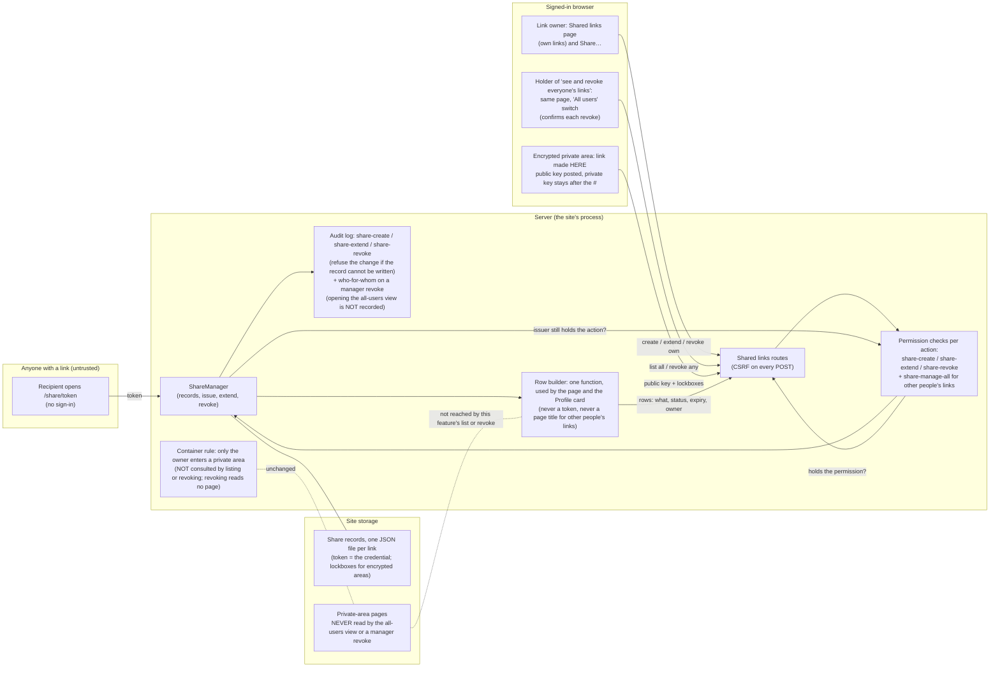

# Shared links: one area for page, chosen-page and whole-vault links

Design for [#2247](https://github.com/jwilleke/ngdpbase/issues/2247). It builds the requirements R1–R12 from the [draft on that issue](https://github.com/jwilleke/ngdpbase/issues/2247#issuecomment-6994410061) and Jim's six decisions (Q1–Q6, comments of 2026-11-19 and 2026-11-22) and his six answers A–F on Q4 (2026-11-22), all listed under [Decisions already made](#decisions-already-made), plus the [design input on the Q5 rename](https://github.com/jwilleke/ngdpbase/issues/2247#issuecomment-7077160895). Nothing here is built. Jim approves this design before any build. Every question this design asked has an answer, recorded in the section it belongs to.

Two follow-ups are out of scope and not designed here: [#2464](https://github.com/jwilleke/ngdpbase/issues/2464) (a link to one public page) and [#2465](https://github.com/jwilleke/ngdpbase/issues/2465) (extend and visit lists for tag links).

__Two requirements are proposed by this design, not yet confirmed.__ Jim's Q4 answer (see and revoke every user's links, including links into another user's private area) moved a thing from "out of scope" to "in scope" without a numbered requirement. R13 and R14 below write it down, with the answers A–F built in. They become requirements when Jim confirms them with this design.

| ID  | Requirement (proposed from Q4)                                                                                                                                                                                                                                                | Problem |
| --- | ----------------------------------------------------------------------------------------------------------------------------------------------------------------------------------------------------------------------------------------------------------------------------- | ------- |
| R13 | A user who holds the permission "see and revoke everyone's shared links" can switch the Shared links page to every user's links, tag links and private-area links alike, and revoke any of them. Each row says who made it. For another user's private-area link a row shows the area name, the number of pages, the expiry, the status and the owner, and no page title ([A](https://github.com/jwilleke/ngdpbase/issues/2247#issuecomment-7080121413)). Without that permission the switch does not exist. | P1      |
| R14 | Revoking another user's link is recorded in the audit log with who revoked it and whose link it was. Opening the all-users view is not recorded ([C](https://github.com/jwilleke/ngdpbase/issues/2247#issuecomment-7080212680)). The owner's list shows the revoked link as "Page not available (404)", with no administrator name and no "revoked by" wording ([D](https://github.com/jwilleke/ngdpbase/issues/2247#issuecomment-7080256567)). The row asks for confirmation first and names the owner.                                                           | (safety) |

## Prior work

Searched on 2026-11-22 at master `c34f43d`: `docs/` (guides, design, planning), `gh issue list` and `gh pr list` with `--state all` and the terms "shared links", "share links list", "vault links", "my links pinned" and "manage all share", `gh search issues` across the `jwilleke` owner, and `git grep` for "shared links" in `docs/` and `src/`.

| Where                                                                                                                                                                                                                                                              | What it gives us                                                                                                                                                                                | Covers                                                                                                                                       |
| ------------------------------------------------------------------------------------------------------------------------------------------------------------------------------------------------------------------------------------------------------------------- | ----------------------------------------------------------------------------------------------------------------------------------------------------------------------------------------------- | -------------------------------------------------------------------------------------------------------------------------------------------- |
| [#2247](https://github.com/jwilleke/ngdpbase/issues/2247)                                                                                                                                                                                                          | The request, the requirements draft and Jim's answers                                                                                                                                           | This design                                                                                                                                  |
| [#2245](https://github.com/jwilleke/ngdpbase/issues/2245) (closed), [#2253](https://github.com/jwilleke/ngdpbase/pull/2253) (merged)                                                                                                                              | The private pages list at `/my/vaults` and its "Links you've shared" button                                                                                                                     | The button R6 repoints. No design for a combined list                                                                                        |
| [#1388](https://github.com/jwilleke/ngdpbase/issues/1388) work: `src/managers/ShareManager.ts` (`issueVaultShare`, `extend`, `revoke`, `list`), `src/types/Share.ts`                                                                                                | One store for both kinds of link. A record keeps its kind (`keyword` or `vault`), so one list is a view change, not a new store                                                                 | The records this design reads. It adds one optional flag to a revoked record, for the owner's list ([D](https://github.com/jwilleke/ngdpbase/issues/2247#issuecomment-7080256567))                                                                           |
| [#842](https://github.com/jwilleke/ngdpbase/issues/842), [#854](https://github.com/jwilleke/ngdpbase/issues/854) (tag links), `views/shares.ejs`                                                                                                                  | The tag-link list, its create form and the media tag page's Share button                                                                                                                        | The second list R1 merges in                                                                                                                 |
| The vault rules: `docs/guides/security-developer-guide.md` ("a vault is a container only its owner enters"), `src/utils/privateStoreAccess.ts`, setting `ngdpbase.vaults.admin-access` ([#2255](https://github.com/jwilleke/ngdpbase/issues/2255)) | The container rule, and the one door an administrator may use to enter an unencrypted vault, recorded as `vault-admin-access`                                                                   | The rule Q4's permission must not break (see [Security](#security-the-everyones-links-permission))                                          |
| `docs/design/required-pages-sync-states.md`                                                                                                                                                                                                                        | The six states of a shipped page and which of them Sync replaces on its own                                                                                                                     | How upgraded sites get the new help pages (see [Upgrading an existing site](#upgrading-an-existing-site))                                    |
| [#1540](https://github.com/jwilleke/ngdpbase/issues/1540)                                                                                                                                                                                                          | Open request to delegate a whole private area to another user                                                                                                                                   | Different capability: it gives a user the owner's permissions. Q4's permission gives no page access at all. Not touched here                 |
| [#2464](https://github.com/jwilleke/ngdpbase/issues/2464), [#2465](https://github.com/jwilleke/ngdpbase/issues/2465)                                                                                                                                              | The two follow-ups Jim's Q2 and Q6 answers created                                                                                                                                              | Out of scope. This design leaves room (a row shows only the actions its kind has) and designs nothing                                        |

Not found anywhere: a combined list of link kinds, a permission to manage other users' links, or a design for either. __No requirement already exists, so the design goes ahead.__

## What exists today

- `ShareManager` stores one JSON record per link. A record's scope is `keyword` (everything with a tag) or `vault` (chosen pages by uuid, or `pages: null` for the whole vault). A link is a capability token resolved live at `/share/:token`, and it stops working at once when its issuer no longer holds the action it delegates.
- Tag links live at `/shares` (`sharesList`, `sharesCreate`, `sharesRevoke`). The list hides private-area links even from an administrator, who otherwise sees every user's tag links. Revoking someone else's tag link needs `admin-system` on top of `share-revoke`.
- Private-area links live at `/my/vaults/links`, owner only: create, extend (up to 24 hours at a time), revoke and a visit list. `ShareManager.extend` refuses anyone but the creator. The `revoke` method itself checks nobody; the routes do.
- The Profile page's "Share Links" card counts every link the user made, private-area links included, then opens `/shares`, which hides them. That is the mismatch behind P2.
- "My Links" is the user's pinned pages. The sidebar heading is code (`views/header.ejs`, `MyLinksPlugin`), not a required page. The required page `36c9c6ed-…` titled "My Links" is the help page for the feature.
- The media tag page's Share button posts straight to the tag-link create route: one click, a link made.
- Permission checks differ by kind: `share-create` for a tag link; `profile-manage` to open the private-area page plus `share-create` inside the vault to issue. An encrypted vault's link is made in the owner's browser: the browser sends a public key, keeps the private key after the `#`, and builds the lockboxes itself, so the server never holds a key for it.

## Guides this design follows

- `docs/guides/security-developer-guide.md`: a vault is a container only its owner enters; permissions and policies are configuration; a door records and an affordance does not; the "How you know you are done" lint checks.
- `docs/guides/audit-developer-guide.md`: an audit event is declared once in the catalog; `share-create`, `share-extend` and `share-revoke` refuse the change when the record cannot be written.
- `AGENTS.md`: pull requests only; a failing test first; no "wiki" in text a person reads; guides and docs change in the same pull request as the code; full URLs for issues and pull requests.
- Jim's standing rules for this work: "permission check", never roles; plain words in the screens, no issue numbers or file paths.

## Decisions already made

| Q   | Jim's answer (date)                                                                                                                                       | Where the design meets it                                               |
| --- | --------------------------------------------------------------------------------------------------------------------------------------------------------- | ----------------------------------------------------------------------- |
| Q1  | One list for tag links and private-area links (2026-11-19)                                                                                                | R1, R2: [The page](#the-page-r1-r2-r3-r12)                              |
| Q2  | Tags only on a public page: Share… offers that page's tags, or nothing if it has none (2026-11-22)                                                       | R4: frame 6, [Share… by kind](#share-by-kind)                           |
| Q3  | The page shows to anyone who may make either kind, and offers only the kinds they may make (2026-11-22)                                                   | R9: [Permission checks](#permission-checks)                             |
| Q4  | The link management page can see and revoke any user's link, including links to another user's private-area pages; a permission check gates it (2026-11-22) | R13, R14, and answers A–F below: [Security](#security-the-everyones-links-permission) |
| Q5  | "Pinned pages" replaces "My Links" everywhere a person sees it (2026-11-22)                                                                               | R8: [The rename](#the-rename-r8)                                        |
| Q6  | Tag links get no extend or visit list in this change (2026-11-22)                                                                                         | R3: a row shows only the actions its kind has                           |

Jim's six answers on how Q4 works (all 2026-11-22, by Slack button; the ones marked recommended took my recommended option):

| Answer | What Jim decided | Where the design meets it |
| ------ | ---------------- | ------------------------- |
| [A](https://github.com/jwilleke/ngdpbase/issues/2247#issuecomment-7080121413) | For someone else's private-area link, a manager sees the area name, the number of pages, the expiry, the status and the owner. No page titles | [The page](#the-page-r1-r2-r3-r12), [Security](#security-the-everyones-links-permission) |
| [B](https://github.com/jwilleke/ngdpbase/issues/2247#issuecomment-7080185251) | Administrators may revoke other people's share links, through a new access rule (permission) the site can change (recommended) | [The new permission](#the-new-permission) |
| [C](https://github.com/jwilleke/ngdpbase/issues/2247#issuecomment-7080212680) | Opening the all-users view is not recorded; only revokes are. An administrator can look at everyone's share links without leaving a trace | [Security](#security-the-everyones-links-permission) |
| [D](https://github.com/jwilleke/ngdpbase/issues/2247#issuecomment-7080256567) | When an administrator revokes an owner's link, the owner's list shows it as "Page not available (404)". No administrator name, no "revoked by" wording | [The page](#the-page-r1-r2-r3-r12), frames 1, 4 and 5 |
| [E](https://github.com/jwilleke/ngdpbase/issues/2247#issuecomment-7080267477) | Share links of a kind the person may no longer make are hidden from that person's Shared links page. They already stop working, and an administrator can revoke them (recommended) | [Permission checks](#permission-checks) |
| [F](https://github.com/jwilleke/ngdpbase/issues/2247#issuecomment-7080272999) | With "admins can enter private areas" off, administrators can still revoke links to private-area pages, because revoking does not show them the page (recommended) | [Security](#security-the-everyones-links-permission) |

## Data flow



Where the lines are:

- __Credentials:__ the link's token lives only in its record and in the link itself. No list, row, audit record or log line holds it. The management id (`id`) is the handle in every URL and form. For an encrypted private area the private key is made and kept in the owner's browser, after the `#`, and the server only stores lockboxes.
- __What the manager of everyone's links cannot reach:__ page text, page titles inside another user's private area, any token, any key, and the ability to make or extend a link for someone else. The new permission lets them see that a link exists and stop it. It never opens a private area.
- __Where a person approves:__ the owner makes, extends and revokes their own links as today. A manager revoking someone else's link confirms on the row, which names the owner (R14). Jim approves this design and the new permission entry before they are built (he chose the permission in answer B). There is no new audit event: a revoke reuses `share-revoke`, and opening the all-users view is not recorded (answer C).
- __Where it can still fail closed:__ if the audit record for a revoke cannot be written, the link stays live and the person sees "Nothing changed".

## Design

### Overview

One page, `/my/shares`, titled __Shared links__. It lists the signed-in user's own links of both kinds (R1), and for a holder of the new permission it has an __All users__ switch (R13). The Share… action on it asks what to share (R4). The five other entry points open it with the page or tag already chosen (R6). The old addresses redirect to it (R7). The Profile card counts with the same function the page lists with, so the two agree (R5). Nothing in what a link exposes, how long it lasts or how it is recorded changes (R10).

Why `/my/shares` and not `/shares`: `/my/*` is already where a signed-in user's own pages live (`profile-manage`), the address is unused, and the old `/shares` becomes a redirect with no ambiguity about what it was.

### The page (R1, R2, R3, R12)

__The records.__ The page builds a row for each record, in memory, with one function used by the page and the Profile card. Apart from the one flag described below, no stored record changes:

```text
SharedLinkRow {
  id            the management id
  kind          'tag' | 'chosen-pages' | 'whole-area'
  what          "Everything tagged X"
                | "N pages in your X vault"   (own view)  /  "N pages in Sam's X vault" (all view)
                | "All of your X vault"       (own view)  /  "All of Sam's X vault"     (all view)
  status        'active' | 'expired' | 'revoked' | 'page not available'
                (own view only: shown as "Page not available (404)" for a link an administrator revoked)
  expiresAt     ISO date or null ("Until cancelled")
  madeBy        the creator (shown only in the all view)
  actions       tag: [revoke];  chosen-pages / whole-area: [extend, visits, revoke]
}
```

`what` for chosen pages counts the page uuids in the record. It reads no page, so it names no title. In the all view the area name and the owner are shown for another user's private-area link, and nothing else about it ([answer A](https://github.com/jwilleke/ngdpbase/issues/2247#issuecomment-7080121413)).

__What the owner sees after an administrator revokes a link.__ The owner's own list shows that row's status as "Page not available (404)" ([answer D](https://github.com/jwilleke/ngdpbase/issues/2247#issuecomment-7080256567)). There is no administrator name, no "revoked by" wording and no email. A link the owner revoked shows "Revoked", as today. To tell the two apart the row builder needs one fact the record does not hold today, so the revoke sets one optional flag on the record, `revokedByManager: true`, and never the administrator's name. This is the only stored-record change in this design; it is read only by the row builder, and the audit record already has the same fact (`byManager`). In the all-users view both cases show "Revoked". `actions` come from the kind, so a later follow-up (#2465) adds actions to a kind without touching the page.

__Which links are listed.__ The user's own links of the kinds they may make (Q3, R9). Links of a kind the user may no longer make are hidden from them ([answer E](https://github.com/jwilleke/ngdpbase/issues/2247#issuecomment-7080267477)). For a holder of the new permission with the switch on, every record, hidden ones included. Newest first, as the manager sorts them today. There is no paging, filter or search: the lists today have none and no requirement asks for one (see [Not drawn](#not-drawn)).

__The Profile card (R5).__ Its numbers are `rows.filter(active).length` and `rows.length` from the same function, on the same input as the page's own view. The page's default view is the user's own, so the card and the page cannot disagree. A test pins this.

### Share… by kind

One action, one question: "What do you want to share?" It offers only the kinds the user may make (Q3). The choice then shows only that kind's settings, which are the ones each kind has today, unchanged (R10):

| Choice shown                        | Offered when (permission check)                                                           | Settings                                                  | Made by                                                                           |
| ----------------------------------- | ----------------------------------------------------------------------------------------- | --------------------------------------------------------- | --------------------------------------------------------------------------------- |
| This page                           | The page is in the user's private area, and the private-area check below passes           | Label, days                                               | The existing private-area chosen-pages issue                                      |
| Chosen pages in a private area      | The private-area check below passes                                                       | Pick the area, tick pages, label, days                    | The same                                                                          |
| A whole private area                | The same                                                                                  | Pick the area, label, days                                | The existing whole-area issue                                                     |
| Everything with a tag               | `share-create`                                                                            | Tag, expiry (24 hours, 7 days, 30 days, until cancelled)  | The existing tag-link issue                                                       |

On a public page, "This page" is not offered (Q2). The tag choice is offered with that page's tags as the pick list, and with a plain sentence when the page has none: "This page has no tags, so there is nothing to share it by." A link to one public page is #2464.

An encrypted private area keeps its flow: the browser makes the key pair and lockboxes (`vault-link-create.js`), then posts them. Only the address it posts to changes.

### Entry points (R6, R7)

Each existing entry opens `/my/shares` with the choice made, using query values the page reads and ignores if they do not apply to the user:

| Entry today                                              | Opens                                                          |
| -------------------------------------------------------- | -------------------------------------------------------------- |
| Page menu "Share this page…" (private pages)             | `/my/shares?share=page&page=<page name>`                       |
| Page menu "Share 'tag'…" (up to 6)                     | `/my/shares?share=tag&tag=<tag>`                               |
| Private pages list button "Links you've shared"          | `/my/shares`                                                   |
| Media tag page Share button                              | `/my/shares?share=tag&tag=<tag>`                               |
| Admin dashboard "Manage Share Links" card                | `/my/shares?view=all` (a user without the permission gets own) |
| Profile card                                             | `/my/shares`                                                   |

The media tag page's button today makes a link in one click. After this it opens the form with the tag chosen and asks for an expiry, as every other entry does. That is a small loss of speed and it is what R6 asks for.

Old addresses (R7): `GET /shares?keyword=X` redirects (302) to `/my/shares?share=tag&tag=X`; `GET /my/vaults/links?page=P` to `/my/shares?share=page&page=P`; the same for a bare `?vault=`. The old `POST` routes (`/shares/create`, `/shares/:id/revoke`, `/my/vaults/links` and its `extend` and `revoke`) answer 307 to the new routes, so a form left open in a browser tab still works, and every permission check runs again at the new route.

### Permission checks

All checks use `hasPermission` for what a person is shown and the same permission check at the route for what they are allowed to do, as today. Nothing below changes who may make a link, what it exposes, or its limit in days (R10).

| Action                                   | Check at the route                                                                                          | Check in the manager                                  |
| ---------------------------------------- | ----------------------------------------------------------------------------------------------------------- | ----------------------------------------------------- |
| Open the page                            | `share-create` (tag) or `profile-manage` plus `share-create` in a private area (private-area kind), at least one | none                                                  |
| Make a tag link                          | `share-create`                                                                                              | as today                                              |
| Make a private-area link                 | `profile-manage`, then `share-create` inside that area (`permitsInVault`), owner's own area only            | as today, including the ceiling on days               |
| Extend a link                            | `share-extend`, and the user made the link                                                                  | `extend` still refuses anyone but the creator         |
| Revoke your own link                     | `share-revoke`, and the user made the link                                                                  | `revoke(id, actor)`                                   |
| See every user's links                   | `share-manage-all`                                                                                          | `list()` with no owner, as the admin list does today  |
| Revoke another user's link               | `share-revoke` and `share-manage-all`. Not governed by the "admins can enter private areas" setting ([F](https://github.com/jwilleke/ngdpbase/issues/2247#issuecomment-7080272999))   | `revoke(id, actor)` with `actor.asManager`            |
| Extend, or make, a link for someone else | nobody                                                                                                      | refused, unchanged                                    |

`share-revoke`'s catalog description today ends "revoking anyone's also needs admin-system". It changes to "also needs share-manage-all". That is the same default result (the administrator policy grants both) and it stops tying a link action to the system-administration permission.

A user who has live links of a kind they may no longer make does not see them on their page (R9 as written, [answer E](https://github.com/jwilleke/ngdpbase/issues/2247#issuecomment-7080267477)). The links already stop working, because a link resolves only while its maker still holds the action. A holder of `share-manage-all` still sees them in the all-users view and can revoke them.

### The manager's revoke

`revoke(id, revokedBy: string)` becomes `revoke(id, actor: { username: string; asManager?: boolean })`. The audit actor stays the person who clicked. The audit metadata already carries `createdBy` and the scope; it gains `byManager: true` when the actor is not the creator, so a reader of the log never has to infer it. The record gets the optional flag `revokedByManager: true` for the owner's list ([answer D](https://github.com/jwilleke/ngdpbase/issues/2247#issuecomment-7080256567)); no name is stored in it. The event is still `share-revoke`, with on-failure `refuse`. No new audit event is added, and opening the all-users view is not recorded ([answer C](https://github.com/jwilleke/ngdpbase/issues/2247#issuecomment-7080212680)).

A manager's revoke does not depend on the "admins can enter private areas" setting. With the setting off, a holder of the permission can still revoke a link to a private-area page, because revoking shows no page ([answer F](https://github.com/jwilleke/ngdpbase/issues/2247#issuecomment-7080272999)).

On a manager's revoke of an encrypted-area link, the manager needs no key: the server drops the lockboxes it holds (`dropLockboxes`), as it does for the owner's own revoke. The link is dead; the pages stay sealed.

A non-owner, non-manager who asks to revoke a private-area link by id gets 404, not 403, so the id does not confirm that the link exists. (Today's tag-link route answers 403; it keeps that, since a tag link is not a private-area secret.)

### The new permission

`share-manage-all`, label "See and revoke everyone's shared links". It ships as a new catalog entry and in __a new policy id__ for the administrator role, never as an edit to `admin-full-access`: policies merge by `id`, so a site holding a stored copy of `admin-full-access` would never see an edit, while a new id is added. The catalog entry carries no `step-up` flag (revoking is reversible by making a new link) and no new audit event for the revoke, which reuses `share-revoke`.

Jim chose this route in [answer B](https://github.com/jwilleke/ngdpbase/issues/2247#issuecomment-7080185251): administrators may revoke other people's links through a new access rule the site can change. The catalog entry and the policy still go through his review of the pull request (the security guide's "Permissions and policies are configuration" rule). No new audit event is needed ([answer C](https://github.com/jwilleke/ngdpbase/issues/2247#issuecomment-7080212680)).

### The rename (R8)

"My Links" becomes "Pinned pages" everywhere a person sees it:

- Profile card and My Contributions card.
- The list page's title and its empty message.
- The sidebar heading and the remove-link tooltip (`MyLinksPlugin`, `header.ejs`).
- The page menu's "Add to My Links" and "Remove from My Links" (four places in `header.ejs`), and the messages in `public/js/my-links.js`.

Internal names do not change: the route `/my/links`, the plugin name and the stored data keep their names, so nothing is migrated. The route stays because bookmarks work. No link text on the sharing pages uses the old name.

### Upgrading an existing site

The sidebar heading, the menu entries, the cards and the page title are code and templates. A site gets them by upgrading, with nothing to sync. That includes the Verified-when check Jim asked for: on a site upgraded from v5.46.0, the sidebar shows "Pinned pages" and no longer shows "My Links".

Three required pages are help text, and they go through Required Pages Sync:

| Page (uuid prefix)                       | Change                                                                                                    | A site that never edited it                       | A site that edited it                                                                                |
| ---------------------------------------- | --------------------------------------------------------------------------------------------------------- | ------------------------------------------------- | ---------------------------------------------------------------------------------------------------- |
| "My Links" (`36c9c6ed-…`)                | Retitled "Pinned pages"; body says "Pinned pages"; slug stays `my-links`                                  | Update ready, then replaced by Sync All           | Edited here, not confirmed: an admin reads the review and picks *Use shipped version* or keeps theirs |
| "Share Links" (`d428a9ed-…`)             | Retitled "Shared links"; describes the one page, its three kinds and the Share… action; slug unchanged     | The same                                          | The same                                                                                             |
| "Your Consents" (`06c1cba1-…`)           | The line that mentions the Share Links page names Shared links                                            | The same                                          | The same                                                                                             |

The slug stays because `slug` is a front-matter key that changes behaviour in the sync rules (`WORKING_FRONTMATTER_KEYS`): changing it could take an unedited site's copy out of auto-sync and into admin review, and it would break the help icon's link. A page title is a wording key, so retitling alone does not do that. Slice 1 confirms with a test on an upgraded fixture that the synced copy carries the new title; if it does not, that is reported before the slice ships.

Until an admin reviews an edited copy, that site's help page says "My Links" while the screens say "Pinned pages". The sync page already shows that state; the release notes mention it.

### Docs changed in the same pull requests

`docs/sharing.md` (the "Managed at" row says vault links are owner-only; it becomes "owner extends and revokes; a holder of the everyone's-links permission also revokes"), `docs/private-stores.md`, `docs/managers/ShareManager.md` (the `revoke` signature and the row function), `docs/guides/security-developer-guide.md` (the vault-owner rule gains the sentence that a revoke is not entry, and the new permission is listed), the plugin docs for the rename, and the three required pages above (R11). The comment on `VaultShareScope.owner` ("the only one who may issue, extend or revoke it") changes to match.

## Wireframes

Low fidelity: boxes and plain copy, no styling. The tag in brackets after an element is the requirement it serves. Nothing is drawn that no requirement asks for.

### Frame 1: Shared links, your own links [R1, R2, R3, R5]

```text
+----------------------------------------------------------------------------+
| Shared links                                          [ Share… ]  primary  |  R4
|                                                      [ All users ]         |  R13 (only if the permission is held)
+----------------------------------------------------------------------------+
| What                           Status   Expires        Actions             |  R2
|----------------------------------------------------------------------------|
| Everything tagged Garden       Active   Until cancelled  [ Revoke ]        |  R2, R3 (tag: revoke only)
| 3 pages in your Journal vault  Active   26 Nov           [ Extend ]        |  R2, R3
|                                                          [ Visits ]        |
|                                                          [ Revoke ]        |
| All of your Family vault       Expired  20 Nov           (none)            |  R2
| Everything tagged Trip         Revoked  --               (none)            |  R2
+----------------------------------------------------------------------------+
```

The Profile card's "N active of M" is these rows' count (frame 9).

If an administrator revoked a link, its status reads "Page not available (404)" in place of "Revoked", with no administrator name and no "revoked by" wording ([D](https://github.com/jwilleke/ngdpbase/issues/2247#issuecomment-7080256567)). Links of a kind the person may no longer make are not listed ([E](https://github.com/jwilleke/ngdpbase/issues/2247#issuecomment-7080267477)).

### Frame 2: empty [R12]

```text
+----------------------------------------------------------------------------+
| Shared links                                          [ Share… ]  primary  |  R4
+----------------------------------------------------------------------------+
| You haven't shared anything yet.                                           |  R12
| A shared link lets someone read pages without signing in.                  |  R12
|                                [ Share… ]                                 |  R12
+----------------------------------------------------------------------------+
```

### Frame 3: long list [R1]

```text
+----------------------------------------------------------------------------+
| Shared links                                          [ Share… ]           |
| What ... | Status ... | Expires ... | Actions ...      row 1 (newest)      |
| ... every link, one row each, newest first ...                             |
| What ... | Status ... | Expires ... | Actions ...      row 60 (oldest)     |
+----------------------------------------------------------------------------+
```

The same table at any length. No paging, search or filter is drawn, because no requirement asks for one.

### Frame 4: All users view [R13, R14, R2]

```text
+----------------------------------------------------------------------------+
| Shared links: all users                       [ Share… ]  [ My links ]     |  R13
| You are seeing every user's links.                                         |  R13
+----------------------------------------------------------------------------+
| Made by  What                           Status   Expires    Actions        |  R2, R13
|----------------------------------------------------------------------------|
| sam      Everything tagged Garden       Active   Until...  [ Revoke ]      |  R13
| sam      3 pages in Sam's Journal vault Active   26 Nov     [ Revoke ]      |  R13 (no extend,
| you      All of your Family vault       Active   30 Nov     [ Extend ]     |        no visits, no
|                                                             [ Visits ]     |        titles for
|                                                             [ Revoke ]     |        other people's)
| lee      Everything tagged Trip         Revoked  --         (none)         |  R2
| lee      All of Lee's Medical vault     Revoked  --         (none)         |  R14
+----------------------------------------------------------------------------+
```

The all view shows another user's private-area link by area name, page count, expiry, status and owner, and nothing else ([A](https://github.com/jwilleke/ngdpbase/issues/2247#issuecomment-7080121413)). Opening this view is not recorded in the audit log ([C](https://github.com/jwilleke/ngdpbase/issues/2247#issuecomment-7080212680)). A revoked link reads "Revoked" here whoever revoked it.

### Frame 5: confirm a revoke of someone else's link [R14]

```text
+------------------------------------------------+
| Stop Sam's link?                               |  R14
| "3 pages in Sam's Journal vault" stops working |  R14
| for everyone who has it. Sam's list will show  |  R14
| it as "Page not available (404)".              |  R14
|           [ Cancel ]   [ Stop link ] primary   |  R14
+------------------------------------------------+
```

Revoking your own link keeps today's behaviour and does not use this frame. The confirm names the owner and says what the owner will see ([D](https://github.com/jwilleke/ngdpbase/issues/2247#issuecomment-7080256567)); it does not put the administrator's name anywhere the owner can read it.

### Frame 6: Share…, step 1 [R4, R9, Q2, Q3]

```text
+----------------------------------------------------+
| What do you want to share?                         |  R4
| ( ) This page                  (only a private page)|  R4, Q2
| ( ) Chosen pages in a private area                 |  R4
| ( ) A whole private area                           |  R4
| ( ) Everything with a tag                          |  R4
|                         [ Cancel ]  [ Next ] primary|  R4
+----------------------------------------------------+
```

Only the kinds the user may make are drawn (R9, Q3): a user who may make tag links only sees one choice. On a public page "This page" is absent. A page with no tags shows, under "Everything with a tag", "This page has no tags, so there is nothing to share it by." (Q2).

### Frame 7: Share…, step 2, by kind [R4, R10]

```text
 Everything with a tag            This page / Chosen pages        A whole private area
+--------------------------+    +--------------------------+    +--------------------------+
| Tag:      [ Garden   v ] |    | Private area: [ Journal v]|   | Private area: [ Family v]|
| Expires:  [ 7 days   v ] |    | Pages:  [x] Trip notes    |   | Label:   [ ____________ ]|
|                          |    |         [ ] Dentist       |   | Days:    [ 7 ]           |
|                          |    | Label:  [ ____________ ]  |   |                          |
|                          |    | Days:   [ 7 ]             |   |                          |
| [ Back ] [ Make link ]   |    | [ Back ] [ Make link ]    |   | [ Back ] [ Make link ]   |
+--------------------------+    +--------------------------+    +--------------------------+
```

Each kind shows only the settings it has today (R4, R10). The number of days is limited to the owner's limit, as today.

### Frame 8: errors [R4, R10, R3]

```text
+----------------------------------------------------------------------------+
| That tag does not exist.                                       (tag)       |  R4
| Choose a number of days between 1 and <your limit>.            (private)   |  R10
| You can't share pages in this area.                            (permission)|  R9
| That link could not be stopped because the record could not    (revoke)    |  R3
| be written. Nothing changed. Try again.                                    |
+----------------------------------------------------------------------------+
```

The messages are today's, moved onto the new page. The last one is the existing refusal when the audit record cannot be written.

### Frame 9: the Profile card [R5, R8]

```text
+-------------------------------------+     +-------------------------------+
| Shared links                        |     | Pinned pages                  |  R8
| 2 active of 4          [ Open ]     |     | 5 pinned           [ Open ]   |  R8
+-------------------------------------+     +-------------------------------+
```

Both counts come from the same function as the page (R5). In "Your consents", the line becomes "Shared links: 2 active  Manage" and opens the page.

### Frame 10: other entry points [R6, R8]

```text
Page menu (private page)            Page menu (public page, tags Garden, Trip)
+---------------------------+       +---------------------------------------+
| Share this page…          | R6    | Share 'Garden'…                       | R6
| Add to Pinned pages       | R8    | Share 'Trip'…                         | R6
+---------------------------+       | Remove from Pinned pages              | R8
                                    +---------------------------------------+
Private pages list                  Media tag page          Admin dashboard
+------------------------+          +----------------+      +---------------------------+
| [ Links you've shared ]| R6       | [ Share ]      | R6   | Shared links              | R6
+------------------------+          +----------------+      | [ Manage shared links ]   |
Sidebar                                                    +---------------------------+
+------------------+
| PINNED PAGES     | R8
| Garden plan      |
+------------------+
```

Each of the five shared-links entries opens frame 1, with the choice made where it is known.

### Not drawn

Paging, search, a filter bar, a "Past links" fold, an email to the owner, and a one-click "revoke all of a user's links" button. No requirement asks for them. If Jim wants one, it is a new requirement first.

## Security: the everyone's-links permission

`share-manage-all` ("See and revoke everyone's shared links") is the part of this change that touches other people's private areas. It gets its own treatment.

__What it allows.__

- See, for every link: who made it, what it covers in words (kind, area name, count of chosen pages), status and expiry. Nothing else about a private-area link, and no page titles ([answer A](https://github.com/jwilleke/ngdpbase/issues/2247#issuecomment-7080121413)).
- Revoke any link (R13, [answer B](https://github.com/jwilleke/ngdpbase/issues/2247#issuecomment-7080185251)). On an encrypted area's link that drops the server's lockboxes.

__What it does not allow.__

- Read a page, a page title, a history entry, or anything inside any private area. Listing and revoking read no page, so the container rule is untouched. The permission does not need the `vault-admin-access` door and is not governed by it: with "admins can enter private areas" off, an administrator can still revoke a link to a private-area page, because revoking shows no page ([answer F](https://github.com/jwilleke/ngdpbase/issues/2247#issuecomment-7080272999)).
- See a token, a link address, a key or a visit list of another user's link. The row builder has no field for them, and a test renders the all-users page and searches the HTML for every token in the store.
- Make or extend a link for someone else. `issue` and `extend` stay creator-only.

__Who holds it.__ The administrator role, through a new policy id, and nobody else by default. A site can remove it by editing that policy; an operator can grant it to another role the same way. Whether a user holds it is a permission check, never a role name in code ([answer B](https://github.com/jwilleke/ngdpbase/issues/2247#issuecomment-7080185251)).

__What is audited.__

- Every revoke, as `share-revoke`: the person who clicked is the actor; `createdBy`, the scope and `byManager: true` are in the metadata. It refuses the revoke if the record cannot be written, as today.
- Opening the all-users view is __not__ recorded ([answer C](https://github.com/jwilleke/ngdpbase/issues/2247#issuecomment-7080212680)). Only revokes are. Said plainly: an administrator who holds this permission can look at everyone's share links, including the area names and owners of private-area links, without leaving a trace. The view shows no page title, token or link address, so what can be seen is limited, but the looking itself is invisible. This is Jim's decision, and it can be reversed later by adding an audit event and a refuse-on-failure rule.
- Nothing audited ever holds a token.

__What can go wrong, and what stops it.__

| Risk                                                                                                                                | Stopped or limited by                                                                                                                                                              |
| ----------------------------------------------------------------------------------------------------------------------------------- | ---------------------------------------------------------------------------------------------------------------------------------------------------------------------------------- |
| An administrator learns the name of someone's private area ("Medical") and that it is shared                                      | The row shows the area name and a count, not titles ([answer A](https://github.com/jwilleke/ngdpbase/issues/2247#issuecomment-7080121413)). The area name is still visible to the holder, and Jim chose that                                                          |
| An administrator stops a link out of spite or by mistake                                                                           | The confirm names the owner (R14); the audit record names the administrator; the owner's list shows the link as "Page not available (404)" with no administrator name ([answer D](https://github.com/jwilleke/ngdpbase/issues/2247#issuecomment-7080256567)), so the owner learns the link stopped but not who stopped it                  |
| Someone guesses a link id and revokes it                                                                                            | The route needs `share-revoke`, and for another user's link `share-manage-all`; without both a private-area id answers 404; CSRF is checked on every POST                         |
| A stale form or old bookmark skips the new checks                                                                                  | Old `POST` routes answer 307 to the new ones, and every check runs at the new route                                                                                               |
| The permission quietly widens into entering a private area                                                                         | A test lists the manager's code path against the container check: revoke and list never call the vault read functions; a test with `vault-admin-access` off still passes the revoke |
| An administrator looks at everyone's links and nobody can tell                                                                    | Accepted by Jim ([answer C](https://github.com/jwilleke/ngdpbase/issues/2247#issuecomment-7080212680)). The view shows no title, token or address; only revokes are recorded. Reversible later with an audit event                               |
| A site's stored copy of the administrator policy hides the new grant                                                                | The grant is in a new policy id, which the merge adds                                                                                                                              |
| A holder revokes a link and the recipient still has the page open                                                                  | A link is resolved live at every request, so the next request is refused. A page already loaded stays on screen, as for the owner's own revoke today                              |
| The log or a message leaks a token                                                                                                  | The row builder and the audit metadata have no token field; a test checks that no token reaches the log or the audit record on this path                                                          |

A security review of this design happens before build, as Jim's Q4 answer says. The pull request for slice 4 also gets the usual review before it is marked ready.

## Requirement map

| Req | Where it is met                                                                                                                                       |
| --- | ----------------------------------------------------------------------------------------------------------------------------------------------------- |
| R1  | `/my/shares` lists both kinds in one table ([The page](#the-page-r1-r2-r3-r12), frame 1). Test: a user with one of each sees three rows             |
| R2  | `SharedLinkRow.what`, `status`, `expiresAt` and `madeBy`; frames 1 and 4                                                                              |
| R3  | `SharedLinkRow.actions` by kind; revoke stops the link at once (resolved live); frames 1, 4, 8                                                       |
| R4  | One Share… action, frames 6 and 7; settings by kind ([Share… by kind](#share-by-kind)); Q2 for public pages                                          |
| R5  | One row function for the page and the Profile card; frame 9; test pins equal counts                                                                  |
| R6  | [Entry points](#entry-points-r6-r7) table; frame 10                                                                                                  |
| R7  | 302 for old `GET`s with the query kept, 307 for old `POST`s                                                                                         |
| R8  | [The rename](#the-rename-r8); frames 9 and 10; the help page retitled through Required Pages Sync                                                    |
| R9  | Page opens for either kind's permission; Share… offers only kinds allowed; [Permission checks](#permission-checks); Q3                               |
| R10 | No limit, exposure, audit event or encrypted-area flow changes, and the stored record gains only the optional `revokedByManager` flag (answer D); existing `shareCeiling`, `ShareManager` and `shareDoors` tests stay unchanged and green |
| R11 | Three required pages and the docs listed under [Docs changed](#docs-changed-in-the-same-pull-requests), each in the pull request that changes its screen |
| R12 | Frame 2                                                                                                                                               |
| R13 | `share-manage-all` (answer B), the All users switch, frame 4 (answer A: area name and count, no titles), [Security](#security-the-everyones-links-permission) (proposed)                                    |
| R14 | `byManager` in the audit metadata (revokes only; opening the view is not recorded, answer C), frames 4 and 5, "Page not available (404)" on the owner's row (answer D) (proposed)                                         |

## Tests

Each is written to fail first, in the same pull request as the change, and committed before it.

### Row function and page (slice 3)

- A user with one tag link, one chosen-pages link and one whole-area link sees three rows with the right `what` text (R1, R2).
- A user who has lost the permission to make one kind no longer sees their links of that kind, and those links no longer resolve (answer E).
- A link revoked by its owner shows "Revoked"; one revoked by a manager shows "Page not available (404)" and the row holds no administrator name and no "revoked by" wording (answer D).
- The Profile card's counts equal the page's rows for the same user, including with a revoked and an expired link (R5).
- A user with `share-create` only sees only the tag choice; a user with the private-area permission only sees only the private-area choices; a user with neither gets today's refusal (R9, Q3).
- A public page with tags offers its tags and no "This page"; one with no tags offers the sentence (Q2).
- An empty list shows the empty state and Share… (R12).
- `GET /shares?keyword=X`, `GET /my/vaults/links?page=P` and the three old `POST` families redirect as designed (R7).
- Rewrites of the tests that pin today's wording: `profileCardsView.test.ts` (the "Share Links" card), `WikiRoutes.myVaults.test.ts` (the button).

### The manager (slices 2 and 4)

- The catalog entry, the new policy id and the registry-drift test pass; the policy grants the permission to the administrator role and to nobody else.
- A holder revokes another user's tag link and private-area link; a non-holder gets 403 for the tag link and 404 for the private-area link; a user with `share-manage-all` but without `share-revoke` cannot revoke.
- The audit record of a manager revoke has the clicker as actor, `createdBy` of the owner and `byManager: true`; an own revoke has no `byManager`.
- If the audit write fails the link stays live and the person sees "Nothing changed" (existing behaviour, re-pinned on the new route).
- A manager revoke of an encrypted-area link works with no key and drops the lockboxes.
- The all-users page HTML contains no token from the store, no link address, and no page title from a private area (searched for by value). For another user's private-area link it shows the area name, page count, expiry, status and owner (answer A).
- Opening the all-users view writes no audit record; a manager revoke writes one (answer C).
- A holder of the permission sees, and can revoke, links of a kind their owner may no longer make (answer E).
- The manager's code path never calls a vault read; with `ngdpbase.vaults.admin-access` off, the all-users view and the revoke still work (pins answer F).
- The extend and issue routes still refuse anyone but the creator.

### The rename (slice 1)

- The sidebar, both menu entries, both cards and the list page render "Pinned pages", and no rendered page of these contains "My Links".
- A required-pages fixture from v5.46.0 shows the three help pages as Update ready (never edited) and Edited here, not confirmed (edited), and Sync All brings the new title.

### Checks the guides require before the pull request is ready

- The security and audit guides' "How you know you are done" checks; the registry-drift test; markdownlint on every changed Markdown file; the no-"wiki" check on every changed view.

## Slicing

Four pull requests, each under the usual review, each with its guides and required pages in the same pull request.

1. __Rename (R8).__ Wording in code and templates, the three required pages, the tests above. No behaviour change. Independent of the others. *Verified when:* on a site upgraded from v5.46.0 the sidebar shows "Pinned pages" and no longer shows "My Links"; an unedited help page shows Update ready.
2. __The manager and the permission (no screen).__ `revoke(id, actor)`, `byManager`, the `revokedByManager` flag, the catalog entry, the new policy id, the catalog description change, tests. Built to answers B (new permission), C (no new audit event) and F (works with the vault setting off). *Verified when:* the new policy is on a site upgraded from v5.46.0 and a unit-level revoke by a holder is recorded with `byManager` and sets `revokedByManager`.
3. __The Shared links page, own view (R1–R7, R9, R12).__ The row function (including "Page not available (404)" for a link a manager revoked, and hiding links of a kind the user may no longer make), `/my/shares`, the Share… flow, the redirects, the entry points, the Profile card. Needs slice 1 for the names. *Verified when:* a user with one link of each kind sees three rows, and the Profile card's counts equal them.
4. __All users (R13, R14).__ The switch, the all-users view (area name and count, no titles), the confirm, the security review of the pull request. Needs slices 2 and 3. *Verified when:* an administrator stops another user's private-area link, the owner's list shows it as "Page not available (404)", the audit log shows the administrator and the owner, and opening the all-users view adds no audit entry.

Slices 1 and 2 can be built at once. Slices 3 and 4 follow in order.

## Out of scope

- A link to one public page: [#2464](https://github.com/jwilleke/ngdpbase/issues/2464).
- Extend and visit lists for tag links: [#2465](https://github.com/jwilleke/ngdpbase/issues/2465).
- Delegating a whole private area to another user ([#1540](https://github.com/jwilleke/ngdpbase/issues/1540)), "Pages Shared With Me" and shared folders.
- Changing what a link shows its recipient, how long a link may last, or how an encrypted area's link is made.
- Paging, search or a filter on the list, and notifying an owner by email.
