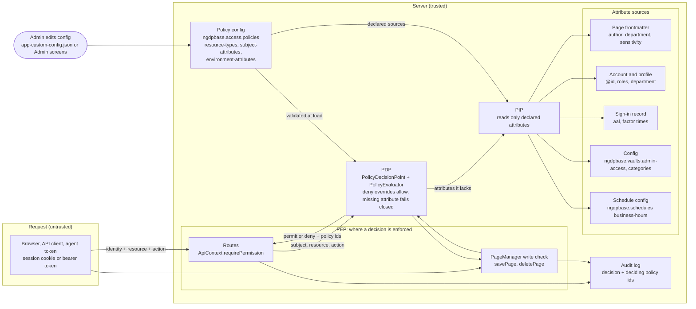

# Attribute-based access in config

Planning. When implemented, this moves into docs/guides/security-developer-guide.md, docs/guides/configuration-developer-guide.md and docs/access-policies.md, and this file is deleted in that PR ([#2261](https://github.com/jwilleke/ngdpbase/issues/2261)).

## Prior work

What exists today, read from the code. Links are pinned to master at [f15ae27e](https://github.com/jwilleke/ngdpbase/commit/f15ae27e385f117ba92ba54c91a01f852514b204).

| Part | Today | Where |
| --- | --- | --- |
| Resource types | `page` (by name), `system-category`, `vault` (by vault id), `shared-folder` (`shared/<name>`). Declared in config, matched by one matcher per type in code | [app-default-config.json:2800-2813](https://github.com/jwilleke/ngdpbase/blob/f15ae27e385f117ba92ba54c91a01f852514b204/config/app-default-config.json#L2800-L2813), [PolicyEvaluator.ts:46-72](https://github.com/jwilleke/ngdpbase/blob/f15ae27e385f117ba92ba54c91a01f852514b204/src/managers/PolicyEvaluator.ts#L46-L72) |
| Subject types | `role` and `job` only; the validator refuses any other | [PolicyEvaluator.ts:80-89](https://github.com/jwilleke/ngdpbase/blob/f15ae27e385f117ba92ba54c91a01f852514b204/src/managers/PolicyEvaluator.ts#L80-L89), [access-policies.md:52](https://github.com/jwilleke/ngdpbase/blob/f15ae27e385f117ba92ba54c91a01f852514b204/docs/access-policies.md#L52) |
| Combining | Policies sorted by `priority`, highest first. The first match decides, allow or deny. No match is deny | [PolicyDecisionPoint.ts:141](https://github.com/jwilleke/ngdpbase/blob/f15ae27e385f117ba92ba54c91a01f852514b204/src/security/PolicyDecisionPoint.ts#L141), [PolicyEvaluator.ts:221-230](https://github.com/jwilleke/ngdpbase/blob/f15ae27e385f117ba92ba54c91a01f852514b204/src/managers/PolicyEvaluator.ts#L221-L230), [access-policies.md:66-67](https://github.com/jwilleke/ngdpbase/blob/f15ae27e385f117ba92ba54c91a01f852514b204/docs/access-policies.md#L66-L67) |
| List and search | One compiled check per subject and action, same first-match rule | [PolicyEvaluator.ts:331-345](https://github.com/jwilleke/ngdpbase/blob/f15ae27e385f117ba92ba54c91a01f852514b204/src/managers/PolicyEvaluator.ts#L331-L345) |
| Decision record | One `policyName` and a `reason` string | [PolicyEvaluator.ts:226](https://github.com/jwilleke/ngdpbase/blob/f15ae27e385f117ba92ba54c91a01f852514b204/src/managers/PolicyEvaluator.ts#L226) |
| Rules outside policy | Vault container rule, author-lock, audience and `access.<action>` are tiers in code in the PIP, run before the policies | [PolicyInformationPoint.ts:763-842](https://github.com/jwilleke/ngdpbase/blob/f15ae27e385f117ba92ba54c91a01f852514b204/src/security/PolicyInformationPoint.ts#L763-L842) |
| Permissions | The catalogue, with `label`, `audit` and `step-up` | [app-default-config.json:1753](https://github.com/jwilleke/ngdpbase/blob/f15ae27e385f117ba92ba54c91a01f852514b204/config/app-default-config.json#L1753) |
| System categories | Label, storage location, vault settings; no access group yet | [app-default-config.json:1183](https://github.com/jwilleke/ngdpbase/blob/f15ae27e385f117ba92ba54c91a01f852514b204/config/app-default-config.json#L1183) |
| Sign-in strength | The session's sign-in record carries `aal`; roles have `required-aal` | [express.ts:36-37](https://github.com/jwilleke/ngdpbase/blob/f15ae27e385f117ba92ba54c91a01f852514b204/src/types/express.ts#L36-L37), [AuthManager.ts:9-11](https://github.com/jwilleke/ngdpbase/blob/f15ae27e385f117ba92ba54c91a01f852514b204/src/managers/AuthManager.ts#L9-L11) |
| Business hours | A named schedule in `ngdpbase.schedules`, read by the availability check, not by policies | [app-default-config.json:1585-1586](https://github.com/jwilleke/ngdpbase/blob/f15ae27e385f117ba92ba54c91a01f852514b204/config/app-default-config.json#L1585-L1586), [availability.ts:245](https://github.com/jwilleke/ngdpbase/blob/f15ae27e385f117ba92ba54c91a01f852514b204/src/utils/availability.ts#L245) |

Decided and not built:

- The XACML model with a PIP: the PEP sends identity, resource, action and environment; the PDP asks the PIP for what it lacks and returns permit or deny; the PEP enforces and audits a deny ([#2255 design](https://github.com/jwilleke/ngdpbase/issues/2255#issuecomment-6653131406)).
- Category groups from the same comment: each system category names a group (`pushed-pages`, `self-managed`, `general`, shared), and the group says which permission each action needs. This replaces the `access:` stamp.
- `ngdpbase.vaults.admin-access`, shipped `true`: an admin may enter a vault that is not encrypted, and every such access is audited ([#2255 amendment](https://github.com/jwilleke/ngdpbase/issues/2255#issuecomment-6653171635)).
- The [OPA/Cedar comparison](https://github.com/jwilleke/ngdpbase/issues/2255#issuecomment-6653866027) concluded: keep our own evaluator. Cedar in WASM measured 124 µs per decision against 0.04 µs in plain JS, about 0.6 s for one 5,000-candidate search. It recommended two ideas from Cedar: return the deciding policy ids, and let a deny override an allow.

No other design covers conditions on attributes. The older [policy-schema-documentation.md](../admin/policy-schema-documentation.md) lists types the evaluator never matched, and [access-policies.md](../access-policies.md#consolidation) already marks it for retirement.

## Data flow



The request supplies only who is asking (via the session or token), the resource it names and the action. Every attribute a condition reads comes from the server side, through the PIP. A request can't send `department` or `aal` and have it believed.

## The model

Policies in `ngdpbase.access.policies` gain a `condition` that compares declared attributes of the subject, the resource and the environment. The engine stays our own JSON evaluator. Everything in this section was decided by Jim on 2026-11-05; what is not decided is under [Open questions](#open-questions).

### Declared attributes

Every attribute a condition reads is declared in config, with a `type` and a `from` that names the PIP source. An attribute with no declared source can't be used: the validator refuses a policy that names it.

| Key | Declares | Example |
| --- | --- | --- |
| `ngdpbase.access.resource-types` (existing) | Each resource type's `attributes` | `owner`, `owning-department` |
| `ngdpbase.access.subject-attributes` (new) | Attributes of whoever asks | `id`, `aal`, `department-id` |
| `ngdpbase.access.environment-attributes` (new) | Attributes of the moment or the site | `is-business-hours`, `vaults-admin-access` |

Types: `string`, `integer`, `boolean`, `identity` (an @id), `list` (of strings).

Sources (`from`), as a prefix and a name:

| Source | Reads | Notes |
| --- | --- | --- |
| `frontmatter:<field>` | The page's frontmatter field | `frontmatter:author`, `frontmatter:department` |
| `account:<field>` | The signed-in account | `account:id` is the subject's @id |
| `profile:<field>` | The user's profile | `profile:department` does not exist yet |
| `sign-in` | The session's sign-in record | The `aal` it reached |
| `vault:<field>` | The vault a page or file is in | `vault:owner`, `vault:encrypted` |
| `config:<key>` | A config value | `config:ngdpbase.vaults.admin-access` |
| `schedule:<name>` | Whether now falls in a schedule in `ngdpbase.schedules` | `schedule:business-hours` |

The set of sources is code: each one is a reader in the PIP. Config chooses which attributes exist and where they come from, never how a source is read.

```json
"ngdpbase.access.resource-types": {
  "page": {
    "description": "A page, matched by its name (glob pattern)",
    "attributes": {
      "owner":             { "type": "identity", "from": "frontmatter:author" },
      "owning-department": { "type": "string",   "from": "frontmatter:department" },
      "sensitivity-level": { "type": "integer",  "from": "frontmatter:sensitivity" },
      "encrypted":         { "type": "boolean",  "from": "vault:encrypted" },
      "vault-owner":       { "type": "identity", "from": "vault:owner" }
    }
  }
},
"ngdpbase.access.subject-attributes": {
  "id":            { "type": "identity", "from": "account:id" },
  "aal":           { "type": "integer",  "from": "sign-in" },
  "department-id": { "type": "string",   "from": "profile:department" }
},
"ngdpbase.access.environment-attributes": {
  "is-business-hours":   { "type": "boolean", "from": "schedule:business-hours" },
  "vaults-admin-access": { "type": "boolean", "from": "config:ngdpbase.vaults.admin-access" }
}
```

### Owner and author

In policies a resource has an `owner` attribute. For a page, `owner` is its `author`, the @id of whoever created it. The page UI still says "author". A page moving into or out of a vault or shared folder keeps its author.

### Naming

All keys are lowercase and hyphenated, like the rest of the config. An attribute is named `<category>:<name>`, where the category is `subject`, `resource` or `environment`:

```json
{ "attribute": "subject:department-id", "equals": "resource:owning-department" }
```

No XACML-style keys (`AttributeId`, `DataType`, `Value`).

### Conditions

A policy may carry one `condition`. The validator enforces a fixed set of operators:

| Operator | Shape | True when |
| --- | --- | --- |
| `equals` | `{ "attribute": a, "equals": b }` | a equals b |
| `not-equals` | `{ "attribute": a, "not-equals": b }` | a differs from b |
| `in` | `{ "attribute": a, "in": [ … ] }` | a is one of the list |
| `greater-or-equal` | `{ "attribute": a, "greater-or-equal": n }` | a ≥ n (integers) |
| `less-or-equal` | `{ "attribute": a, "less-or-equal": n }` | a ≤ n (integers) |
| `any-of` | `{ "any-of": [ condition, … ] }` | at least one is true |
| `all-of` | `{ "all-of": [ condition, … ] }` | every one is true |
| `not` | `{ "not": condition }` | the condition is false |

The right-hand side is an attribute when it is a string starting with `subject:`, `resource:` or `environment:`, and a literal otherwise. Both sides must have the same declared type; the validator refuses a mismatch. No free-form expressions, no functions, no regular expressions.

### A missing attribute fails closed

If any attribute a condition reads is missing (a page with no `department`, a profile with no department), the condition can't be evaluated. Then:

- an allow with that condition does not apply;
- a deny with that condition does apply.

So a page with no `department` can't slip past a deny that checks the department.

### A deny overrides an allow

Among the policies that match, one deny decides, whatever its priority. With no matching allow, the answer is deny, as today.

This replaces first-match by priority ([PolicyEvaluator.ts:221-230](https://github.com/jwilleke/ngdpbase/blob/f15ae27e385f117ba92ba54c91a01f852514b204/src/managers/PolicyEvaluator.ts#L221-L230), [access-policies.md:66](https://github.com/jwilleke/ngdpbase/blob/f15ae27e385f117ba92ba54c91a01f852514b204/docs/access-policies.md#L66)). Today a higher-priority allow beats a lower deny; after this change it doesn't. Every shipped and add-on policy must be re-checked. At f15ae27e none of the 17 shipped policies or the 5 add-on policies (calendar 2, journal 2, forms 1) is a deny, so their outcome does not change. A site's own policies in `app-custom-config.json` may change, and the upgrade must say so (see Open questions).

### Subjects

Two new subject types beside `role` and `job`:

| Type | Matches |
| --- | --- |
| `role` | A user who holds the role (today) |
| `job` | A scheduled run of that job (today) |
| `authenticated` | Anyone signed in, a share visitor excluded |
| `anyone` | Every caller, signed in or not |

`authenticated` and `anyone` take no `value`. Roles still appear only in the policies that grant permissions to roles.

### MFA is the sign-in's AAL

Strength of sign-in is `subject:aal`, the assurance level the session's sign-in reached (1 to 3). A policy that needs a second factor says `{ "attribute": "subject:aal", "greater-or-equal": 2 }`. There is no separate MFA flag. `"step-up": true` on a permission in `ngdpbase.permissions.definitions` still asks for a fresh factor at the moment of the action, as today.

### Every decision names its policies

A decision returns the ids of the policies that decided it: the deny that won, or the allows that matched when nothing denied. An empty list means no policy matched. The audit record of a deny carries the ids, and a refusal page can answer "why was I refused?" with the policy names.

## Category groups as policies

The [#2255 groups](https://github.com/jwilleke/ngdpbase/issues/2255#issuecomment-6653131406) written as policies with conditions. These are sketches; whether groups stay as shorthand is open.

| Group | Categories | As policies |
| --- | --- | --- |
| `pushed-pages` | `system`, `documentation`, `addon` | Allow `pushed-pages-edit` / `-delete` / `-rename` to `admin` on `system-category` in those categories |
| `self-managed` | `capture`, `journal`, `user-profile` | Allow `page-edit` / `page-delete` / `page-rename` to `authenticated`, condition `resource:owner equals subject:id`; a second allow to `admin` with no condition |
| `general` | `general` | Allow `page-edit` / `page-delete` / `page-rename` to the roles that hold them today; `author-lock` becomes a deny with `resource:owner not-equals subject:id`, unless the subject is admin |
| shared | `shared` | Allow `shared-folder-file` on `shared/<name>`, as today; author-lock as for `general` |

Self-managed, as one policy:

```json
{
  "id": "self-managed-author",
  "effect": "allow",
  "subjects": [{ "type": "authenticated" }],
  "resources": [{ "type": "system-category", "pattern": "{capture,journal,user-profile}" }],
  "actions": ["page-edit", "page-delete", "page-rename"],
  "condition": { "attribute": "resource:owner", "equals": "subject:id" }
}
```

### Admin in a vault

`ngdpbase.vaults.admin-access` ships `true`. As a policy condition:

```json
{
  "id": "admin-in-vault",
  "effect": "allow",
  "subjects": [{ "type": "role", "value": "admin" }],
  "resources": [{ "type": "vault", "pattern": "*" }],
  "actions": ["page-read", "page-edit", "page-delete", "page-rename"],
  "condition": {
    "all-of": [
      { "attribute": "environment:vaults-admin-access", "equals": true },
      { "attribute": "resource:encrypted", "equals": false }
    ]
  }
}
```

An encrypted vault still needs its key. That is not a policy question: without the key nothing can be read, whatever the decision. Every admin read or write inside another user's vault is audited with the admin as actor. Today the vault container rule ([PolicyInformationPoint.ts:813](https://github.com/jwilleke/ngdpbase/blob/f15ae27e385f117ba92ba54c91a01f852514b204/src/security/PolicyInformationPoint.ts#L813)) runs before any policy and lets no admin in; this changes it, and the security guide's "Private stores are decided by their container" ([security-developer-guide.md:67](https://github.com/jwilleke/ngdpbase/blob/f15ae27e385f117ba92ba54c91a01f852514b204/docs/guides/security-developer-guide.md#L67)) changes with it.

## Worked example: project documents

Jim's example. A `project-document` resource type. Members of the owning department may read. A project lead may approve, but not outside business hours and not below AAL 2.

```json
"ngdpbase.access.resource-types": {
  "project-document": {
    "description": "A project document page",
    "attributes": {
      "owner":             { "type": "identity", "from": "frontmatter:author" },
      "owning-department": { "type": "string",   "from": "frontmatter:department" }
    }
  }
},
"ngdpbase.permissions.definitions": {
  "document-approve": {
    "description": "Approve a project document",
    "label": "Approve project documents",
    "step-up": true,
    "audit": { "enabled": true, "on-failure": "refuse" }
  }
},
"ngdpbase.access.policies": [
  {
    "id": "project-document-read-department",
    "effect": "allow",
    "subjects": [{ "type": "authenticated" }],
    "resources": [{ "type": "project-document", "pattern": "*" }],
    "actions": ["page-read"],
    "condition": { "attribute": "subject:department-id", "equals": "resource:owning-department" }
  },
  {
    "id": "project-document-approve",
    "effect": "allow",
    "subjects": [{ "type": "role", "value": "project-lead" }],
    "resources": [{ "type": "project-document", "pattern": "*" }],
    "actions": ["document-approve"],
    "condition": { "attribute": "subject:department-id", "equals": "resource:owning-department" }
  },
  {
    "id": "project-document-approve-guard",
    "effect": "deny",
    "subjects": [{ "type": "anyone" }],
    "resources": [{ "type": "project-document", "pattern": "*" }],
    "actions": ["document-approve"],
    "condition": {
      "any-of": [
        { "attribute": "environment:is-business-hours", "equals": false },
        { "attribute": "subject:aal", "less-or-equal": 1 }
      ]
    }
  }
]
```

How it decides:

| Who, when | Read | Approve | Deciding policies |
| --- | --- | --- | --- |
| Engineering member, document in Engineering | permit | deny (no allow) | `project-document-read-department` |
| Sales member, document in Engineering | deny | deny | none |
| Engineering lead, AAL 2, Tuesday 10:00 | permit | permit, after a fresh factor (`step-up`) | `project-document-approve` |
| Engineering lead, AAL 2, Saturday | permit | deny | `project-document-approve-guard` |
| Engineering lead, AAL 1, Tuesday 10:00 | permit | deny | `project-document-approve-guard` |
| Anyone, document with no `department` | deny (allow can't apply) | deny | none |
| Lead whose profile has no department | deny | deny | none |

The deny needs no priority. Under today's rule it would have needed a priority above the allow (Jim's sketch used 200).

## Open questions

- __Category groups: shorthand or plain policies.__ Does `ngdpbase.system-category-groups` stay as config that expands into policies at load, or do the groups become plain policies an admin edits directly? Shorthand keeps one short table for the common case; plain policies keep one place to read. `user-profile` needing both the author and `profile-manage` does not fit one policy either way.
- __Conditions on lists and search.__ A search filters up to 5,000 candidates ([SearchManager.ts:480](https://github.com/jwilleke/ngdpbase/blob/f15ae27e385f117ba92ba54c91a01f852514b204/src/managers/SearchManager.ts#L480)), one decision each. Subject and environment attributes can be read once per search; resource attributes come from each page's frontmatter. Which sources are allowed in a condition that runs on a list, and whether some (a profile lookup per page, a vault lookup) are refused there.
- __Migration of stored policies.__ Sites with their own deny policies, or allows that relied on outranking a deny, decide differently after deny-overrides. How the upgrade finds and reports them (a startup warning naming each policy, a one-time check, or a refusal to boot), and what `priority` means afterwards.
- __Validator error messages.__ The exact wording for an undeclared attribute, an unknown source, a type mismatch, an unknown operator and an empty `any-of`. Each must say what to change.
